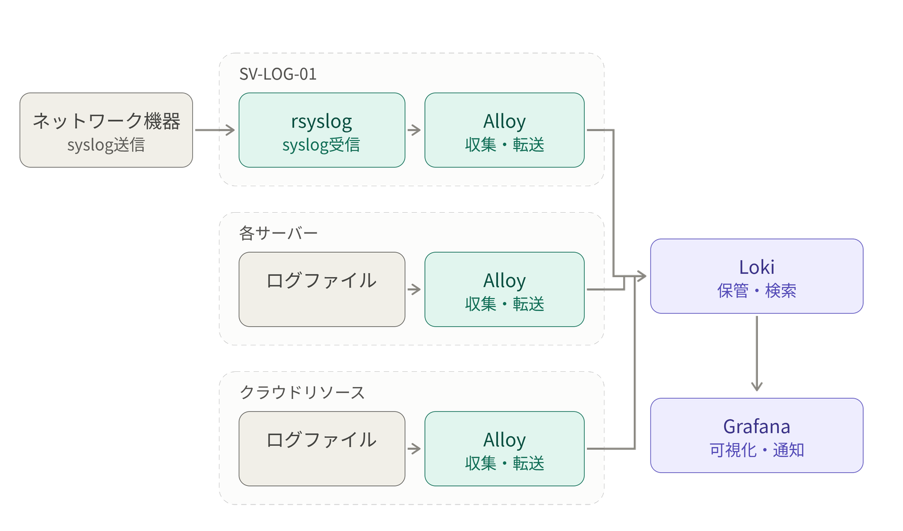

### 目次

1.  [はじめに](#introduction)
2.  [本書の位置づけ](#positioning)
3.  [セグメント設計](#segment)
4.  [ホスト名命名規則](#naming)
5.  [アカウント設計](#account)
6.  [IPアドレス管理](#ipam)
7.  [リバースプロキシと証明書](#reverse-proxy)
8.  [構成管理](#iac)
9.  [ログ設計](#logging)
10.  [監視設計](#monitoring)
11.  [今後の予定](#roadmap)
12.  [更新履歴](#history)

### はじめに

本ドキュメントは、自宅ネットワークの基本設計をまとめたものである。作成目的は以下の3点。

**① 設計方針の記録と維持**

構成変更を重ねる中で、当初の設計意図が失われることを防ぐ。「なぜこの構成にしたか」を残し、将来の判断基準とする。

**② 同様の環境を構築する方の参考として**

個人環境で商用機器を用いたセグメント分離やログ基盤の構築事例は、情報が限られている。設計の考え方が参考になれば幸いである。

**③ 設計・構築スキルの可視化**

ネットワークエンジニアとしての設計思想と技術選定の根拠を示す資料とする。

なお、本書はセキュリティ上の配慮から、IPアドレス・機器型番・ポート設定・アカウント名等の具体値は記載していない。構成の考え方に焦点を当てた内容としている。

### 本書の位置づけ

本書は、設計方針が確定した時点、または実装完了後に更新する後追いのドキュメントである。検討段階の内容は含まない。

現在検討中の項目は「今後の予定」に記載する。

### セグメント設計

| VLAN | 用途 | 方針 |
| --- | --- | --- |
| 416 | ユーザー | 家族が使用する端末を収容 |
| 720 | IoT | 侵害時の横展開を防ぐため、他セグメントへの通信を原則不許可 |
| 999 | 管理 | ネットワーク機器・サーバーの管理用。到達元を限定 |
| ― | サーバー | 仮想基盤内に閉じたセグメント。仮想ルーター経由でのみ到達可能とする |
| 未定 | ゲスト | インターネットのみ許可 |

#### サーバーセグメントの構成

サーバー群は、仮想基盤上の仮想ルーターの内側に、物理NICを持たない内部ブリッジで収容する。サーバーへの到達経路を仮想ルーターに一本化し、アクセス制御をそのポリシーで一元的に行うためである。

#### 仮想基盤ホストからサーバーセグメントへの経路

仮想基盤ホストのデフォルトゲートウェイは物理側のルーターである。そのままでは、ホストからサーバーセグメント宛の通信は物理NICを出て物理ルーターで折り返し、再び同じホストへ戻る経路となる。

この経路では、ホストの物理NICが障害を起こすと、同一筐体内にあるサーバーへも到達できなくなる。そこで、ホストにはサーバーセグメント宛の静的ルートを設定し、仮想ルーターへ直接向ける。これにより通信はホスト内部で完結し、物理NICの障害時もホストからサーバーへのログ転送等が維持される。

なお、ホスト自身に内部ブリッジのアドレスを持たせる方法も検討したが、採用しない。この方法では、サーバーセグメントから仮想基盤ホストの管理面へ、仮想ルーターのポリシーを経由せずに到達できるようになる。サーバーが1台でも侵害された場合に、仮想基盤全体の管理面が直接の攻撃対象となるため、管理面への到達元を限定する方針と整合しない。

本方式では、ホストからサーバーへの通信が仮想ルーターの稼働に依存する。ただし仮想ルーターの停止時はサーバーセグメント自体が外部から到達不能となるため、ホストからの到達性のみを確保する意義は小さいと判断した。

#### 起動順序

仮想基盤ホストの起動時、ゲストは依存関係に従って以下の順に自動起動する。

| 順序 | 対象 | 理由 |
| --- | --- | --- |
| 1 | 仮想ルーター | サーバーセグメントへの経路の要であるため |
| 2 | 名前解決 | 他のサーバーが起動時から名前解決を用いるため |
| 3 | ログ基盤 | 他のサーバーが起動時に出力するログを受け取るため |
| 4 | 監視基盤 | 監視対象が揃ってから監視を開始するため |
| 5 | その他 | 他から依存されないため |

起動順序を定めていなかった際、名前解決のサーバーが仮想ルーターより先に起動し、上位への問い合わせに失敗した状態をリゾルバが記憶したため、仮想ルーターの起動後も名前解決に失敗し続ける事象が発生した。経緯は「[UnboundがSERVFAILを返す原因はinfraキャッシュだった](/unbound-servfail-infra-cache/)」にまとめている。

### ホスト名命名規則

#### 書式

```text
<識別子>-<役割>[-<サービス>]-<項番>[-<オプション>]
```

サービスは、役割がサーバー（SV）の場合にのみ付与する。ネットワーク機器は役割のみで機能が特定できるため付与しない。

#### 識別子

| 区分 | 内容 |
| --- | --- |
| オンプレミス機器 | 固有の識別子A |
| クラウドリソース | 固有の識別子B |
| その他 | OTH |

識別子は設置場所を表す方針とする。  
物理か仮想かは識別子ではなく、オプションで表す。  
1つの区分に場所と形態の2つの意味を持たせると、クラウド上の仮想サーバーのように、どちらにも該当する対象で区分が決まらなくなるためである。

#### 役割（2文字）

| コード | 意味 |
| --- | --- |
| FW | ファイアウォール |
| SW | スイッチ |
| RT | ルータ |
| AP | 無線アクセスポイント |
| SV | サーバー |
| HV | 仮想基盤ホスト |

役割は、そのホストがネットワーク上で担う機能で判断する。仮想基盤上で稼働するルーターは、形態はサーバーであっても役割は RT とする。

#### サービス（3文字）

| コード | 意味 |
| --- | --- |
| DNS | 名前解決 |
| LOG | ログ基盤 |
| MON | 監視基盤 |
| HAS | ホームオートメーション |
| IAC | 構成管理・自動化 |
| RPX | リバースプロキシ |

サービスは製品名ではなく、機能で表す。稼働するソフトウェアを別の製品へ入れ替えても、ホスト名を変更せずに済むようにするためである。

#### 項番

2桁の連番（01, 02, …）。同一役割内で採番する。サービスを付与する場合は、同一サービス内で採番する。

サービス内で採番することで、同一サービスを複数台で構成した場合に、それらが冗長構成の関係にあることをホスト名から判別できる。

#### オプション

| コード | 意味 |
| --- | --- |
| P | PoE対応 |
| 3 | L3機能を有する |
| P3 | PoE対応かつL3 |
| V | 仮想マシン |
| C | コンテナ（LXC） |

コードには、小文字で表記した際に数字や他の文字と判別しにくい文字（I、L、O）を用いない。ホスト名は小文字で設定するため、`l` と `1`、`o` と `0` の取り違えを防ぐためである。

#### 表記

本書および管理資料では大文字で表記する。機器・サーバーに設定するホスト名と DNS レコードは、小文字で設定する。

DNS は大文字と小文字を区別しないが、構成管理ツールのインベントリなど、区別するものがある。  
設定値を小文字に統一し、表記の揺れによる不一致を防ぐ。

#### 例

```text
xxx-SW-01-P3       PoE対応L3スイッチ
xxx-FW-01          ファイアウォール
xxx-HV-01          仮想基盤ホスト
xxx-RT-01-V        仮想マシンで稼働するルーター
xxx-SV-DNS-01-C    LXCで稼働するDNSサーバー
xxx-SV-DNS-02-C    上記と冗長構成を組む2台目のDNSサーバー
```

### アカウント設計

#### 命名規則

```text
<システム>-user.<利用者>
```

アカウント名には、「どのシステムのアカウントか」と「誰（何）が使うか」を含める。操作の記録にはアカウント名が残るため、その操作が人によるものか、自動処理によるものかを名前から判別できるようにするためである。

| システム | 利用者 | 用途 |
| --- | --- | --- |
| クラウド | 管理者 | 人によるクラウドの操作 |
| クラウド | 証明書の取得 | 証明書の取得に伴う DNS レコードの書き込み |
| 仮想基盤 | 構成管理ツール | 仮想マシン・コンテナの作成と変更 |
| サーバーOS | 構成管理ツール | 自動処理によるサーバーの設定 |
| サーバーOS | 管理者 | 人によるサーバーの操作 |

#### サーバーのOSユーザー

仮想マシン・コンテナ・物理サーバーを問わず、OSのユーザーは同一のシステム名で統一する。形態はホスト名から判別できるため、ユーザー名に持たせない。形態ごとに名前を分けると、同じ利用者の操作履歴が複数の名前に分散し、移行のたびに名前が変わるためである。

| ユーザー | ログイン | 管理者権限 |
| --- | --- | --- |
| 構成管理ツール用 | 公開鍵認証のみ | パスワードなしで昇格 |
| 管理者用 | 公開鍵認証のみ | パスワードを要求して昇格 |
| root | 禁止 | ― |

自動処理は途中で入力を受け付けられないため、パスワードなしで昇格させる。人による操作は、昇格の際に確認を挟む。root によるログインと、パスワードによるログインは禁止する。

#### 認証情報の扱い

公開鍵は、実行元（管理端末、構成管理サーバー、ジョブ実行基盤）ごとに分ける。登録された鍵から実行元を判別でき、1つの鍵を失効させても他の実行元に影響しない。

クラウドの操作には、長期のアクセスキーを用いず、シングルサインオンで発行される一時的な認証情報を用いる。自動処理のために長期の認証情報が必要な場合は、権限を用途に必要な最小限に絞る。

### IPアドレス管理

NetBox を Source of Truth（信頼できる唯一の情報源）として運用する。

機器に投入する設定と NetBox の登録内容を一致させ、乖離が生じない運用を前提とする。

### リバースプロキシと証明書

#### 構成

サーバーが提供する管理画面などの Web サービスは、サーバーセグメントに置いたリバースプロキシを経由し、HTTPS で提供する。リバースプロキシを通らない直接の接続を受け付ける必要がないサービスは、ホストのファイアウォールで、リバースプロキシからの接続のみに限定する。

#### 名前の付け方

Web サービスの名前には、ホスト名ではなく、命名規則のサービスコードを用いる。

ホスト名は、SSH による接続、構成管理のインベントリ、ログにおいて、そのホスト自身を指す名前として用いる。ホスト名をリバースプロキシに向けると、これらがリバースプロキシに接続してしまうため、Web サービスの名前とは分ける。また、サービスの名前はホストの冗長化や改名の影響を受けない。

#### 証明書

内部用のサブドメインに対するワイルドカード証明書を、公的な認証局から DNS-01 チャレンジで取得し、自動で更新する。

-   DNS-01 を用いることで、サーバーをインターネットに公開せずに証明書を取得できる
-   ワイルドカード証明書とすることで、個々のサービス名が証明書の公開ログに記録されない
-   取得に用いる DNS の書き込み権限は、検証用の TXT レコードのみに限定する。認証情報が漏洩した場合も、他のレコードは書き換えられない

#### 配下に置かないもの

仮想基盤ホストの管理画面は、リバースプロキシの配下に置かない。サーバーセグメントから仮想基盤の管理面への通信を生じさせないためである。仮想基盤ホストの証明書は、ホスト自身の機能で取得する。

管理セグメント上のサービスをやむを得ず配下に置く場合は、リバースプロキシから当該サービスの待受ポートへの通信のみを許可する。

管理セグメント上のホームオートメーションをリバースプロキシの配下に置いた際の設定は、「[Home Assistantのリバースプロキシで400になる原因と対処法](/home-assistant-reverse-proxy-trusted-proxies/)」にまとめている。

### 構成管理

#### 方針

サーバーとクラウドリソースはコードで定義し、コードから同じ状態を再現できることを前提とする。変更はコードの修正と適用によって行い、コードはバージョン管理システムで履歴を管理する。既存のサーバーは、順次コードの管理下へ移行する。

#### 役割分担

| ツール | 担当 | 対象の例 |
| --- | --- | --- |
| Terraform | 何が存在するか | 仮想マシン・コンテナ、クラウドのアカウントと権限 |
| Ansible | どういう状態であるべきか | OSの初期設定、ユーザー、ソフトウェアの導入と設定 |

仮想マシン・コンテナの定義は共通の部品（モジュール）にまとめ、非特権化や自動起動など、全台で揃えるべき設定は部品の中で固定する。設定の抜けによる個体差を、構造的に生じさせないためである。

#### 状態と秘密情報の管理

Terraform の状態ファイルは、バージョニングと暗号化を有効にし、公開を禁止したオブジェクトストレージに保管する。同時実行による破損を防ぐため、ロックを有効にする。状態ファイルは環境（オンプレミス、クラウド）ごとに分け、一方の変更が他方に影響しないようにする。

API トークンなどの秘密情報は、暗号化したうえでコードと同じリポジトリに置く。復号の鍵は、パスワードマネージャーで保管する。秘密情報が状態ファイルに平文で記録されることを避けるため、発行時に平文が残る認証情報は Terraform では作成しない。

#### 実行環境

構成管理は、サーバーセグメント上の構成管理サーバーから実行する。定型の処理はジョブ実行基盤から実行し、誰がいつ何を実行したかを履歴に残す。

### ログ設計

#### 目的

機器・サービスのログを一元管理し、障害調査とセキュリティ監視に用いる。

#### 前提条件

収集対象の全ホストは、タイムゾーンを JST に統一する。

syslog のタイムスタンプは送信側が付与するため、受信側での補正はできない。1台でもずれていると Loki のインデックスが実時刻と乖離し、複数機器を時系列で突き合わせる調査が成立しない。ログ基盤の成立条件は、ログ基盤の外にある。

#### 基盤

| コンポーネント | 役割 |
| --- | --- |
| rsyslog | ネットワーク機器および仮想基盤ホストから syslog(UDP/514) を受信し、ファイルへ出力する |
| Alloy | ログを収集し、Loki へ転送するエージェント |
| Loki | ログの保管と検索を担う |
| Grafana | ログの可視化とアラート通知を担う |

ネットワーク機器は、任意のエージェントを常駐させる手段を持たないことが多い。  
本環境の機器も同様であり、syslog を UDP で送出する機能のみを備える。

サーバーおよびクラウドリソースは、出力されたログファイルを Alloy が直接収集する。  
  
rsyslog による受信基盤の構築手順は「[Proxmox の非特権LXCで syslog 514番が開かない理由と対処法](/proxmox-unprivileged-lxc-rsyslog-514/)」にまとめている。

なお Alloy は、収集対象の各ホスト上で稼働する。

ただし仮想基盤ホストのカーネルログは例外として、rsyslog から syslog(UDP/514) で転送する。物理NICの障害など、ホスト自身の異常を記録するためである。転送経路は前述の静的ルートによりホスト内部で完結するため、物理NICの障害中も記録は途切れない。Alloy のホスト導入後は、他のサーバーと同様に Alloy による収集へ移行する。

#### 構成図



*ログ収集の全体構成*

#### 収集対象

-   オンプレミスネットワーク機器
-   オンプレミスサーバー
-   クラウドリソース

#### 収集方針

| 項目 | 方針 |
| --- | --- |
| 収集レベル | notice 以上（severity 5 以下） |
| 保管先 | S3（東京リージョン） |
| 保持期間 | 180日 |
| ストレージクラス | S3 標準のみ。階層移行は行わない |
| 流量制御 | 受信側で上限を設け、異常時のディスク枯渇を防ぐ |

##### 保管先とローカルの役割

Loki のオブジェクトストアを S3 とするため、チャンクは flush された時点で S3 に書き込まれる。ローカルに残るのは WAL とキャッシュのみであり、「一定期間ローカルに保持した後 S3 へ移す」という段階的な移動は発生しない。

したがって保持期間の 180日は、ローカルの保存期間ではなく Loki が検索可能な期間を指す。実装上は Loki の compactor に設定する retention\_period と、S3 ライフサイクルの Expiration については、retention\_period を S3 の Expiration より短くし、削除は Loki が先に行う。

##### 保持期間を180日とした根拠

試算の結果、本環境の想定ログ量（notice 以上で約15,000行/日）では、保持期間を180日としても S3 の費用は月額1円未満となる。内訳は保管料よりもリクエスト料が支配的であり、保持期間を延ばしても総額はほとんど変わらない。

費用が判断材料にならないため、基準は「どこまで遡れれば障害調査とセキュリティ監視が成立するか」に置いた。発生から発覚までに時間があく事象や、季節性のある事象を追えるよう、半年を確保する。

##### ストレージクラスを移行しない理由

Glacier 系への移行はリクエスト単位で課金され、本環境の想定オブジェクト数では移行料が保管料そのものを上回る。加えて最小課金サイズが設定されているため、Loki が生成する小さなチャンクでは課金容量が実容量を大きく超える。

また Glacier Flexible Retrieval 以降のクラスは復元を挟まなければ読み出せず、Loki から直接クエリできない。検索可能であることを保持期間の定義としている以上、要件と整合しない。

#### 対象外とするもの

ファイアウォールの転送トラフィックログは収集対象外とする。

制約となるのは S3 の費用ではなく、ログ基盤を収容している LXC のディスク・メモリと、LogQL の応答性能である。本環境の目的（障害調査・セキュリティ監視）に対して、これらを消費してまで保持する優先度は低いと判断した。

#### 異常時の保護

機器のログループや下流の停止により、想定を超える書き込みが発生しうる。ログ基盤自身がディスク枯渇で停止すると調査手段そのものを失うため、以下を設ける。

-   rsyslog の受信側にレートリミットを設定し、入口で超過分を破棄する
-   ログ出力先を rootfs と別のマウントポイントに分離し、溢れても基盤本体を巻き込まない構成とする
-   Loki 側に ingestion の上限を設け、単一ストリームの異常が基盤全体へ波及しないようにする

なお、平常時の書き込み量を削減することは目的としない。想定書き込み量は SSD の TBW に対して十分小さく、摩耗は制約にならないためである。守るべきは容量であり、異常時に上限で停止する構造を用意することを方針とする。

#### 構築記録

本設計に基づく構築の記録を、以下に記載する。構築の進捗に応じて追記する。

-   2026-09-07 [rsyslog:非特権LXCでの受信基盤の構築](/proxmox-unprivileged-lxc-rsyslog-514/)
-   2026-09-13 [S3:ログ保管先の設計と構築](/loki-s3-bucket-retention-cost/)
-   2026-09-16 [Loki:非特権LXCへの導入とS3への書き込み](/loki-unprivileged-lxc-s3-setup/)

### 監視設計

#### 目的

機器・サーバーの状態をメトリクスとして継続的に把握し、異常に早期に気付くことを目的とする。

特に筐体温度は重点監視項目とする。自宅に設置している以上、機器の過熱は障害にとどまらず、火災のリスクにつながるためである。

#### ログ設計との役割分担

ログは「何が起きたか」を記録するイベントの情報であり、監視は「今どういう状態か」を示す状態の情報である。両者を併用し、ログでは原因の調査を、監視では異常の検知を担う。

#### 監視項目

| 区分 | 項目 | 目的 |
| --- | --- | --- |
| インターフェース | 動作状態（Up/Down） | リンク断の検知 |
| インターフェース | 送受信量・エラー・破棄 | 通信停止や品質劣化の検知 |
| 筐体 | 温度 | 過熱の検知 |
| 筐体 | ファンの状態 | 冷却機能の停止の検知 |
| サービス | 名前解決の応答 | 利用者影響の直接的な検知 |

#### 監視項目の考え方

インターフェースの動作状態だけでは、検知できない障害がある。本環境では、NICがハングアップし、リンクはUpのまま送受信が停止する事象が実際に発生した。このためリンク状態に加え、送受信量の停止とサービスの応答を併せて監視する。

同様に、サービスのプロセスが稼働していても、サービスとして利用できるとは限らない。名前解決のサーバーが稼働しネットワークも疎通している状態で、名前解決のみが失敗し続ける事象も発生している。プロセスの死活ではなく、名前解決の応答そのものを監視項目とするのはこのためである。

ファンの停止は温度上昇に先行する兆候である。温度が閾値に達する前に異常へ気付けるよう、温度とファンの状態を併せて監視する。

#### 収集方式

ネットワーク機器は SNMP で取得し、読み取り専用とする。バージョンは認証と暗号化に対応する SNMPv3 を採用する。なお現時点では SNMPv2c で動作確認を行っており、SNMPv3 へ順次移行する。

サーバーは監視エージェントで取得する。

#### 既知の制約

監視サーバーは仮想基盤上で稼働しているため、仮想基盤ホスト自体の停止は検知・通知できない。この制約は、通知経路の整備とあわせて今後の課題とする。

### 今後の予定

| 項目 | 概要 |
| --- | --- |
| DNSの冗長化 | 名前解決を単一のサーバーに依存しない構成とする |
| ゲストVLANの作成 | オープン認証とキャプティブポータルによるゲスト用ネットワークを構築する |
| ユーザーセグメントの RADIUS 認証 | 家族用端末のネットワーク認証を RADIUS による認証へ移行する |
| 通知の Slack 連携 | 監視サーバーとログ基盤で検知した異常を Slack へ通知する |
| ネットワーク機器の構成管理 | サーバーの構成管理は実装済み。ネットワーク機器の設定の管理と投入も、構成管理サーバーから自動化する |
| 既存サーバーの構成管理への移行 | 既存のサーバーをコードの管理下に取り込み、命名規則に沿って改名する |
| 管理セグメントへの通信の限定 | サーバーセグメントから管理セグメントへの通信を、構成管理とリバースプロキシに必要なものに限定する |
| 仮想基盤ホストの証明書 | 仮想基盤ホスト自身の機能で、公的な認証局の証明書を取得する |
| ログ収集の拡充 | 各サーバーへ Alloy を配布する。あわせて、認証の記録、名前解決の失敗理由、構成管理の実行記録を、収集レベルの例外として収集する |
| SNMPv3 への移行 | 監視に用いる SNMP を、動作確認中の SNMPv2c から SNMPv3 へ移行する |

### 更新履歴

| 日付 | 内容 |
| --- | --- |
| 2026-09-06 | 初版作成 |
| 2026-09-07 | ログ設計に構築記録を追加 |
| 2026-09-12 | 保持期間・保管方針を見直し。前提条件と異常時の保護を追加 |
| 2026-09-18 | サーバーセグメントの構成と経路方針、監視設計、今後の予定を追加。ログ設計に仮想基盤ホストの例外を追記 |
| 2026-09-22 | ホスト名命名規則を改訂（サービス区分、役割 HV、オプション V・C を追加し、表記を追記）。ログ設計の構築記録を追記 |
| **2026-09-23** | **目次を追加。アカウント設計、リバースプロキシと証明書、構成管理を追加。セグメント設計に起動順序を、監視設計に監視項目の考え方を追記。今後の予定を更新** |
