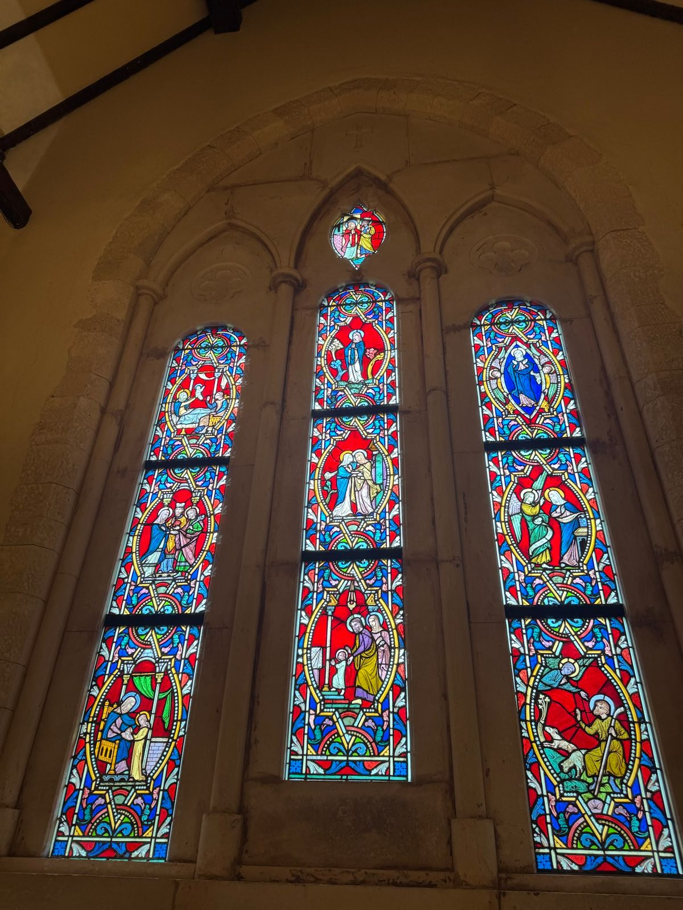

## 経歴

ネットワークエンジニアです。  
おもにJuniper、FortiGate、Cisco、Allied Telesisの製品などに触れる機会が多いです。  
CCNP ENCOR勉強中。

## 保有資格

- CCNA
- 基本情報技術者
- AWS Solution Architect Asociate
- AWS Solution Architect Professional

## 写真

2025年 5月 北海道旅行

オホーツク海の夕焼け

2025年 7月 那須旅行

ステンドガラス博物館

