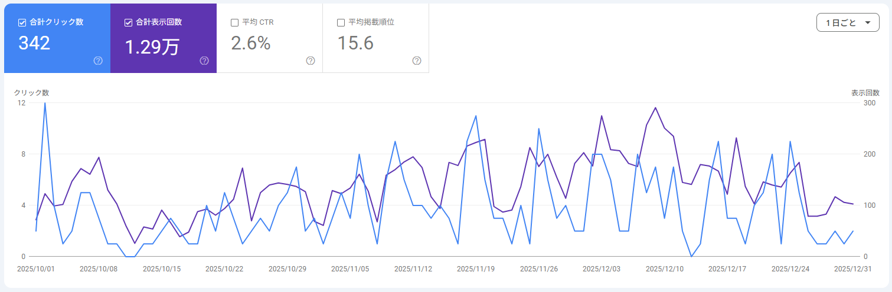
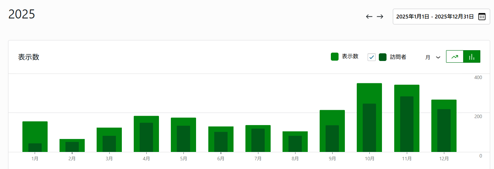

## はじめに

2025年も終わりが近づき、年末の区切りとして、  
技術ブログを始めてからの1年間を振り返ってみることにしました。  
  
**PVは月300前後と、決して多い数字ではありません。**  
それでも、ブログを書き続けたことで、  
技術への向き合い方や、  
エンジニアとしての気持ちには、確かな変化があったと感じています。  
  
この記事では、技術ブログを始めた理由と、  
1年続けてみて感じたこと、  
Search ConsoleやJetpackの数字を交えながら、  
今の率直な実感をまとめます。  
  
これから技術ブログを始めようか迷っている方や、  
続ける意味を探している方にとって、  
少しでも参考になれば嬉しいです。

## 技術ブログを始めた理由、1年続けてみた結果

2025年に入ってから、技術ブログを始めました。  
当時は「アウトプットした方が勉強になるらしい」とか、  
「技術の備忘録がてら、自分向けに書いてみようかな」くらいの、  
かなり軽い気持ちだったと思います。  
  
書き始めてみると意外と楽しく、  
一方で「こんなことを書いて大丈夫かな」と、  
少し恥ずかしい気持ちもありました。  
人に読まれる前提で文章を書くのは、  
思っていた以上に緊張するものだった記憶があります。  
  
正直に言うと、どこかで  
「続けたら何か変わるかもしれない」  
という期待がなかったわけではありません。  
ただ、最初からPVを伸ばすとか、  
収益化を目指すといった明確な目標が  
あったわけでもありませんでした。  
  
とにかく、自分が勉強したことや、  
仕事で触れた技術を忘れないために、  
どこかに残しておきたい。  
そんな感覚で書き続けていたように思います。  
  
**1年間続けてみて、PV数は月300前後。**  
数字だけを見ると、  
大きな成果とは言えないかもしれません。  
  
それでも今振り返ると、  
この1年で一番変わったのは、  
「技術との向き合い方」や、  
継続することで得られた  
「少しの自信」だったと感じています。  

## 技術ブログを続ける中で、技術に対する向き合い方が変わってきた

技術そのものが急に得意になったわけではありませんが、  
ブログを書き続けたことで、技術に向き合うときの考え方は  
確実に変わってきたと感じています。  
  
以前は、トラブルが起きたときに  
設定や構成を一通り確認しながらも、  
原因を深掘りする前に  
「機器の仕様や癖の話かもしれない」と  
思ってしまう場面がありました。  
  
エンジニア歴もまだ浅く、  
そもそも操作は合っていたのか、  
足りない設定が他にあるのではないかと、  
漠然とした不安を抱えながら  
手探りで対応していた感覚だったと思います。  
  
ブログを書き続ける中で、  
「分からない」こと自体に必要以上に焦らなくなった  
と感じています。  
  
例えばBGPのトラブル対応でも、考え方が変わったと感じています。  
以前はセッションが上がらないと、  
設定の書き方や機器差分ばかりが気になり、  
どこから手を付けるべきか迷っていました。  
  
ブログを書くようになってからは、  
「BGPは何を条件に成立するのか」を  
一度言葉にして整理する癖がつきました。  
  
TCPの疎通は取れているのか、  
ネイバー設定やAS番号は合っているのか、  
どこまで処理が進んでいて、  
どこで止まっているのか。  
  
順番に切り分けて考えることで、  
不安の正体が少しずつ見えるようになった気がします。  
  
解決できたときには、  
「これは後でブログにまとめられそうだな」  
と考えるようにもなりました。  
トラブルそのものは相変わらず大変ですが、  
学びとして残せると思えるようになったことで、  
向き合う気持ちは以前より前向きになったと感じています。

実際にトラブルシュートをしてみてまとめた記事は以下  
[【strongSwan × Cisco】IPsec VPNでsubnet追加したら通信断した話 〜認証方式とCHILD SA再交渉の落とし穴〜](/strongswan-cisco-ipsec-subnet-add-failure/)

## PV数は月300前後。それでも「続けてよかった」と思えた理由

PVだけを見ると、月300前後と決して多い数字ではありません。  
正直、「少ないな」と感じたこともありました。  
  
ただ、10月から始めたSearch Consoleを振り返ってみると、  
3か月間での表示回数は1万回を超えていて、クリック数も300以上ありました。  
  
派手に伸びた記事があったわけではありませんが、  
検索結果に表示される記事がゼロにならなかったことは、  
続けてきた証拠のように感じています。  
  
「誰かが、どこかで、  
このブログの記事を目にしている」  
そう思えるだけで、  
続けてきた意味はあったのかもしれないと感じました。  

### Search Consoleで見る1年間の表示回数とクリック数の推移

もう一つ、続けてよかったと感じた理由が、  
Jetpackで見た月ごとのアクセス推移です。  
  
月によって多少の上下はありますが、  
1年間を通して、どの月にも一定のアクセスがありました。  
更新が止まりがちだった時期も含めて、  
完全にゼロになることはなく、  
少しずつ積み上がっていたことが分かります。  
  
正直、最初は  
「せいぜい数記事書いて終わるだろう」  
くらいに思っていました。  
それが、こうして1年分のグラフとして並ぶのを見ると、  
PVの数字以上に、  
「ちゃんと続いていたんだな」と実感できました。  

### Jetpackで見る、2025年の月別アクセス推移

## 2025年のPVを支えてくれた記事一覧

2025年にPV数を支えてくれた記事は以下です。  
  
[【完全解説】FortiGateの正しい電源の切り方 | 安全な手順を解説](/fortigate-shutdown/)  
[【図解】CAPWAPとは？無線APとWLCのセッション確立手順をわかりやすく解説](/capwap/)  
[Google ChromeにBitwardenを導入する方法｜無料で使えるパスワード管理アプリ](/bitwarden-configuration/)

## 技術ブログは、自分専用のナレッジベースになった

技術ブログを続けていて、一番よかったと感じているのは、  
このブログが「自分専用のナレッジベース」になったことです。  
  
以前は、勉強した内容やトラブル対応の記録を  
PCのメモ帳や自分のノートなど、  
いくつかの場所に分けて残していました。  
記録自体はしていたものの、  
いざ見返そうとすると  
どこに書いたのか分からなくなり、  
探すのに時間がかかることが多かったと思います。  
  
ブログとして自分の言葉でまとめるようになってからは、  
「全部覚えておかなくてもいい」と思えるようになりました。  
分からなくなっても、  
過去の自分が書いた記事を読み返せばいい。  
その「戻れる場所」があることは、  
想像以上に大きな安心感につながっています。  
  
また、過去の記事を見返すことで、  
自分がどこでつまずいていたのか、  
どんな考え方をしていたのかを  
客観的に振り返れるようにもなりました。  
それは、少しずつでも  
**エンジニアとして前に進めている**という実感にもなっています。  

## これから技術ブログを始める人へ

これから技術ブログを始めようか迷っている人がいたら、  
「最初からうまく書こう」と思わなくて大丈夫だと思います。  
  
自分自身も、特別な知識があったわけでも、  
文章が得意だったわけでもありません。  
それでも、分からなかったことや、  
つまずいたことを自分の言葉で残すだけで、  
少しずつ積み上がっていきました。  
  
PVがすぐに伸えなくても、  
更新が止まってしまう時期があっても、  
続けていれば、確実に何かは残ります。  
それは数字かもしれませんし、  
考え方の変化や、  
自分への小さな自信かもしれません。  
  
もし迷っているなら、  
まずは1記事だけ書いてみる。  
それだけでも十分だと思います。  
  
このブログも、そんな1記事目から始まりました。

## ブログを続けるために、最初に整えてよかった環境

自分自身は、AWSのLightsailを使って  
WordPressブログを運用しています。  
  
当時は資格勉強のためにAWSに触りたかったこともあり、  
学習も兼ねてこの構成を選びました。  
  
ただ、これから技術ブログを始める人すべてに  
Lightsailをおすすめするかというと、  
正直そうではありません。  
  
ブログを続けるうえで一番大事なのは、  
**「できるだけ迷わず、書くことに集中できる環境」**を  
最初から用意することだと思っています。  
  
その点で考えると、  
これからブログを始める人には、  
WordPressの初期設定や管理が圧倒的に楽な  
レンタルサーバーを選ぶ方が、  
継続のハードルは下がると感じています。  
  
特に、設定や運用でつまずく時間を減らしたい場合は、  
WordPressを簡単に始められる[エックスサーバー](https://px.a8.net/svt/ejp?a8mat=4AUWCZ+C8KSFM+CO4+6AZAQ)のようなサービスは、  
現実的で選びやすい選択肢だと思います。

実際の手順については、こちらの記事にまとまっています。

<a href="https://px.a8.net/svt/ejp?a8mat=4AUWCZ+C8KSFM+CO4+6QEUQ" rel="nofollow">【初心者でも安心】たった10分で出来るWordPressブログの始め方</a>

  [the_ad id="449"]

