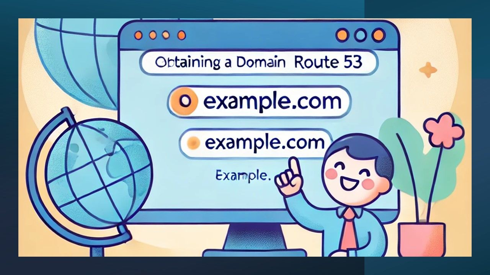

AWSの「Route53」というサービスで、新規にドメインを取得する方法について解説します。

### ドメインとは

ドメインとは、**インターネット上の「住所」**のようなものです。  
URLでいう、「https://example.com/aa.html」の中の**「example.com」の部分がドメイン**です。

世界中のサーバやデバイスには、「203.0.113.1」のようなグローバルIPアドレスが割り当てられています。しかし、人間がこれらの数値を覚えたり検索に使ったりするのは現実的ではありません。そのため、**IPアドレスをわかりやすい文字列に変換したものがドメイン**です。

ドメイン名はDNS（Domain Name System）※を通じてIPアドレスに変換され、目的のサーバにアクセスできる仕組みになっています。例えば、www.example.comというドメインを使うと、背後でそのドメインに対応するIPアドレスに接続され、情報が取得できます。

なお、ドメインやIPアドレス(グローバルIPアドレス)は、世界中で一意となっております。

Webサイトやブログをインターネット上で公開するためには、IPアドレスとドメイン名を登録するのが一般的です。  
ドメイン名を利用することで、アクセスが簡単になり、ユーザーにも信頼感を与えることができます。

※DNSについては、**[「DNSとは？初心者向けに仕組み・Aレコード/AAAAレコード/CNAMEをわかりやすく解説」](/dns/)**にまとめておりますのでよければご覧ください。

### ドメインの取得方法

実際にドメインを取得する場合は、  
**レンタルサーバー会社**（エックスサーバーやさくらインターネットなど）か**ドメイン取得サービス**（お名前.comやムームードメインなど）を使用して取得する方法が一般的です。

Webサイトなどを立ち上げる際、サーバーとドメインをまとめて取得したい場合は、レンタルサーバー会社を活用すると便利です。

ドメイン取得サービスは、単純にドメインを取得するだけのサービスです。  
そのため、ドメイン取得サービスを利用する場合は、サーバーは別途用意する必要があります。

ここまでで、レンタルサーバー会社やドメイン取得サービスを利用してドメインを取得する方法について解説しました。

次に、**AWSの提供するドメイン取得サービス「Route 53」**を活用して、実際にドメインを取得する手順について詳しくご紹介します。Route 53は、ドメイン取得だけでなく**DNS管理やトラフィック管理の機能も備えた多機能なサービス**です。

AWSを利用して効率的にWebサイトを運営したい方にはおすすめの方法です。

### AWS Route53でドメインを取得する方法

まず、AWSのマネジメントコンソールから**Route53****の画面に遷移**します。

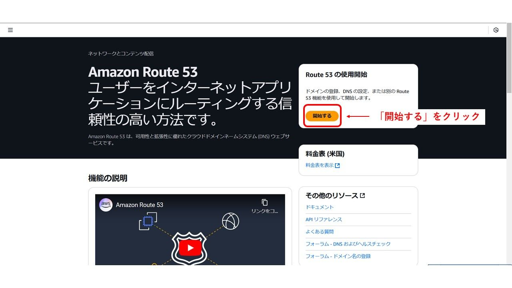

上記画面が表示されたら、**「開始する」をクリック**します。

---

クリックすると、以下の画面に移動します。

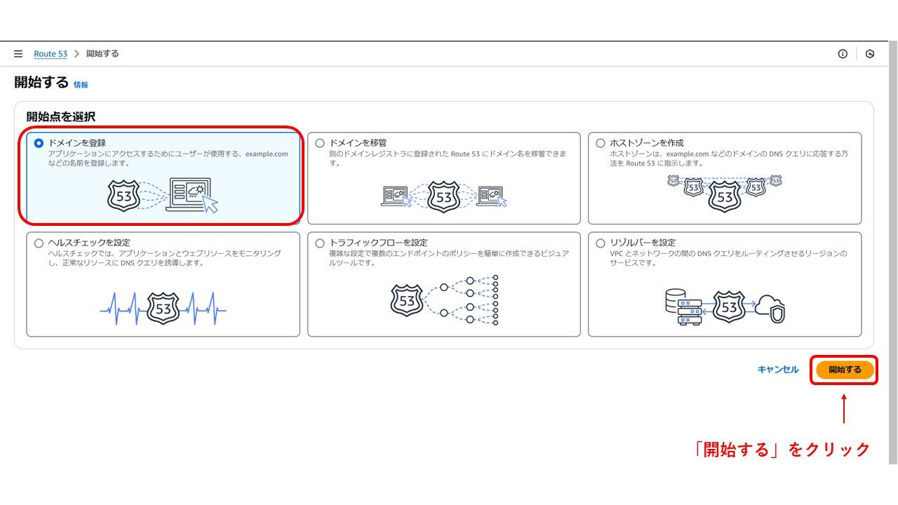

今回は「ドメイン登録」を行うため、**「ドメインを登録」**を選択し、**「開始する」**をクリックします。

---

以下の画面が表示されます。

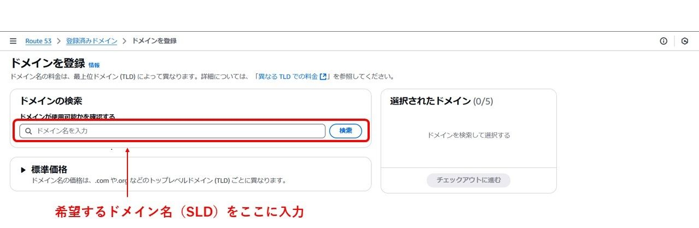

ここでは、ご自身がドメインとして登録したい文字列を検索していきます。

なお、**「標準価格」を**クリックすると以下のように選択できるTLD（トップレベルドメイン）の一覧が表示されます。

※トップレベルドメイン：.comなどのこと

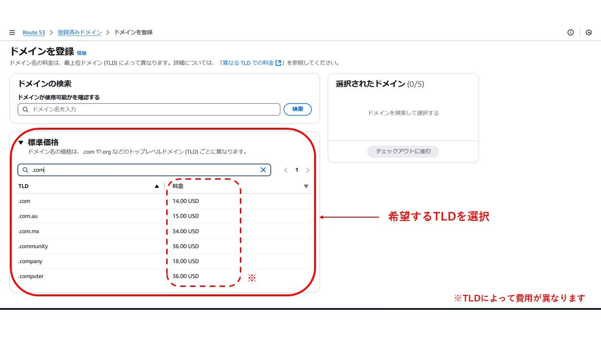

---

希望するドメインが、使用可能（他で利用されてないドメイン）な場合は、以下のように表示されます。

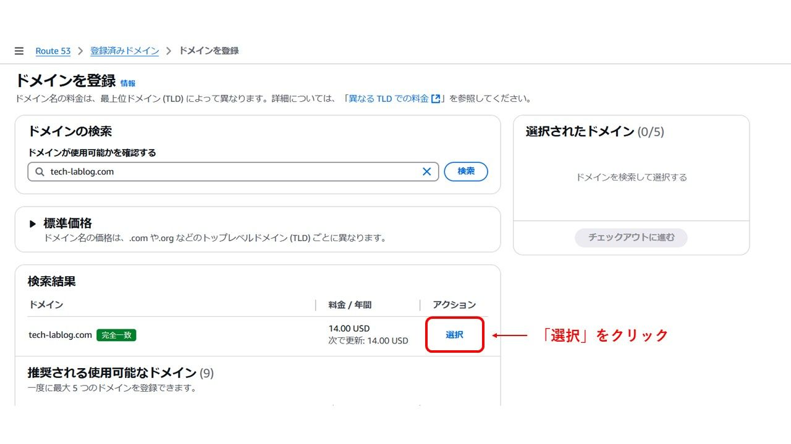

よろしければ、**「選択」**をクリックします。

---

右側の**「選択されたドメイン」**に選択したドメインと利用料金（年額）が表示されます。

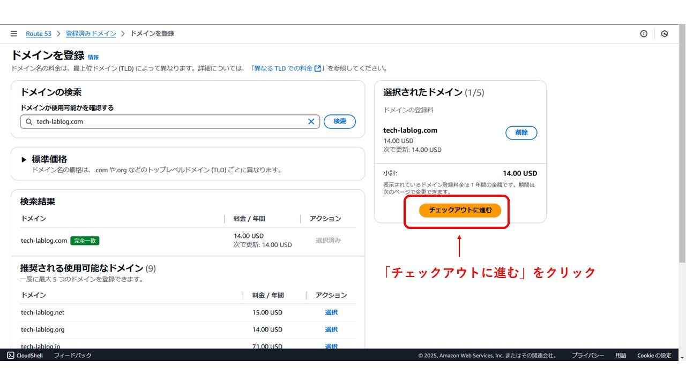

表示内容や金額に問題なければ、上記の通り、**「チェックアウトに進む」**をクリックします。

---

以下の画面に切り替わります。

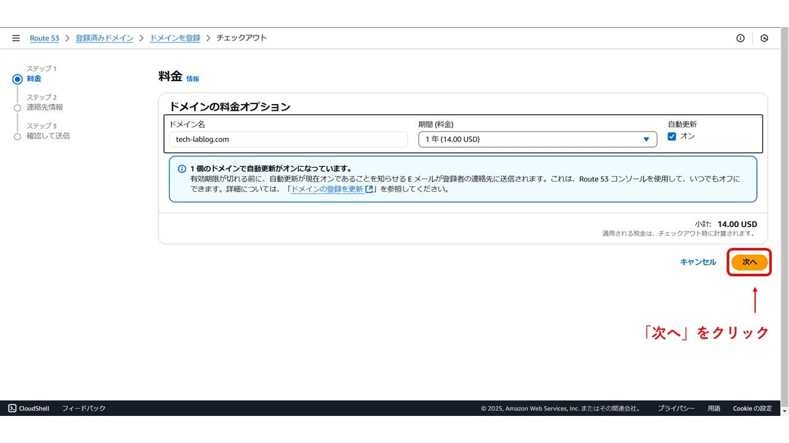

ここで、再度内容の確認をします。  
なお、選択したドメインを来年以降も継続して利用したい場合、**「自動更新：オン」**にチェックをします。

---

上の手順で、**「次へ」**をクリックすると以下の画面に遷移しますので、必要事項を入力します。

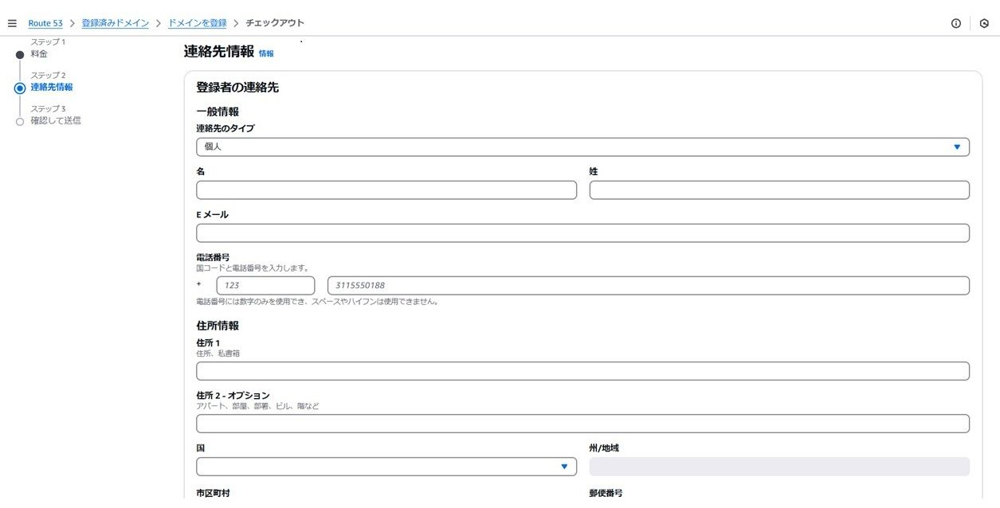

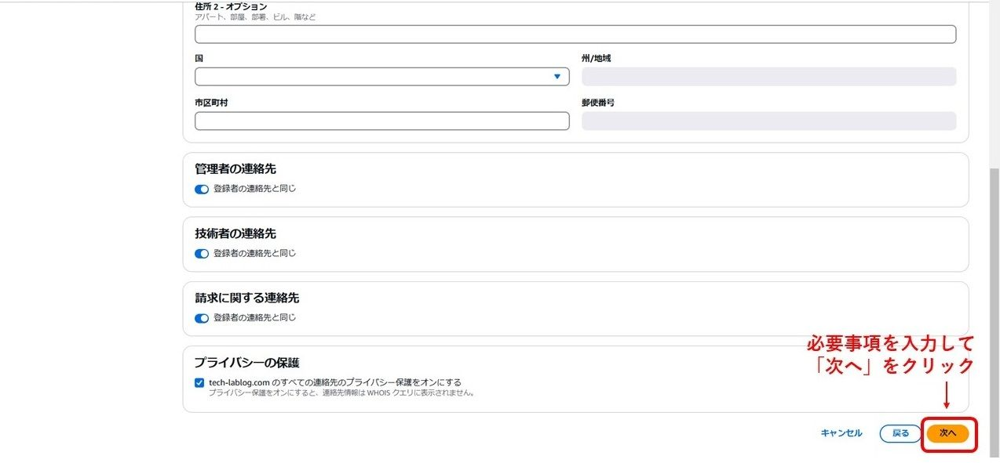

必要事項を入力したら、**「次へ」**をクリックします。

---

以下の確認画面が表示されますので、内容を確認します。

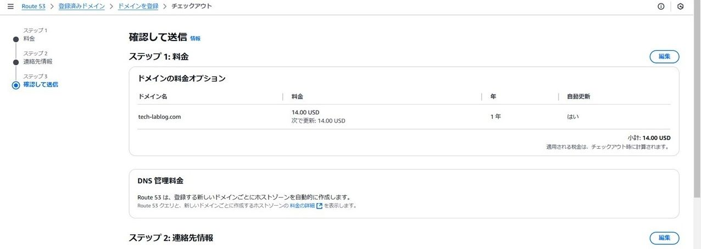

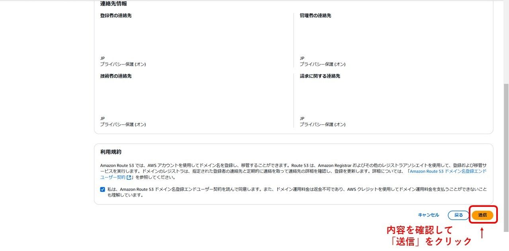

内容に問題がなければ、**「送信」**をクリックします。

---

**ここまでの手順で、ドメイン登録の申請は完了**です。  
※別途AWSからメールが届きます。

なお、申請後は、ドメインの正式登録まで、数分～数時間程度かかります。

**正常にドメインが登録されると、以下のように画面上で確認できる**ようになります。

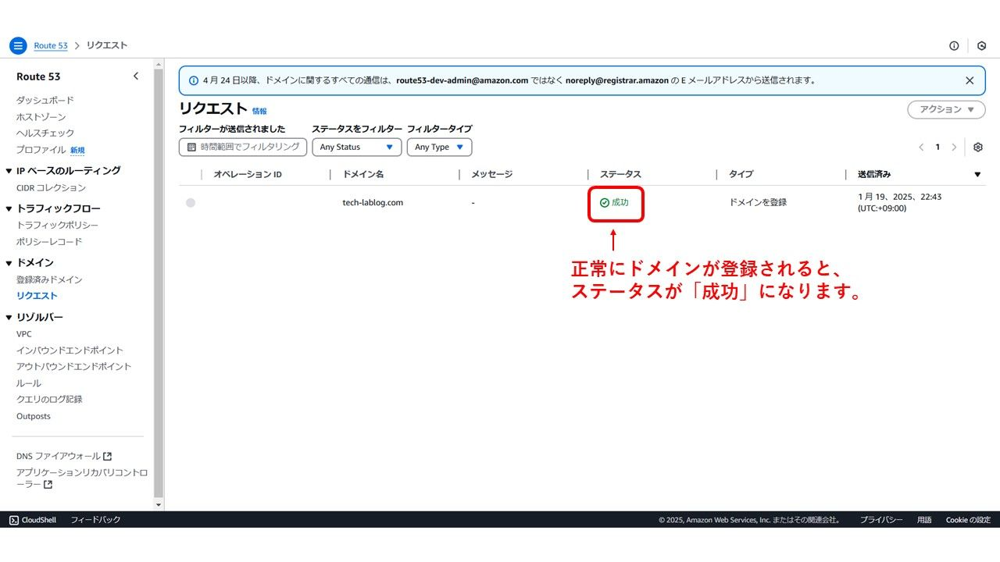

### まとめ

この記事では、AWSのRoute53を使用してドメインを登録する方法について解説しました。  
以下のポイントをおさらいしましょう。

●**ドメインとは**  
**ドメインはインターネット上の住所**のようなもので、Webサイトやサービスにアクセスする際に重要な役割を果たします。

●**ドメインの取得方法**  
ドメインは専門の登録業者を通じて取得でき、**AWSのRoute53もその一つ**です。  
**他のサービスと比べて、AWSの環境とシームレスに連携できるのが特徴**です。

●**Route53でドメインを登録する方法**  
Route53のドメイン登録プロセスは直感的で、AWS管理コンソールから簡単に操作できます。料金や必要な情報を確認し、**数ステップで登録を完了**できます。

AWS Route53を利用することで、信頼性の高いDNS管理とドメイン登録が一括して行えるため、特にAWS環境を利用している場合に非常に便利です。

このガイドを参考に、自分のプロジェクトやビジネスに最適なドメインを取得し、活用してください！
