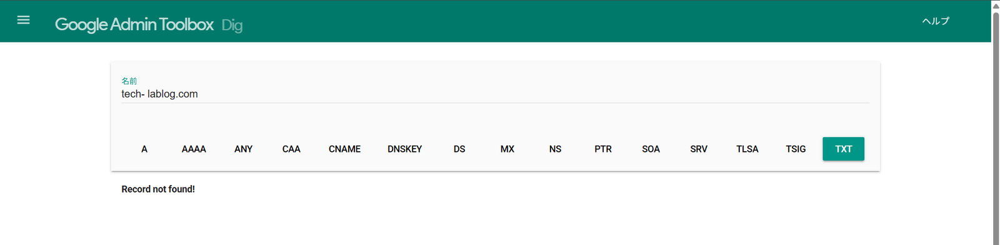
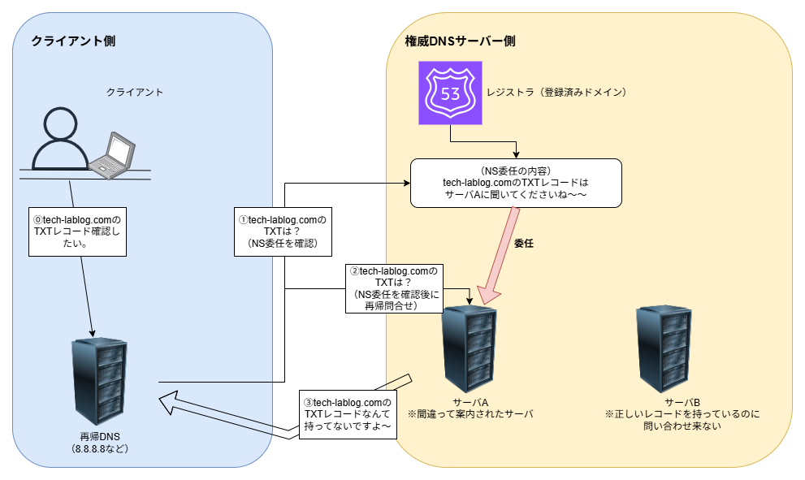
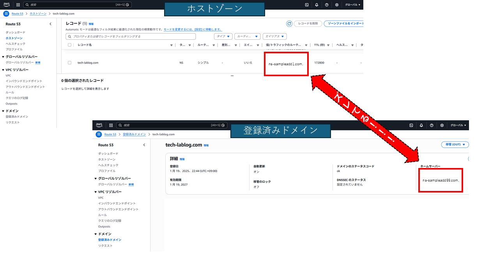

## 本記事の結論

かなり長文の記事のため、先に結論をまとめておきます。  
時間がない方は、まずはこちらだけ確認していただければと思います。

- TXTレコードを更新後72時間経過してもdigで表示されなかった原因は、**DNS伝搬ではなく NS 委任の不整合**だった
- Route 53 の**ホストゾーンと、登録済みドメインのネームサーバーが一致していなかった**
- NS 委任を修正したことで、TXTレコードが参照されるようになった（事象解決）
- 設定変更後、 NXDOMAIN が発生したのは、 Lightsail 側でのみ A / CNAME を管理していたため

詳細な切り分けの過程や背景については、以降で詳しく解説します。

## はじめに

年末のタイミングで、本ブログの問合せ・管理用として  
**独自ドメインのメールアドレスを作成しよう**と思い、設定を進めていました。

従来は Gmail に POP 接続で取り込む構成も検討しましたが、  
**Google が Gmail で外部メールを POP 経由で取り込む機能を段階的に終了する方針**を発表していることから、  
今回は **Google Workspace** を利用する構成を選択しました。

その過程で、ドメイン所有権確認のために  
Route 53 に **TXT レコードを設定したにもかかわらず、**  
dig や Google 側の確認画面では **72 時間以上経過しても反映されない** という事象に遭遇しました。

当初は DNS 伝播遅延を疑っていましたが、  
最終的な原因は **TXT レコードの設定ミスではなく、ネームサーバー（NS）委任の不整合** でした。

本記事では、

- TXT レコードは正しいのに digで確認できなかった理由
- 72時間待っても解決しなかった原因
- NS委任を修正した際に発生したNXDOMAIN(Lightsail 利用時)の対処

について実際の切り分け過程とあわせて整理します。

## 発生した事象：TXTレコードを設定しても dig で表示されない

Google Workspace のドメイン所有権確認のため、  
Amazon Route 53 のホストゾーンに TXT レコードを追加しました。

設定内容は以下のとおりです。

- レコードタイプ：TXT
- 値(Value0)：google-site-verification=xxxxxxxx
- TTL：300

Route 53 の管理画面上では、**TXT レコードは正しく登録**されており、  
**少なくとも設定内容に明らかな誤りは見当たりませんでした**。

しかし、Google Workspace 側の**ドメイン所有権確認画面**や  
Google が提供する **[DNS 確認ツール](https://toolbox.googleapps.com/apps/dig/)**では、  
**TXT レコードが検出されない状態が続いていました**。



通常であれば DNS 伝播の影響を考慮し、  
数十分～数時間、**長くても 72 時間程度で反映されるケースが一般的**です。  
しかし、本事象では 72 時間以上経過しても状況に変化がなく、  
**単なる DNS 伝播遅延では説明がつかない挙動**でした。

この時点では、原因を特定できる明確な手掛かりはなく、  
「設定は正しいが、まだ反映されていないだけなのか」  
という疑問が残る状況でした。

また、ここで気になっていたのが、  
nslookup で指定する参照先による挙動の違いです。

以下のコマンドのように**8.8.8.8 のようなパブリック DNS を指定した場合**は、  
通常の名前解決と同じ経路（ルート → TLD → 委任先）を辿って  
問い合わせが行われます。  
そのため、**委任先に問題がある場合は、  
正しいレコードを登録していても、nslookupの取得に失敗**します。

### nslookupでパブリックDNSを指定したコマンド実行結果

```text
> nslookup -type=TXT tech-lablog.com 8.8.8.8

サーバー:  dns.google
Address:  8.8.8.8

tech-lablog.com
        primary name server = ns-xxxx.awsdns-xx.xxx
        responsible mail addr = awsdns-hostmaster.amazon.com
        serial = 1
        refresh = 7200 (2 hours)
        retry   = 900 (15 mins)
        expire  = 1209600 (14 days)
        default TTL = 86400 (1 day)
```

一方で、**以下のように権威ネームサーバーを直接指定した場合**は、  
委任の状態に関係なく、  
その DNS サーバーが持つ情報を直接参照します。  
今回、権威サーバーを指定すると TXT レコードが返ってきたのは、  
**レコード自体は正しく登録されていたため**です。

### nslookupで権威ネームサーバーを指定したコマンド実行結果

```text
> nslookup -type=TXT tech-lablog.com ns-xxxx.awsdns-xx.xxx

サーバー:  UnKnown
Address:  123.45.67.89

tech-lablog.com    text =
        "google-site-verification=XXXXXXXXXXXXXXXXXXXXXXXXXXXXXXXXXXXXXXXX"
tech-lablog.com    text =
        "google-site-verification=XXXXXXXXXXXXXXXXXXXXXXXXXXXXXXXXXXXXXXXX"

tech-lablog.com    nameserver =
        ns-xxxx.awsdns-xx.xxx
tech-lablog.com    nameserver =
        ns-xxxx.awsdns-xx.xxx
tech-lablog.com    nameserver =
        ns-xxxx.awsdns-xx.xxx
tech-lablog.com    nameserver =
        ns-xxxx.awsdns-xx.xxx
```

ただ、この時点では、nslookup の挙動の違いについて  
明確な理由を説明できる状態ではなく、  
当初は単に DNS の伝播待ちなのだろうと考えていました。

しかし、**72 時間以上経過しても状況に変化がなかった**ことから、  
「何か別の要因があるのではないか」と考え、  
以降は**一つずつ要因を洗い出す形で切り分けを進めることにしました**。

> [!NOTE]
> ※ TLD（Top Level Domain）とは、  
> 「.com」「.net」「.jp」などのドメインの最上位区分を指します。  
> 名前解決では、ルート DNS の次に TLD の DNS サーバーへ問い合わせが行われ、  
> そこから委任先のネームサーバー情報が案内されます。

## 最初に疑ったこと（DNS伝播・TTL・72h待ち）

原因が特定できていない段階で、  
まず**最初に疑ったのは TXT レコードの設定内容そのもの**でした。

設定完了後、**一定時間が経過しても反映されない場合、  
単純な入力ミスや設定漏れが原因であるケースも少なくありません。**

実際、設定後に 1 日ほど経過しても状況が変わらなかったため、  
「どこか見落としがあるのではないか」という違和感がありました。

そこで、まずは TXT レコードの中身について、  
以下の点をあらためて確認しました。

- **レコード名** が正しく設定されているか
- TXTレコードの **値** が Googleから指定された内容と一致しているか
- **TTL** が極端に長い値になっていないか

これらを確認した結果、  
少なくとも **TXT レコードの内容や設定方法自体には  
問題はなさそうだと判断**しました。

その上で、**次に考えたのが DNS 伝播による反映遅延**です。  
DNS レコードの変更は即時に全世界へ反映されるわけではなく、  
**キャッシュの影響などにより、  
一定時間は古い情報が参照されることがあります**。

また、作業時期が年末年始であったこともあり、  
「外部要因によって通常より反映に時間がかかっているのではないか」  
という可能性も考えました。

こうした状況を踏まえ、  
この段階では**設定内容そのものに大きな問題はないと判断し、  
まずは DNS 伝播を考慮して 72 時間程度は様子を見る方針**を取りました。

しかし、**72 時間以上経過しても状況に変化がなかったことから、**  
単なる伝播遅延では説明がつかないと考え、  
設定や構成そのものを含めて  
**本腰を入れて切り分けを進める**ことにしました。

## dig で確認できない原因は NS委任の不整合だった

結論から言うと、dig や Google の [DNS 確認ツール](https://toolbox.googleapps.com/apps/dig/)で  
TXT レコードが確認できなかった原因は、  
TXT レコードの設定内容そのものではなく、  
**NS（ネームサーバー）委任の不整合**でした。

TXT レコードは Route 53 のホストゾーン上に  
正しく登録されており、  
**権威ネームサーバーを直接指定して問い合わせた場合には、  
TXT レコードが返ってくる**状態でした。

しかし、8.8.8.8 を指定した dig や  
Google の [DNS 確認ツール](https://toolbox.googleapps.com/apps/dig/)では、  
TXT レコードが取得できませんでした。

これは、**インターネット上の名前解決で参照される  
「このドメインの問い合わせ先（権威ネームサーバー）」と、  
Route 53 のホストゾーンで管理している  
ネームサーバーが一致していなかったため**です。

もう少し具体的に説明すると、  
Route 53 には大きく分けて  
**「登録済みドメイン」**と**「ホストゾーン」**という  
2つの管理ポイントがあります。

Route 53 の「登録済みドメイン」に設定されている  
ネームサーバー（NS）は、  
インターネット全体に対して  
「このドメインの問い合わせはここに行ってください」  
と示す、いわば案内板の役割を持っています。

一方で、Route 53 のホストゾーンに存在する NS レコードは、  
ホストゾーン作成時に自動生成されるもので、  
その DNS サーバー自身が  
「自分はこの名前の権威 DNS です」  
と名乗るための情報に過ぎません。  
この NS レコード自体が、  
委任先を決定する役割を持っているわけではありません。

**今回の環境では、  
ホストゾーン上には正しい TXT レコードが存在していたものの、  
登録済みドメイン側で指定されている  
ネームサーバーが別のものを指していました。**

そのため、再帰 DNS（8.8.8.8 など）は、  
登録済みドメインに設定された NS 情報を正として問い合わせを行い、  
結果として TXT レコードを保持していない  
別の DNS サーバーに問い合わせてしまっていた、  
という状態でした。

**つまり今回の事象は、**  
**「TXT レコードは正しく存在しているが、  
名前解決の入口となる NS 委任が別の場所を指していた」**  
**ことによって発生していたと整理**できます。

## NS委任とは何か（なぜ72h待っても解決しないのか）

NS 委任とは、  
**「このドメインに関する問い合わせは、  
どの DNS サーバーに聞きに行くのか」  
をインターネット全体に示す仕組みのこと**です。

NS委任が不一致の時の挙動イメージは[**こ**](#ns-delegation-mismatch-flow)[**ちら**](http://ns-delegation-mismatch-flow)

**DNS の名前解決では**、  
クライアントや再帰 DNS（8.8.8.8 など）は、  
いきなりホストゾーンのレコードを見に行くわけではありません。  
**まず最初に、  
ドメインの登録情報に設定されている  
ネームサーバー（NS）を参照**します。

**このとき重要なのが、  
再帰 DNS が参照している NS 情報は、  
Route 53 のホストゾーンではなく、  
ドメインの登録情報（レジストラ／登録済みドメイン）に  
設定されているものである**、という点です。

再帰 DNS は、  
「tech-lablog.com の権威 DNS はどこか」  
という問い合わせに対して、  
レジストラが管理している登録済みドメイン情報を参照し、  
そこに設定されている NS 情報を正として扱います。

つまり、登録済みドメインは  
再帰 DNS に対して  
「このドメインの問い合わせ先はここです」  
と答えてあげる役割を担っており、  
この情報が DNS 名前解決の出発点になっています。

再帰 DNS は、  
この案内板に書かれている情報を信頼して問い合わせを行うため、  
「本当にあなたが権威 DNS ですか？」といった確認を  
毎回行うことはありません。

そのため、登録済みドメインに設定されている  
ネームサーバーが A だった場合、  
再帰 DNS は A に対してのみ問い合わせを行います。  
もし A に TXT レコードが存在しなければ、  
再帰 DNS は  
「このドメインには TXT レコードは存在しない」  
と判断します。

この時点で処理は終了し、  
他の DNS サーバーを探索することはありません。  
たとえ別の DNS サーバー B に  
正しい TXT レコードが存在していたとしても、  
登録済みドメインの NS 委任が B を指していなければ、  
その情報に辿り着くことはありません。

ここで重要なのが、  
DNS 伝播や TTL が影響するのは  
「どのレコードが返ってくるか」であって、  
「どこに問い合わせが行われるか」ではない、という点です。

NS 委任が誤っている場合、  
問い合わせ先そのものが最初から間違っているため、  
いくら時間が経過しても、  
正しいホストゾーンのレコードが参照されることはありません。

今回、72 時間以上待っても状況が変わらなかったのは、  
DNS 伝播の問題ではなく、  
この NS 委任が原因だったためです。

つまり本事象は、  
「DNS 伝播を待てば解消する問題」ではなく、  
「問い合わせ先が誤っているため、  
待っても解決しない問題」だったと言えます。

> [!NOTE]
> ※再帰DNSは、キャッシュDNSサーバー　とか　DNSリゾルバーとも呼ばれます。

## 今回の環境で実際に起きていたNS委任のズレ



今回の環境では、  
**DNS のレコード自体は Route 53 のホストゾーンで管理している一方**で、  
**登録済みドメイン側の NS 委任が、  
別の DNS サーバーを指している状態**になっていました。

具体的には、  
TXT レコードや A レコードなどの DNS レコードは  
Route 53 のホストゾーンに登録していましたが、  
登録済みドメイン（レジストラ）に設定されている  
ネームサーバーは、  
Route 53 のホストゾーンとは異なるものになっていました。

そのため、**再帰 DNS（8.8.8.8 など）は、  
登録済みドメインに設定された NS 情報を正として、  
別の DNS サーバーへ問い合わせを行っていました。  
**  
結果として、

> [!CAUTION]
> \- Route 53 のホストゾーン  
> → 正しい TXT レコードが存在している  
> \- 再帰 DNS が問い合わせている先  
> → TXT レコードが存在しない

という状態が発生していました。

**この構成では、  
Route 53 のホストゾーンにどれだけ正しいレコードを設定しても、  
再帰 DNS がそのホストゾーンに辿り着くことはありません。**  
そのため、DNS 伝播を待っても状況が改善しなかった、  
という挙動になります。

なお、権威ネームサーバーを直接指定して問い合わせた場合に  
TXT レコードが返ってきていたのは、  
Route 53 のホストゾーン自体は  
正しく構成されていたためです。

つまり**今回の問題は、  
「DNS レコードの設定ミス」ではなく、  
「DNS レコードを管理している場所と、  
インターネットから参照されている場所が  
食い違っていた」ことによって  
発生していた**ものでした。

## 対応内容：登録済みドメインのネームサーバーを修正



原因が NS 委任の不整合であることが分かったため、  
対応としては、  
**登録済みドメイン側で設定されている  
ネームサーバーを修正**することにしました。

まず、Route 53 のホストゾーンに登録されている  
NS レコードの内容を確認しました。  
ここには、このドメインを管理する  
権威ネームサーバーの情報が登録されています。

次に、Route 53 の登録済みドメイン画面で、  
ネームサーバーの内容を確認しました。  
ここでは、インターネット上の名前解決において、  
再帰 DNS に対して案内される  
問い合わせ先のネームサーバーが設定されています。

これら二つを比較したところ、  
ホストゾーンに登録されている NS レコードの内容と、  
登録済みドメイン側で指定されている  
ネームサーバーの内容が一致していない状態でした。

DNS の名前解決では、  
**再帰 DNS はまず、  
登録済みドメインに設定されている  
ネームサーバーの情報を参照し、  
その情報をもとに問い合わせ先となる  
ネームサーバーを決定**します。

そのため、  
登録済みドメイン側で指定されている  
ネームサーバーが  
Route 53 のホストゾーンと一致していない状態では、  
ホストゾーンに登録した  
TXT レコードが参照されません。

そこで対応として、  
**登録済みドメイン側のネームサーバーを修正し、  
Route 53 のホストゾーンに登録されている  
NS レコードの内容と同じ値になるように設**定しました。

この修正により、  
再帰 DNS は正しく Route 53 のホストゾーンへ  
問い合わせを行うようになります。

ネームサーバー修正後は、  
DNS 伝播の反映を待つ必要がありますが、  
しばらく時間を置いた後、  
dig や Google の DNS 確認ツールでも  
TXT レコードが確認できるようになりました。

結果として、  
Google Workspace 側の  
ドメイン所有権確認も正常に完了しました。

## おまけ：NS 委任情報を修正した結果、Web サイトが NXDOMAIN になった理由（Lightsail）

登録済みドメインのネームサーバーを修正した後、  
TXT レコードは正しく参照されるようになりましたが、  
その直後、一時的に Web サイトへアクセスできなくなり、  
ブラウザ上で NXDOMAIN が表示される事象が発生しました。

NXDOMAIN は、  
「そのドメイン名に対する DNS レコードが存在しない」  
ことを意味する応答で、  
名前解決自体ができていない状態を示します。

今回の事象は、  
登録済みドメインのネームサーバーを  
Route 53 側へ切り替えたことにより、  
それまで Web サイトの名前解決に利用されていた  
Lightsail 側の DNS 設定が参照されなくなったことが原因でした。

今回の構成では、  
Lightsail を利用して Web サイトを運用しており、  
独自ドメインに対する A レコードや CNAME レコードは、  
過去に構築した際、Lightsail 側の DNS 機能で  
管理する形にしていたようです。

しかし、ネームサーバーを Route 53 に切り替えたことで、  
インターネット上の名前解決は  
すべて Route 53 のホストゾーンを  
参照する状態になりました。

その結果、  
Route 53 のホストゾーン上に  
Web サイト用の A レコードや CNAME レコードが  
存在しないことが原因で、  
ドメイン名に対する名前解決ができず、  
NXDOMAIN が返されていました。

振り返ってみると、  
DNS の設定自体に大きな問題があったというよりも、  
「どのサービスで DNS を管理しているのか」  
を十分に意識しないまま作業を進めてしまった点が、  
今回の事象につながったと感じています。

Lightsail と Route 53 を併用している場合、  
DNS の更新作業を行う前に、  
現在どちらがネームサーバーとして参照されているのか、  
どこで DNS レコードを管理しているのかを  
一度整理してから作業することが重要だと感じました。

## Route 53 に切り替えた後の復旧方法（A / CNAME レコード）

NS 委任情報を修正し、  
DNS の参照先が Route 53 に切り替わった後は、  
Web サイト用の DNS レコードも  
Route 53 のホストゾーン側に作成する必要があります。

今回の環境では、  
これまで Lightsail 側で管理していた  
A レコードや CNAME レコードが  
Route 53 には存在していなかったため、  
名前解決ができず NXDOMAIN となっていました。

そのため、  
Route 53 のホストゾーンに対して、  
以下のレコードを新たに作成しました。

\- ルートドメイン（tech-lablog.com）向けの A レコード  
\- www サブドメイン向けの CNAME レコード

値については、  
Lightsail インスタンスに割り当てられている  
パブリック IP アドレスや、  
Lightsail が指定する CNAME を設定しています。

これらのレコードを Route 53 側に作成したことで、  
Web サイトへのアクセスは正常に復旧しました。

## まとめ：DNSトラブルではレコードだけでなくNS委任も確認する

今回の事象を通して感じたのは、  
**DNS トラブルの切り分けでは、  
レコード設定だけを見て終わってはいけない**、  
という点です。

TXT レコードの内容や TTL に問題がなくても、  
ネームサーバー（NS 委任）の設定がずれていると、  
そのレコード自体が参照されません。

今回も当初は、  
「DNS の伝播待ちだろう」  
「もう少し時間が経てば反映されるはず」  
と考えていましたが、  
72 時間以上状況が変わらなかったことで、  
NS 委任の確認に踏み切りました。

結果として、  
ホストゾーンと登録済みドメイン側の  
ネームサーバー設定に不整合があり、  
それが原因で DNS レコードが  
参照されていない状態であることが分かりました。

**DNS の切り分けを行う際**は、  
レコードの内容だけでなく、  
**「そのレコードがどのネームサーバーで管理され、  
インターネット上でどこが参照されているのか」  
まで含めて確認することが重要**だと感じました。

同様の構成でトラブルに遭遇した場合の  
参考になれば幸いです。

## 参考

・[【AWS公式リファレンス】ドメインのネームサーバーおよびグルーレコードの追加あるいは変更](https://docs.aws.amazon.com/ja_jp/Route53/latest/DeveloperGuide/domain-name-servers-glue-records.html)
