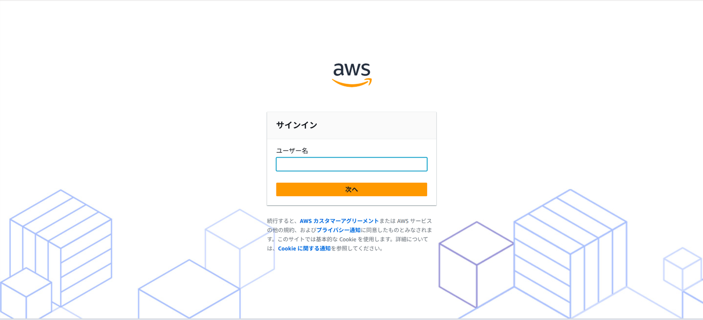
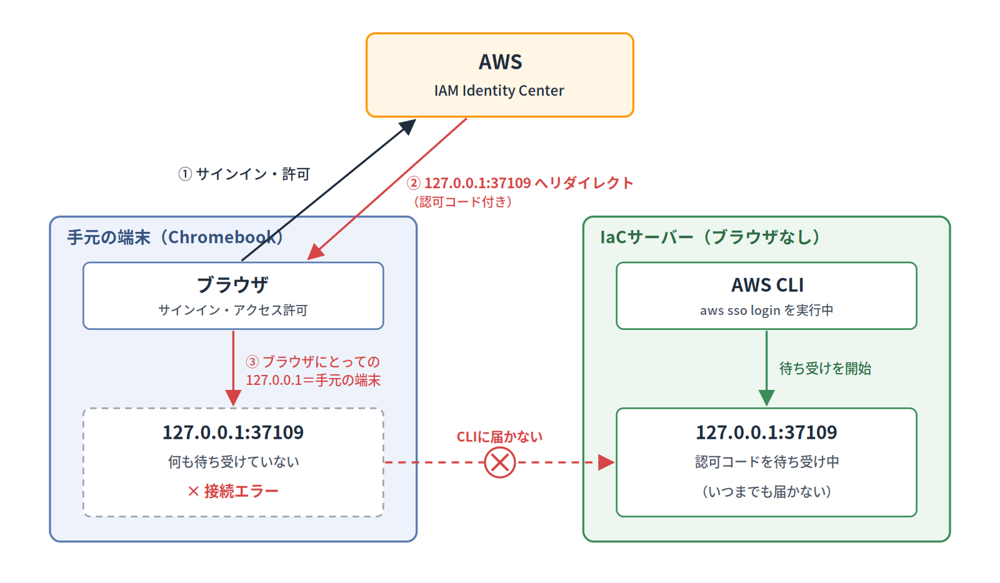

## はじめに

先日、自宅LAB用にTerraformやAnsibleを実行するためのIaC用サーバーを構築しました。これまでAWS CLIは手元の端末から操作していましたが、今後はIaCサーバーに操作を集約することにしました。

ところが、手元の端末と同じように `aws sso login` を実行したところ、ブラウザで認証しても 127.0.0.1 のエラーページが表示され、ログインが完了しませんでした。

この記事では、この現象の原因と対処法を解説します。

## 環境

- 手元の端末：Chromebook（Linux開発環境）
- IaCサーバー：Debian 13（ブラウザなし）
- AWS CLI：v2.37.0
- 認証：IAM Identity Center（AWS SSO）

## 症状

IaCサーバーにSSHで接続し、次のコマンドを実行しました。

```bash
aws sso login --profile プロファイル名
```

出力は次のとおりです（一部マスクしています）。

```text
Attempting to open your default browser.
If the browser does not open, open the following URL.
If you are unable to open the URL on this device, run this command again with the '--use-device-code' option.

https://oidc.ap-northeast-1.amazonaws.com/authorize?response_type=code&client_id=xxxx&redirect_uri=http%3A%2F%2F127.0.0.1%3A37109%2Foauth%2Fcallback&state=xxxx（以下省略）
```

このURLを手元のブラウザで開いてサインインし、アクセスを許可すると、ブラウザは `http://127.0.0.1:37109/oauth/callback` に移動し、接続できない旨のエラーページが表示されます。CLI側は待ち受けたまま、いつまでもログインが完了しません。



_表示されたURLをクリックし、SSOログインページが表示される_


_ユーザ名とパスワードを入力し、承認を押したあとにこの画面が表示されてしまう_

## 結論

`--use-device-code` オプションを付けて実行すれば、ログインできます。

```bash
aws sso login --profile プロファイル名 --use-device-code
```

## 原因：AWS CLI 2.22.0で認証方式がPKCEに変わった

### 2つの認証方式

`aws sso login` には次の2つの認証方式があります。

- 認可コードフロー（PKCE）：AWS CLI 2.22.0以降のデフォルト　（[PKCEとは](https://qiita.com/ist-n-m/items/992c67b803ff460818ec)）
- デバイス認可フロー（device code）：2.22.0より前のデフォルト。現在は `--use-device-code` で利用する

### PKCEでログインする流れ

1.  CLIが自分自身の 127.0.0.1 の空きポート（今回は37109）で一時的なWebサーバーを起動し、待ち受ける
2.  CLIが認可URLを表示する。URLには認証後の戻り先として `redirect_uri=http://127.0.0.1:37109/oauth/callback` が含まれている
3.  ユーザーがブラウザでサインインし、アクセスを許可する
4.  AWSがブラウザを redirect\_uri へリダイレクトし、認可コードを渡す
5.  CLIが認可コードを受け取り、トークンと交換してログインが完了する

ポイントは4です。認可コードをCLIへ届ける役目を担っているのはブラウザです。

### IaCサーバーで失敗する理由

127.0.0.1（ループバックアドレス）は「自分自身」を指すアドレスです。同じ127.0.0.1でも、どのマシンから見るかで指す先が変わります。

- CLIにとっての127.0.0.1：IaCサーバー
- ブラウザにとっての127.0.0.1：手元の端末

CLIはIaCサーバーの37109番で待ち受けていますが、ブラウザは手元の端末の37109番へアクセスします。手元の端末では何も待ち受けていないため、エラーページが表示され、認可コードはCLIに届きません。



_ブラウザにとっての127.0.0.1は手元の端末なので、IaCサーバーのCLIには届かない_

### 手元の端末では問題にならなかった理由

手元の端末ではCLIとブラウザが同じマシンで動いているため、ブラウザにとっての127.0.0.1とCLIにとっての127.0.0.1が一致します。そのため、同じコマンドでも問題なくログインできていました。

なお、症状の出力にもヒントが出ています。「If you are unable to open the URL on this device, run this command again with the '_**\--use-device-code**_' option.」は、「この端末でURLを開けない場合は --use-device-code を付けて再実行してください」という意味です。

## 対処法：--use-device-code を使う

待ち受け中のCLIを `Ctrl+C` で止め、オプションを付けて実行し直します。

```bash
aws sso login --profile プロファイル名 --use-device-code
```

- `--profile プロファイル名` ：`~/.aws/config` に定義したプロファイル名
- `--use-device-code`：デバイス認可フローでログインする

実行すると、認証用のURLとコードが表示されます。

```text
Attempting to open your default browser.
If the browser does not open or you wish to use a different device to authorize this request, open the following URL:

https://SSO用URL

Then enter the code:

XXXX-XXXX
Successfully logged into Start URL: SSO用URL
```

1.  表示されたURLを手元のブラウザで開く
2.  CLIに表示されたコード（XXXX-XXXX）を、ブラウザで開いたページに入力して承認する（未ログインの場合は、先にサインインを求められる）
3.  CLIに戻ると、ログイン完了のメッセージが表示される

### device codeならCLIに届く理由

デバイス認可フローでは、ブラウザがCLIへ結果を届ける必要がありません。CLIは承認されたかどうかをAWSに定期的に問い合わせ（ポーリング）、承認を確認した時点でトークンを受け取ります。通信は常に「CLI→AWS」の方向なので、ブラウザがどの端末にあっても関係ありません。

### ログインできたか確認する

```bash
aws sts get-caller-identity --profile プロファイル名
```

`sts get-caller-identity` は、今の認証情報が「どのアカウントの、誰として」認識されているかを返すコマンドです。特別な権限がなくても実行できるので、ログイン確認に便利です。

```text
{
    "UserId": "AROAXXXXXXXXXXXXXXXXX:username",
    "Account": "123456789012",
    "Arn": "arn:aws:sts::123456789012:assumed-role/AWSReservedSSO_AdministratorAccess_xxxxxxxxxxxxxxxx/username"
}
```

Arnに `AWSReservedSSO_` から始まるロールが表示されていれば、IAM Identity Centerの権限セットでログインできています。

### 初期設定時も同じ

`aws configure sso` でプロファイルを作成するときも同じ認証方式が使われます。ブラウザのないサーバーで初期設定する場合は、こちらも `--use-device-code` を付けて実行します。

```bash
aws configure sso --use-device-code
```

### 別解：SSHポートフォワード

SSHのポートフォワードで、手元の端末の37109番をIaCサーバーの127.0.0.1:37109へ中継すれば、PKCEのままでも認可コードを届けられます。

```bash
ssh -L 37109:127.0.0.1:37109 user@iac-server
```

- `-L ローカルポート:転送先ホスト:転送先ポート`：手元のポートへの通信を、SSH接続先から見た転送先へ中継する。ここでの `127.0.0.1` はIaCサーバーから見た自分自身

ただし、CLIの待ち受けポートは実行のたびに変わるため、毎回ポートを確認して転送し直す必要があります。実用的には `--use-device-code` のほうが手軽です。

## 使い分け：常にdevice codeを使えばいいわけではない

デフォルトがPKCEに変わった理由はセキュリティ向上のためです。デバイス認可フローには、攻撃者が発行したコードを被害者に入力させ、攻撃者のセッションを承認させるフィッシングのリスクがあります。PKCEでは認可コードがlocalhostで待ち受けるCLIにしか届かないため、この攻撃が成立しません。

そのため、次のように使い分けるのがおすすめです。

- ブラウザのある手元の端末：デフォルトのPKCE
- IaCサーバーなどブラウザのない環境：`--use-device-code`

また、デバイス認可フローで承認するときは、自分が今実行したコマンドのコードであることを必ず確認しましょう。

## まとめ

- AWS CLI 2.22.0以降、`aws sso login` のデフォルトはPKCE
- PKCEは認証後にブラウザを127.0.0.1へ戻す方式なので、CLIとブラウザが別のマシンだと認可コードが届かない
- ブラウザのないサーバーでは `--use-device-code` を使う
- 手元の端末ではPKCE、サーバーではdevice codeと使い分ける

## 参考

- [AWS CLI を使用した IAM Identity Center 認証の設定 - AWS Command Line Interface](https://docs.aws.amazon.com/ja_jp/cli/latest/userguide/cli-configure-sso.html)
- [AWS CLI Adds PKCE-based Authorization for SSO - AWS Developer Tools Blog](https://aws.amazon.com/blogs/developer/aws-cli-adds-pkce-based-authorization-for-sso/)
