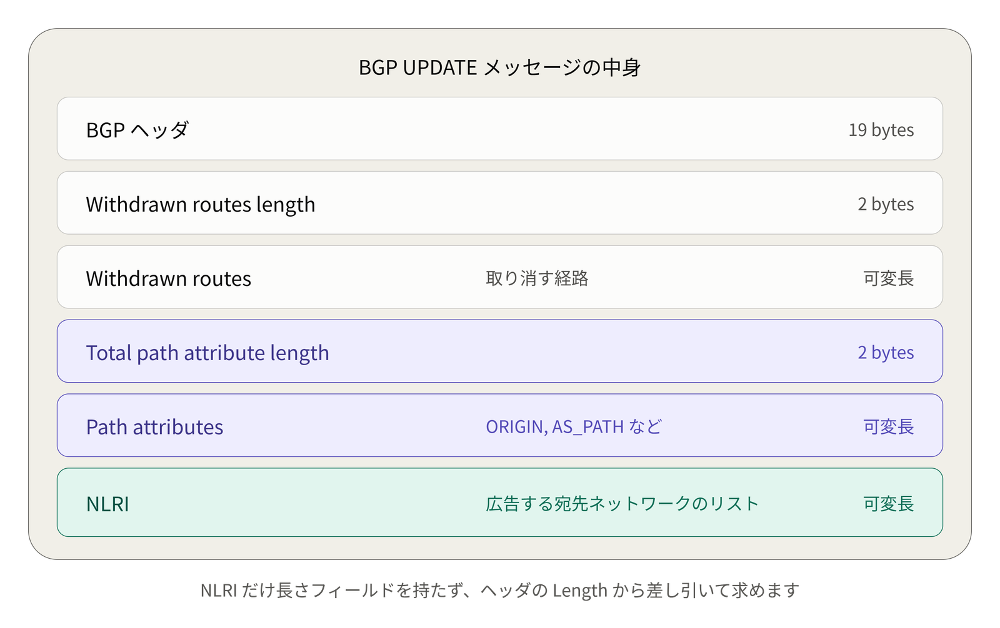
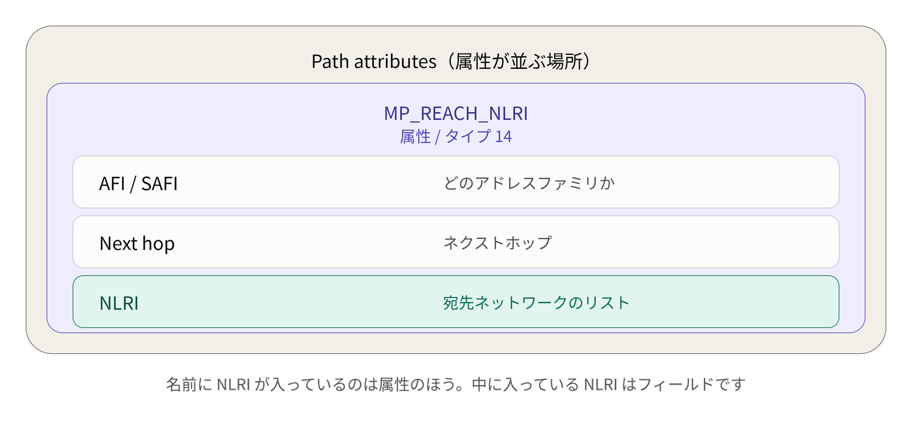

## この記事の結論

先に答えを書いておきます。

**NLRIは「属性」ではありません。UPDATEメッセージの中にある「フィールド」です。**

BGPの解説を読んでいると「NLRI属性」という表記を見かけることがありますが、正確ではありません。ただ、こう呼ばれてしまうのには理由があって、そこを理解すると混乱がすっきり解けます。

CCNP ENARSIの学習中にBGPのUPDATEメッセージを追っていて、自分自身がここで詰まったので記事にしました。

## この記事で扱う範囲

先に前提を整理しておきます。

この記事の主役は、**UPDATEメッセージのフィールドとしてのNLRI**です。MP-BGPやMP\_REACH\_NLRIも出てきますが、それは「なぜNLRI属性と呼ばれてしまうのか」を説明するためで、MP-BGPそのものの解説ではありません。

MP-BGPの仕組みやVPNv4について詳しく知りたい方は、別記事で扱う予定なのでそちらを参照いただければと思います。

扱う内容は以下の3点です。

- NLRIとは何か
- フィールドと属性は何が違うのか
- なぜ「NLRI属性」と呼ばれてしまうのか

## そもそもNLRIとは何か

NLRIは **Network Layer Reachability Information（ネットワーク層到達可能性情報）** の略です。

名前が仰々しいので身構えてしまいますが、中身は単純です。

**NLRI = 広告する宛先ネットワークのリスト**

これだけです。

BGPが隣のルータに「10.1.1.0/24 に行けますよ」と伝えるとき、その `10.1.1.0/24` の部分がNLRIにあたります。複数のプレフィックスをまとめて並べられるので、同じ条件の経路は1つのUPDATEでまとめて広告できます。

「経路情報」とよばれることもありますが、実質的には宛先の一覧だと思っておけば困りません。

## UPDATEメッセージの中身を見てみる

NLRIがどこにあるのかを、UPDATEメッセージ全体の構造で確認します。

_BGP UPDATEメッセージの中身とNLRIの位置_

大きく分けると、UPDATEメッセージは以下の3つの情報で構成されています。

- **Withdrawn routes** … 取り消す経路
- **Path attributes** … 属性が並ぶ場所
- **NLRI** … 広告する経路

そして図を見るとわかるとおり、**NLRIはPath attributesの外側にあります**。ここが今回のポイントです。

### NLRIだけ長さフィールドを持たない

もうひとつ、図から読み取れる特徴があります。

Withdrawn routesの前には Withdrawn routes length が、Path attributesの前には Total path attribute length が、それぞれ2バイトで付いています。ところが**NLRIには対応する長さフィールドがありません**。

ではどうやって長さを知るのかというと、BGPヘッダのLengthフィールドから他のフィールドの長さを差し引いて求めます。つまりNLRIは「残りの領域」として扱われているわけです。

この点からも、NLRIが属性とは別枠の存在であることが見えてきます。

## フィールドと属性はどう違うのか

ここが今回の本題です。

まず前提として、フィールドと属性は**対立する概念ではありません**。

- **フィールド** … メッセージを区切ったときの「枠」全般
- **属性** … その枠のうち、Path attributesの中に入っている特定の情報

つまり属性はフィールドの一種です。四角形（フィールド）と正方形（属性）のような関係だと考えるとわかりやすいと思います。

先ほどの図でいえば、Withdrawn routes も Path attributes も NLRI も、**どれもフィールド**です。そのうち **Path attributesの中に入っているものだけが「属性」** と呼ばれます。

NLRIはPath attributesの外にある独立したフィールドなので、属性ではないということになります。

### 属性だけが持っている性質

もう少し踏み込むと、属性には「ただの枠（フィールド）」にはない特徴が3つあります。

**1\. タイプ番号が振られている**

ORIGINは1、AS\_PATHは2、NEXT\_HOPは3、というように、属性にはそれぞれ番号が割り当てられています。

**2\. 必須か任意かの区分がある**

「必ず付けなければならないのか」「他のASに伝えてよいのか」といった扱いのルールが属性ごとに決まっています。

**3\. 経路選択の判断材料になる**

BGPのベストパス選択では、LOCAL\_PREFが高い方を選ぶ、AS\_PATHが短い方を選ぶ、といった比較をします。この判断に使われるのが属性です。

NLRIにはこの3つがすべてありません。タイプ番号もなければ、経路選択にも影響しません。ただ「宛先はこれです」と示すだけの枠です。

言い換えると、こうなります。

> **NLRIは「どこ宛か」を示すもの。** **属性は「その経路がどういう経路か」を示すもの。**

役割がそもそも違うので、NLRIを属性と呼ぶのは無理があるわけです。

## なぜ「NLRI属性」と呼ばれてしまうのか

原因はほぼ一つだと思っていて、**MP\_REACH\_NLRI** という属性の存在です。

MP-BGP（マルチプロトコルBGP）では、IPv4以外の経路情報も運べるように新しい属性が追加されました。それが以下の2つです。

| 属性名            | タイプ番号 | 役割                 |
| ----------------- | ---------- | -------------------- |
| MP\_REACH\_NLRI   | 14         | 到達できる経路の広告 |
| MP\_UNREACH\_NLRI | 15         | 経路の取り消し       |

見てのとおり、**名前に「NLRI」が入っています**。しかもこちらは正真正銘の属性です。

そして紛らわしいことに、MP\_REACH\_NLRIという属性の**中にNLRIフィールドが入っています**。

_MP\_REACH\_NLRI属性の中にあるNLRIフィールド_

「NLRIという名前の属性がある」「その中にNLRIというフィールドがある」という入れ子構造になっているので、資料を流し読みすると両者が混ざります。

整理するとこうです。

- **MP\_REACH\_NLRI** → 属性（タイプ14）
- **NLRI** → その属性の中のフィールド、または通常のUPDATEの末尾にあるフィールド

「NLRI属性」という表記を見かけたら、たいていはMP\_REACH\_NLRIのことを指しているか、単純に混同されているかのどちらかだと思います。

## まとめ

今回の内容を3行でまとめます。

- NLRIは属性ではなく、UPDATEメッセージのフィールド
- 中身は「広告する宛先ネットワークのリスト」で、長さフィールドを持たない
- 「NLRI属性」と呼ばれるのは、MP\_REACH\_NLRIという属性と名前が似ているため

用語そのものは難しくないのですが、名前の紛らわしさだけで理解が止まってしまうポイントだと思います。ここを押さえておくと、MP-BGPやMPLS L3VPNの資料を読むときに引っかかりにくくなるはずです。
