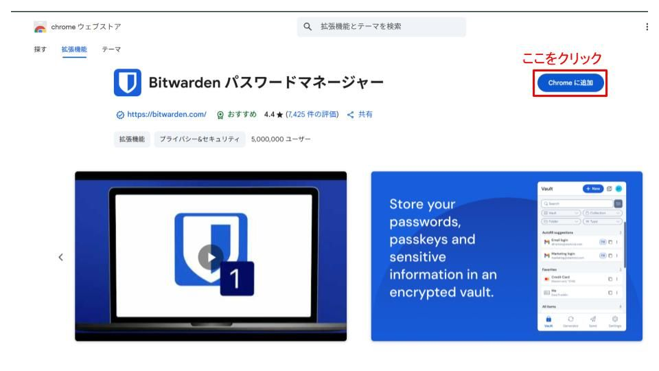
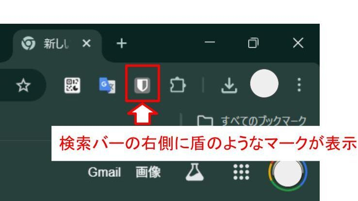

## 概要

普段使うブラウザアプリのGoogle chromeの拡張機能としてBitwardenを導入しました。  
Bitwardenは、高度なパスワード管理アプリで、ログイン情報の自動入力や、パスワードの自動生成・管理などを行ってくれます。

## 手順解説

### 手順１：Bitwardenのアカウント登録

[こちら](https://bitwarden.com/ja-jp/go/start-free/)からBitwardenの公式サイトへ移動しアカウント作成を行います。  
大体5分くらいでアカウントを作成できます。  
アカウント作成方法の詳細は[公式](https://bitwarden.com/ja-jp/help/create-bitwarden-account/)サイトに記載されていますので、ご確認ください。

### 手順２：拡張機能のインストール

chrome ウェブストアで下記の拡張機能をインストールします。  
[Bitwarden パスワードマネージャー](https://chromewebstore.google.com/detail/bitwarden-%E3%83%91%E3%82%B9%E3%83%AF%E3%83%BC%E3%83%89%E3%83%9E%E3%83%8D%E3%83%BC%E3%82%B8%E3%83%A3%E3%83%BC/nngceckbapebfimnlniiiahkandclblb?hl=ja)

### 手順３：設定

拡張機能をインストール後、おそらくchromeの右上（検索バーの横らへん）に下図のようなマークが表示されていると思います。  
マークをクリック後ログインすると機能が利用できるようになります。

## 実際に使用してみた感想

今回は Bitwarden の導入までを解説しました。  
実際に使ってみた感想としては、まだ少し使いづらさを感じる場面がありました。  
正直なところ、Google Chrome 標準搭載の「パスワードマネージャー」の方が操作性や手軽さでは優れていると感じています。

とはいえ、Bitwarden ならではのメリットもあります。  
私はこれまで、 iPhone では Apple 公式の「パスワード」アプリを使い、PC では Windows を利用していたため、端末間でパスワードを共有できず不便さを感じていました。

その点、Bitwarden は iPhone・Windows・Mac など複数の環境で利用可能なため、パスワードの一元管理が可能です。  
したがって、複数の端末を使い分けている人にとっては、Bitwarden を導入する価値は十分にあると考えています。

## おまけ：Bitwardenとあわせて使いたいセキュリティ対策「Surfshark Antivirus」

Bitwardenを導入することで、パスワードの一元管理ができ、複数端末で安全に利用できるようになります。  
ただし「パスワード管理」だけではセキュリティ対策としては不十分です。

デバイス自体の防御やオンライン上でのプライバシー保護 も組み合わせることで、より安心してインターネットを利用できます。

そこでおすすめなのが、<a href="https://px.a8.net/svt/ejp?a8mat=45E95T+64VU7M+4LSW+BX3J6" rel="nofollow">Surfshark Antivirus</a>

を中心としたセキュリティサービスです。

### Surfshark Antivirus の特徴

- ダウンロード/開封時にファイルを自動スキャン！未知の脅威もクラウド分析で検知
- Webカメラ保護機能で不正アクセスからカメラをブロック！プライバシーの保護が可能に
- スキャンのスケジュール設定や、スキャン対象から特定フォルダを除外するなど自由度の高い設定が可能

### Surfshark Oneでさらに安心

<a href="https://px.a8.net/svt/ejp?a8mat=45E95T+64VU7M+4LSW+BX3J6" rel="nofollow">Surfshark Antivirus</a>

は「Surfshark One」として、他の3つの製品とセット利用も可能です。

- **Surfshark VPN**：オンライン上の行動を匿名化し、追跡を防止
- **Surfshark Alert**：個人情報漏えいをリアルタイムで通知
- **Surfshark Search**：プライバシーを守りながら検索できる独自エンジン

パスワード管理の Bitwarden とあわせて導入すれば、  
「アカウントのセキュリティ」＋「デバイスの防御」＋「オンラインプライバシー」の3本柱で、より強固なセキュリティ環境を実現できます。
