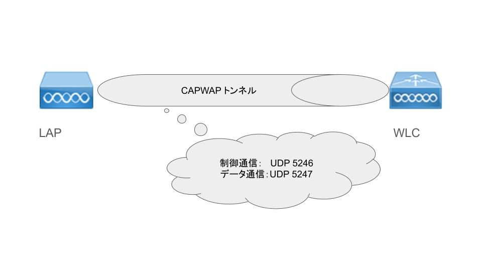

## 概要

WLC (Wireless LAN Controller) とLAP (Lightweight Access Point)の通信に使われるCAPWAPは、無線関連の実務、CCNAやCCNPの試験においてもよく出てくるプロトコルです。  
この記事では、CAPWAPの概要とAPがWLCに接続するまでのセッション確立手順について解説します。

## CAPWAPとは

CAPWAP (正式名称：Control And Provisioning of Wireless Access Points)は、LAP (Lightweight AP)とWLC間で制御情報とデータのやり取りを行うプロトコルです。

> [!NOTE] CAPWAPの特徴
>
> - UDPベースの通信（制御用:UDP 5246 、 データ用:UDP 5247）
> - DTLSによる暗号化に対応
> - LWAPPから進化した標準化プロトコル



## CAPWAPセッションの確立手順

CAPWAPセッションを確立する前に無線APはWLCを探索します。  
無線APがWLCを探索するプロセスについては、下記リンク先の記事で詳細を解説しております。  
[**Cisco無線AP（LAP）がWLCを探索する仕組み｜試験＆実務で役立つ解説**](/lap-wlc-discovery-process/)

<iframe src="https://docs.google.com/presentation/d/e/2PACX-1vT19-Fu6ydrvXMKeJ9c3GpWZj5BxLo_g1D4ra2ZOgLz98zWOAjZDlokPYi08NnQ-9iqgzRdn9yY7bRf/pubembed?start=false&loop=false&delayms=3000" frameborder="0" width="960" height="569" allowfullscreen="true" mozallowfullscreen="true" webkitallowfullscreen="true"></iframe>

## CAPWAPがつながらない-よくあるトラブルシュート

### 原因①：コントローラ側の時刻が、APの証明書有効期限外の時刻に設定されてしまっている

CAPWAP では、AP と WLC 間の制御通信に DTLS が使用されており、  
この DTLS セッションの確立には AP に搭載されている証明書（MIC / SSC） が利用されます。

AP の証明書状態は、AP CLI から以下のコマンドで確認できます。

```text
show crypto ca certificate
```

このコマンドにより、AP にインストールされている証明書の 有効期間（Validity Date） を確認できます。

出力には複数の証明書情報が含まれる場合がありますが、  
Associated Trustpoints に表示される証明書のうち、Name フィールドが AP 名と一致するもの が、  
実際に CAPWAP/DTLS 通信で使用される証明書です。

この証明書の有効期限が切れている場合、  
AP は WLC と DTLS セッションを確立できず、CAPWAP Join に失敗します。

### 原因②：ファイアウォールによる必要ポート遮断

企業のネットワークでは、AP と WLC の間にファイアウォールが挟まることが多いですが、必要なポートが遮断されていると AP は WLC に Join できません。  
CAPWAP 通信では、以下の UDP ポートが必須です。

<table><tbody><tr><td><strong>用途</strong></td><td><strong>プロトコル</strong></td><td><strong>ポート番号</strong></td></tr><tr><td>CAPWAP コントロール</td><td>UDP</td><td>5246</td></tr><tr><td>CAPWAP データ</td><td>UDP</td><td>5247</td></tr></tbody></table>

これらのポートが許可されていない場合、  
AP は Discovery や Join 処理を完了できず、接続に失敗します。

## 参考

[【Cisco公式】データ暗号化の設定](https://www.cisco.com/c/ja_jp/td/docs/switches/lan/catalyst3850/software/release/16-3/configuration_guide/b_163_consolidated_3850_cg/b_163_consolidated_3850_cg_chapter_0110101.pdf)  
[【Cisco公式】Catalyst 9800 WLC を使用した AP 参加プロセスの理解](https://www.cisco.com/c/ja_jp/support/docs/wireless/catalyst-9120axe-access-point/221056-understand-the-ap-join-process-with-the.html)  
[【Cisco公式】Lightweight アクセス ポイントに関する FAQ](https://www.cisco.com/c/ja_jp/support/docs/wireless/aironet-1200-series/70278-lap-faq.html)  
[【Cisco公式】Cisco Wireless Controller リリース 8.5 コンフィギュレーション ガイド](https://www.cisco.com/c/ja_jp/td/docs/wireless/controller/8-5/config-guide/b_cg85/b_cg85_chapter_0100010.html)
