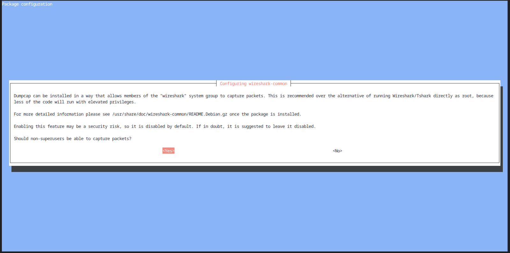
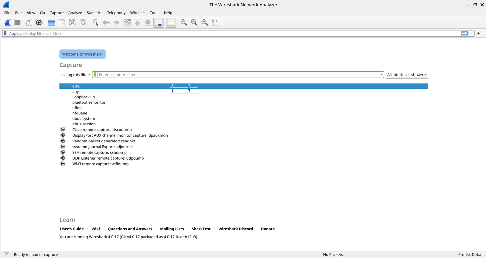

## この記事の結論

先に答えを書いておきます。

**ChromebookでもWiresharkは普通に動きます。** Linux開発環境（Crostini）に `apt install` するだけです。

ただし制約があります。**ChromeOS本体のWi-Fiや物理NICのトラフィックはキャプチャできません。** 見えるのはLinuxコンテナに割り当てられた仮想NICだけです。

なので「手元のPCの通信を解析する」用途には向きません。逆に、GNS3のようなリモート環境と組み合わせるクライアント機としては十分に使えます。

譲り受けた古いChromebookが手元にあったので、ネットワーク検証用に仕立ててみた記録です。

## この記事で扱う範囲

扱う内容は以下の3点です。

-   ChromebookへのWiresharkのインストール手順
-   権限設定（ここを飛ばすとインターフェースが表示されません）
-   Chromebookで「見えるもの」と「見えないもの」

なお、この環境にはGNS3のクライアント（GUI）も入れています。GNS3サーバ本体はAWS上にあり、Chromebookからリモート接続して使う構成です。GNS3側のパケットキャプチャについては別記事で扱います。

## 検証環境

今回使ったのは、HP Chromebook 14a-na0009TU です。Gemini Lake世代の入門機で、かなり非力な部類に入ります。

| 項目 | 内容 |
| --- | --- |
| 機種 | HP Chromebook 14a-na0009TU |
| 基板コードネーム | octopus / blooglet |
| ファームウェア | Google\_Bloog.11297.440.0 |
| ChromeOS | 16733.60.0（stable-channel） |
| Chrome | 151.0.7922.222 |
| CPU | Intel Celeron N4020（2コア / 1.10GHz） |
| Linux環境 | Debian GNU/Linux 12 (bookworm) x86\_64 |
| カーネル | 6.6.135 |
| コンテナ割当メモリ | 2747MiB |
| Wireshark | 4.0.17（4.0.17-0+deb12u3） |

型番は本体裏面のラベルで確認できます。基板コードネームやファームウェアのバージョンは `chrome://version`、Linux側のスペックは `neofetch` でまとめて見られます。

**Celeron N4020でも問題なく動きます。** Wiresharkの表示処理も、GNS3のクライアントGUIも軽量だからです。重い処理はすべてAWS側のサーバが持つので、手元のマシンパワーはほとんど要求されません。

「古いChromebookが余っている」という方には、わりと現実的な選択肢だと思います。

## 前提：Linux開発環境（Crostini）の有効化

ChromeOSでLinuxアプリを動かすには、Linux開発環境（Crostini）を有効にしておく必要があります。

設定 → デベロッパー → Linux開発環境 から数分で完了します。ディスク割り当てを聞かれますが、Wiresharkだけなら10GBもあれば十分です。

有効化が済むと「ターミナル」アプリが使えるようになります。以下の作業はすべてこのターミナル上で行います。

## Wiresharkのインストール

まずパッケージリストを更新して、Wiresharkを入れます。

```text
sudo apt update
sudo apt install wireshark
```

Debian 12のリポジトリから入るので、追加のリポジトリ登録などは不要です。依存パッケージを含めて30個ほど、150MBくらいのディスクを使います。

### 途中で出る青い画面は「Yes」

インストールの途中で、パッケージ設定（debconf）の画面が表示されます。



*インストール中に表示されるdebconfの設定画面。ここは Yes を選ぶ*

> Should non-superusers be able to capture packets?

ここは **<Yes>** を選びます。Tabキーで選択を移動し、Enterで決定です。

これは「`wireshark` グループに所属するユーザーが `dumpcap` を実行できるようにするか」という質問です。

Wiresharkをrootで直接起動する方法もありますが、それだと膨大なプロトコル解析コードがすべてroot権限で動くことになります。Yesを選ぶと、**特権が必要な部分を `dumpcap` という小さなプログラムだけに切り出せる**ので、こちらのほうが安全です。

一方で、グループに追加したユーザーは誰でもキャプチャできるようになります。デフォルトが「無効」になっているのはそのためです。共用マシンでは慎重に判断してください。今回は個人の検証機なのでYesにします。

なお、誤って <No> を選んでしまった場合は、以下のコマンドで選び直せます。

```text
sudo dpkg-reconfigure wireshark-common
```

## 自分のユーザーをwiresharkグループに追加する

インストール時にYesを選んだだけでは足りません。**自分自身をグループに追加する作業が別途必要です。**

```text
sudo usermod -aG wireshark $USER
```

ここまで終わったら、グループ情報を反映させるためにコンテナを再起動します。ランチャーのLinuxアイコン（またはターミナルアプリのアイコン）を右クリックして「Linuxをシャットダウン」を選び、もう一度ターミナルを開き直してください。

反映されたかどうかは `groups` で確認できます。

```text
$ groups
user chronos-access android-everybody dialout cdrom floppy sudo audio video plugdev users kvm wireshark
```

末尾に `wireshark` が入っていればOKです。

**この手順を飛ばすと、Wiresharkを起動してもインターフェース一覧が空のままになります。** 「Wiresharkが起動するのにキャプチャできない」というトラブルの大半はここが原因です。

## 起動して確認する

ターミナルから起動します。

```text
wireshark &
```

`&` を付けるとバックグラウンド実行になり、ターミナルを続けて操作できます。



*Chromebook上で起動したWireshark 4.0.17。eth0の右に波形が出ていればキャプチャ権限は正常*

Welcome画面のインターフェース一覧に `eth0` や `Loopback: lo` が並んでいれば成功です。`eth0` の右に波形（スパークライン）が動いていれば、実際にパケットが見えている証拠になります。

### 起動時に出るメッセージは無視してよい

起動すると、ターミナルに以下のようなメッセージが出ます。

```text
nl80211 not found.
 ** (wireshark:320) [GUI WARNING] -- Ignoring unexpected wl_surface.enter received for output with id: 7 ...
```

どちらも実害はありません。

**`nl80211 not found`** は、Linuxカーネルの無線制御インターフェースがコンテナ内に存在しない、という意味です。Crostiniは仮想NICしか持たないので当然の結果で、モニターモードや無線チャンネル設定の機能が使えないというだけです。有線・仮想リンクのキャプチャには影響しません。

**`wl_surface.enter`** のほうは、ChromeOSのコンポジタとQt5の間で起きる描画関連の警告です。表示上の問題はほぼ起きません。どうしても消したい場合は、Waylandではなく X11（Xwayland）で起動すると出なくなります。

```text
QT_QPA_PLATFORM=xcb wireshark &
```

## Chromebookで見えるもの・見えないもの

ここが一番重要な部分だと思うので、改めて整理しておきます。

| 対象 | 可否 |
| --- | --- |
| Linuxコンテナの仮想NIC（eth0） | ○ |
| ループバック（lo） | ○ |
| pcapファイルの読み込み・解析 | ○ |
| ChromeOS本体のWi-Fi / 物理NIC | × |
| モニターモード（無線キャプチャ） | × |

Crostiniのコンテナは、ChromeOS本体から見ると仮想マシンの中の一区画です。本体のネットワークスタックとは分離されているため、コンテナからは本体のトラフィックが見えません。

`eth0` に付くIPアドレスも `100.115.92.x` という、ChromeOS内部で使われる固定レンジになります。

つまりChromebookのWiresharkは、「手元の通信を覗く道具」ではなく「どこか別の場所で取ったパケットを見る道具」という位置づけになります。この割り切りができれば、十分に実用的です。

## 次回からの起動方法

3通りあります。

**1\. ランチャーから**

ランチャーで「Wireshark」と検索すると、Linuxアプリのアイコンが出ます。Linuxコンテナが停止していても、自動で起動してから立ち上がります。シェルフにピン留めしておくと一番速いです。

**2\. ターミナルから**

```text
wireshark &
```

**3\. pcapファイルを直接開く**

```text
wireshark ~/capture.pcap &
```

ファイルマネージャーでpcapファイルをダブルクリックしても開けます。

## まとめ

今回の内容を3行でまとめます。

-   ChromebookのLinux開発環境に `apt install wireshark` でインストールできる
-   debconf画面で <Yes> を選び、`usermod -aG wireshark $USER` でグループに追加するまでが必須
-   ChromeOS本体のNICは見えないため、リモート環境のキャプチャを表示するクライアント機として使うのが現実的

Celeron N4020・メモリ2GB台という控えめな構成でも、この用途なら不足を感じません。使い道に困っている古いChromebookがあれば、検証用のサブ機として仕立ててみる価値はあると思います。

なお、この環境からAWS上のGNS3に接続してパケットキャプチャを行う方法については、別途記事にする予定です。
