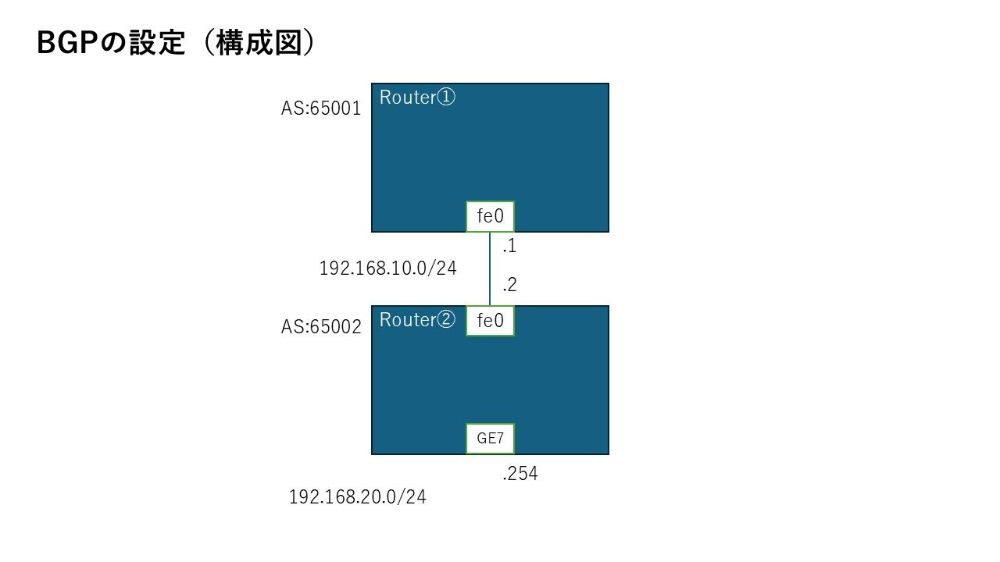

## 概要

現在CCNP ENCORの試験対策で、BGPの設定を勉強中です。  
備忘も兼ねて設定の手順を解説します。

紹介している設定手順で進めると、BGPによるルートの広告とBGPネイバー関係の確立が出来ます。

## 構成図（超ざっくり）



上の図の「router②」の設定を中心に解説していきます。  
同様の流れで対向のルータも設定することで、BGPのネイバー関係が確立されます。

## 設定編

```text
Router2(config)#
Router2(config)#router bgp 65002
Router2(config-router)#neighbor 192.168.10.1 remote-as 65001
Router2(config-router)#network 192.168.20.0 mask 255.255.255.0
```

コマンドについて、解説していきます。

**①BGPの有効化　（BGPのルータコンフィグレーションモードに遷移）**  
コマンド：router bgp ＜自AS番号＞  
コマンドを実行するモード：グローバルコンフィグレーションモード　 (config)#

**②ネイバーの設定**  
コマンド：neighbor ＜ネイバーのIPアドレス＞ remote-as　＜ネイバーのAS番号＞  
コマンドを実行するモード：ルータコンフィグレーションモード　(config-router)#

**③広告するネットワークの設定（アドバタイズ設定）**  
コマンド：network ＜広告するネットワークアドレス＞ \[mask ＜サブネットマスク＞\]  
コマンドを実行するモード：ルータコンフィグレーションモード　(config-router)#  
※\[mask ＜サブネットマスク＞\]は省略することも可能です。  
省略した場合は、クラスフルネットワークを広告します。

## 設定値の確認①

上記の手順によりBGPの設定が出来たら、コマンドで設定状態を確認します。  
コマンド：show ip bgp neighbors

```text
Router2#show ip bgp neighbors
BGP neighbor is 192.168.10.1,  remote AS 65001, external link　 >>ネイバーのIPアドレスとAS番号
  BGP version 4, remote router ID 192.168.10.1
  BGP state = Established, up for 00:01:38　　　　　　　　　　　　>>状態が確認できる　※Establishedのため正常にBGP関係が確立できている
  Last read 00:00:40, last write 00:00:43, hold time is 180, keepalive interval is 60 seconds
  Neighbor sessions:
    1 active, is not multisession capable (disabled)
  Neighbor capabilities:
    Route refresh: advertised and received(new)
    Four-octets ASN Capability: advertised and received
    Address family IPv4 Unicast: advertised and received
    Enhanced Refresh Capability: advertised and received
    Multisession Capability:
    Stateful switchover support enabled: NO for session 1
  Message statistics:
    InQ depth is 0
    OutQ depth is 0

                         Sent       Rcvd
    Opens:                  1          1
    Notifications:          0          0
    Updates:                2          1
    Keepalives:             3          3
    Route Refresh:          0          0
    Total:                  6          5
  Default minimum time between advertisement runs is 30 seconds
 For address family: IPv4 Unicast
  Session: 192.168.10.1
  BGP table version 2, neighbor version 2/0
  Output queue size : 0
  Index 1, Advertise bit 0
  1 update-group member
  Slow-peer detection is disabled
  Slow-peer split-update-group dynamic is disabled
                                 Sent       Rcvd
  Prefix activity:               ----       ----
    Prefixes Current:               1          0
    Prefixes Total:                 1          0
    Implicit Withdraw:              0          0
    Explicit Withdraw:              0          0
    Used as bestpath:             n/a          0
    Used as multipath:            n/a          0
                                   Outbound    Inbound
  Local Policy Denied Prefixes:    --------    -------
    Total:                                0          0
  Number of NLRIs in the update sent: max 1, min 0
  Last detected as dynamic slow peer: never
  Dynamic slow peer recovered: never
  Refresh Epoch: 1
  Last Sent Refresh Start-of-rib: never
  Last Sent Refresh End-of-rib: never
  Last Received Refresh Start-of-rib: never
  Last Received Refresh End-of-rib: never
				       Sent	  Rcvd
	Refresh activity:	       ----	  ----
	  Refresh Start-of-RIB          0          0
	  Refresh End-of-RIB            0          0
  Address tracking is enabled, the RIB does have a route to 192.168.10.1
  Connections established 1; dropped 0
  Last reset never
  Transport(tcp) path-mtu-discovery is enabled
  Graceful-Restart is disabled
Connection state is ESTAB, I/O status: 1, unread input bytes: 0
Connection is ECN Disabled, Mininum incoming TTL 0, Outgoing TTL 1
Local host: 192.168.10.2, Local port: 26046
Foreign host: 192.168.10.1, Foreign port: 179
Connection tableid (VRF): 0
Maximum output segment queue size: 50
Enqueued packets for retransmit: 0, input: 0  mis-ordered: 0 (0 bytes)
Event Timers (current time is 0x2120AC):
Timer          Starts    Wakeups            Next
Retrans             5          0             0x0
TimeWait            0          0             0x0
AckHold             4          1             0x0
SendWnd             0          0             0x0
KeepAlive           0          0             0x0
GiveUp              0          0             0x0
PmtuAger            1          0        0x28C5D0
DeadWait            0          0             0x0
Linger              0          0             0x0
ProcessQ            0          0             0x0
iss:  920177443  snduna:  920177635  sndnxt:  920177635
irs:   20589617  rcvnxt:   20589755
sndwnd:  16193  scale:      0  maxrcvwnd:  16384
rcvwnd:  16247  scale:      0  delrcvwnd:    137
SRTT: 487 ms, RTTO: 3168 ms, RTV: 2681 ms, KRTT: 0 ms
minRTT: 0 ms, maxRTT: 1000 ms, ACK hold: 200 ms
Status Flags: active open
Option Flags: nagle, path mtu capable
IP Precedence value : 6
Datagrams (max data segment is 1460 bytes):
Rcvd: 9 (out of order: 0), with data: 5, total data bytes: 137
Sent: 10 (retransmit: 0, fastretransmit: 0, partialack: 0, Second Congestion: 0), with data: 5, total data bytes: 191
 Packets received in fast path: 0, fast processed: 0, slow path: 0
 fast lock acquisition failures: 0, slow path: 0
TCP Semaphore      0x0EBACB30  FREE
```

上記は\[show ip bgp neighbors\]の実行例です。

2行目の出力を参照すると、ネイバーのIPアドレスとAS番号が確認できます。  
「BGP neighbor is 192.168.10.1, remote AS 65001, external link」

なお、4行目の「BGP state」の状態を確認すると、BGP関係が確立できているかを確認できます。  
Establishedと表示されているため、正常に接続が確立できている状態です。

**Establishedの状態では、  
UPDATEメッセージを交換し、経路情報の交換を行います。**  
そして、NOTIFICATIONメッセージを受信した場合や問題が発生した場合は、stateはIdleに戻ります。  
※この辺の解説はまた改めてまとめます。

※UPDATEメッセージとは・・・  
経路情報を広告するために用いられるパケット。このパケットに経路情報が格納されている。  
なお、UPDATEメッセージには、①転送可能な経路情報、②転送が不可能になり削除が必要な経路情報、③パス属性  
が含まれている。

## 設定値の確認②

ネイバーから受信した経路情報を格納する**BGPテーブル**を確認します。  
コマンド：show ip bgp

```text
Router1#show ip bgp
BGP table version is 2, local router ID is 192.168.10.1
Status codes: s suppressed, d damped, h history, * valid, > best, i - internal,
              r RIB-failure, S Stale, m multipath, b backup-path, f RT-Filter,
              x best-external, a additional-path, c RIB-compressed,
Origin codes: i - IGP, e - EGP, ? - incomplete
RPKI validation codes: V valid, I invalid, N Not found
     Network          Next Hop            Metric LocPrf Weight Path
 *>  192.168.20.0     192.168.10.2             0             0 65002 i
```

「\*」が有効な経路であることを意味します。  
「>」は最適経路であることを意味しています。  
「>」が付与されている経路がBGPの最適経路として判断され、ルーティングテーブルに登録されます。

show ip routeを実行し、結果を確認してみます。

```text
Router1#show ip route
Codes: L - local, C - connected, S - static, R - RIP, M - mobile, B - BGP
       D - EIGRP, EX - EIGRP external, O - OSPF, IA - OSPF inter area
       N1 - OSPF NSSA external type 1, N2 - OSPF NSSA external type 2
       E1 - OSPF external type 1, E2 - OSPF external type 2
       i - IS-IS, su - IS-IS summary, L1 - IS-IS level-1, L2 - IS-IS level-2
       ia - IS-IS inter area, * - candidate default, U - per-user static route
       o - ODR, P - periodic downloaded static route, H - NHRP, l - LISP
       a - application route
       + - replicated route, % - next hop override
Gateway of last resort is not set
      192.168.10.0/24 is variably subnetted, 2 subnets, 2 masks
C        192.168.10.0/24 is directly connected, FastEthernet0
L        192.168.10.1/32 is directly connected, FastEthernet0
B     192.168.20.0/24 [20/0] via 192.168.10.2, 01:54:28
```

上記の結果より、  
「B 192.168.20.0/24 \[20/0\] via 192.168.10.2, 01:54:28」の表示からBGPで経路を学習できていることが確認できます。
