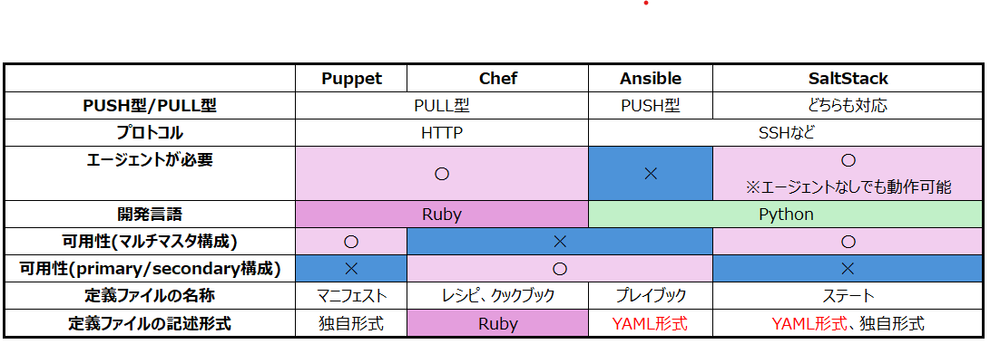

## 概要

CCNPの勉強をしていて、AnsibleやPuppet、Chefなどいろいろ出てくるんですが、  
表を見ても覚えにくいところがあったので、自分なりに分かるように整理してみました。  
※人によってはわかりにくいかもしれません

また、記事の後半では、これらのツールとよく並べて語られるTerraformとの違いも整理しています。

## 比較表

早速ですが、下記が比較表です。

## 所感

PupettとChefは仲間な気がします。  
開発言語がRubyで同じで使用するプロトコルがHTTPだったりやPULL型であるなど共通点が多いので  
  
Saltstackは万能なイメージです。  
  
※勉強用で覚えやすいようにまとめているので、私のグルーピングのイメージと実際では異なる可能性もあります

## Terraformとの違い：構成管理とプロビジョニング

Ansible、Puppet、Chef、SaltStackについて調べていると、一緒に名前が挙がることが多いのがTerraformです。どれも「インフラをコードで管理する（IaC：Infrastructure as Code）」ためのツールですが、得意としている領域が異なります。

### 構成管理ツールとプロビジョニングツール

大きく分けると、次の2種類になります。

-   **構成管理（Configuration Management）**：すでに存在するサーバーやネットワーク機器の「中身の設定」を、あるべき状態に揃えるツールです。Ansible、Puppet、Chef、SaltStackはこちらに分類されます。
-   **プロビジョニング（Provisioning）**：サーバーやネットワークといったインフラ「そのもの」を作成・変更・削除するツールです。Terraformはこちらに分類されます。

| 項目 | Ansible / Puppet / Chef / SaltStack | Terraform |
| --- | --- | --- |
| 主な役割 | 既存のサーバーや機器の設定を揃える | クラウドなどのインフラそのものを作る |
| 操作対象の例 | パッケージの導入、設定ファイル、ルータのコンフィグ | VPC、サブネット、EC2、S3バケット |
| 記述言語 | YAML（Ansible）、Ruby系のDSL（Puppet / Chef）など | HCL（HashiCorp Configuration Language） |
| 操作の方法 | SSHや、対象に導入したエージェント経由 | Providerを通じて各サービスのAPIを呼び出す |
| 状態の管理 | 対象のサーバーや機器の状態を確認して反映する | 管理しているリソースの状態をstateファイル（tfstate）に記録する |

ネットワークの作業にたとえると、Terraformは「ラックに機器を設置して配線する工事」、Ansibleなどの構成管理ツールは「設置済みの機器にコンフィグを投入する作業」に近いイメージです。

クラウドであれば、TerraformでVPCやEC2を作成し、EC2の中のOSやミドルウェアの設定をAnsibleで行う、という組み合わせがよく使われます。

なお、両者の境界は厳密ではありません。Ansibleにもクラウドのリソースを作成するモジュールがありますし、Terraformにもリソース作成時にコマンドを実行する仕組みがあります。とはいえ、まずは「構成管理が得意なツール」と「インフラを作るのが得意なツール」と覚えておくと、整理しやすくなります。

### Terraformの仕組みをもっと知りたい方へ

Terraformには、Ansibleなどにはない「stateファイル（tfstate）」という考え方があります。Terraformを使い始めると、Provider、tfstate、Backendといった用語でつまずきやすいです。

実際にAWS上でtfstate保存用のS3バケットを構築したコードを題材に、これらの役割を次の記事で整理しています。

[TerraformのS3 Backendとは？tfstate・Provider・initの役割を初心者向けに解説](/terraform-s3-backend-tfstate/)
