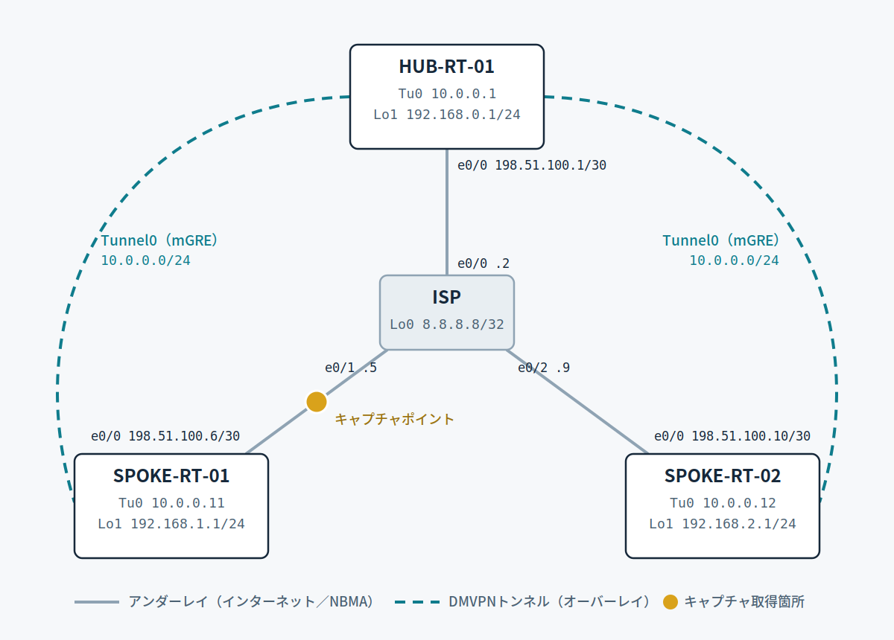
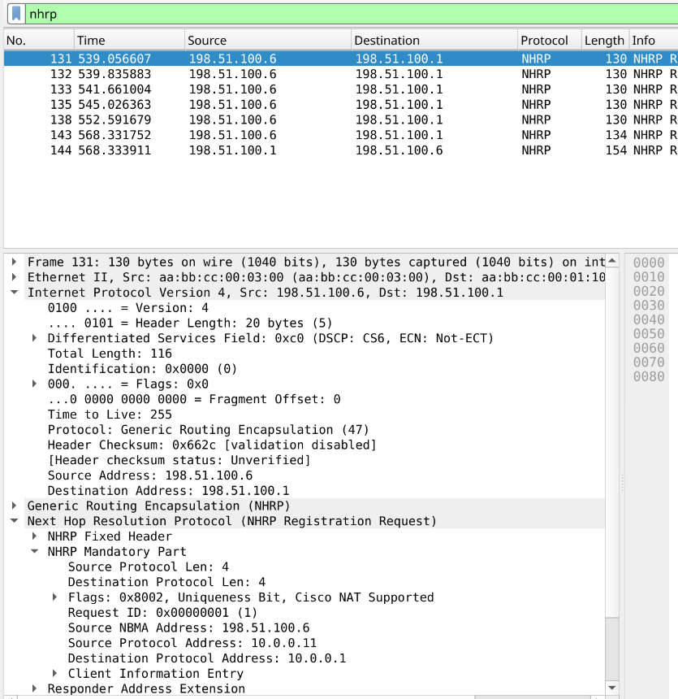
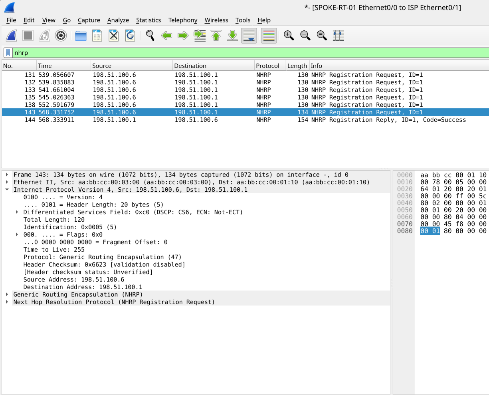
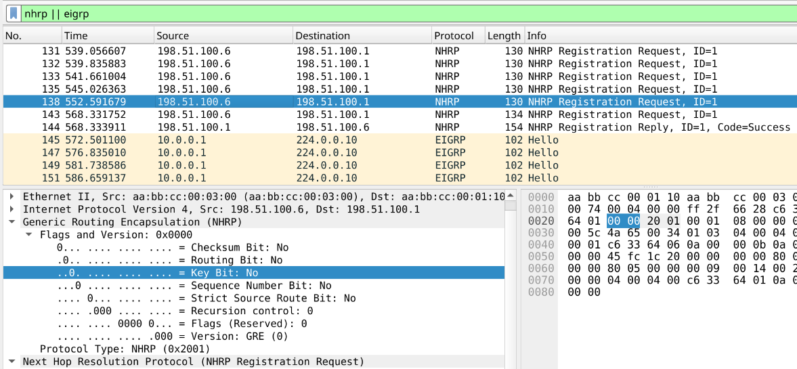
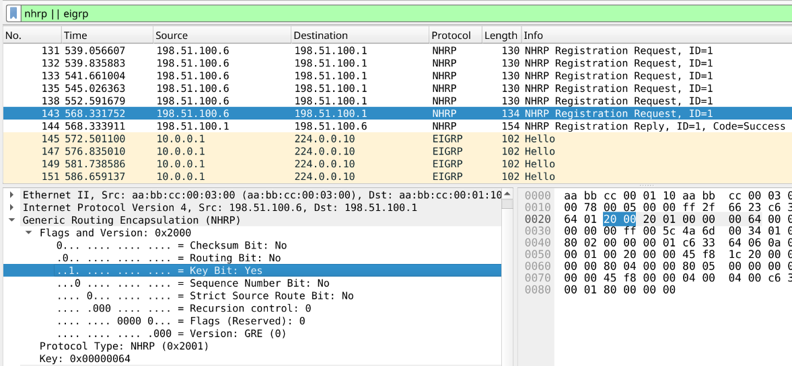
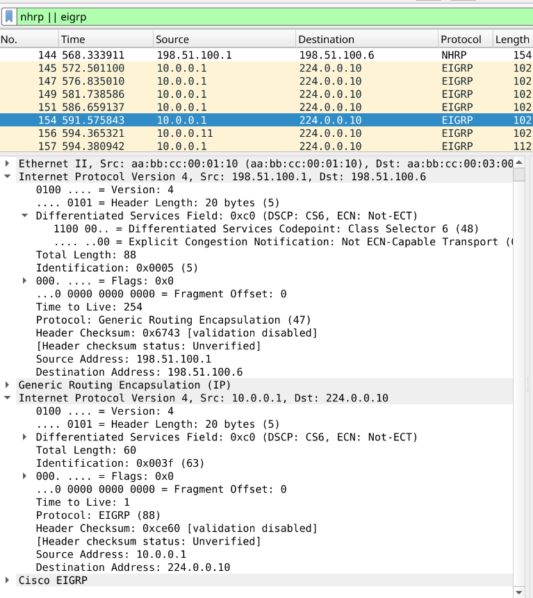

DMVPNは設定例こそたくさん見つかりますが、「実際にどんなパケットが流れて、ハブとスポークのトンネルが張られるのか」まで確認できる情報は多くありません。

この記事では、GNS3上のCiscoルータでDMVPN（Phase 1）を構築し、スポークとインターネット（ISP）の間でWiresharkを使ってパケットキャプチャを取得しました。NHRPの登録からEIGRPのHelloまで、トンネルが確立するまでの流れをパケット単位で解説します。

検証中にtunnel keyの設定を後回しにしてしまい、NHRP登録が失敗し続ける様子も偶然キャプチャできたので、あわせて紹介します。

## この記事でわかること

- DMVPNでスポークがハブに登録される仕組み（NHRP Registration）
- NHRPパケットのどこに何が書かれているか
- tunnel keyが一致しないとNHRP登録が失敗する理由
- GREでEIGRPのマルチキャストが運ばれる様子
- トンネル確立までの時系列と、各設定の役割

## DMVPNの基本をおさらい

DMVPN（Dynamic Multipoint VPN）は、ハブ1台の設定を変えずにスポークを追加でき、必要に応じてスポーク同士が直接通信できるVPNの仕組みです。主に次の3つの技術で構成されています。

| 技術                   | 役割                                                       |
| ---------------------- | ---------------------------------------------------------- |
| mGRE（multipoint GRE） | 1つのトンネルインターフェースで複数の相手とトンネルを張る  |
| NHRP                   | トンネルIPと実IP（NBMAアドレス）の対応を管理する「住所録」 |
| IPsec（任意）          | トンネルを暗号化する                                       |

ここで重要なのが「トンネルIP」と「NBMAアドレス」の2種類のアドレスです。トンネルIPはDMVPN網の中で使うアドレス、NBMAアドレスはインターネット側の実際のアドレスです。スポークは起動するとハブに「自分のトンネルIPの実体はこのNBMAアドレスです」と登録し、ハブはそれを住所録として保持します。この登録がNHRP Registrationです。

## 検証環境



_検証構成。キャプチャはSPOKE-RT-01とISP間のリンクで取得_

GNS3上にCisco IOLを4台立て、1台をインターネット役（ISP）、残りをハブ1台とスポーク2台にしています。アンダーレイのアドレスには文書用アドレス（198.51.100.0/24）を使っています。

| 機器        | インターフェース | アドレス               | 用途               |
| ----------- | ---------------- | ---------------------- | ------------------ |
| HUB-RT-01   | Ethernet0/0      | 198.51.100.1/30        | NBMA（実アドレス） |
| HUB-RT-01   | Tunnel0          | 10.0.0.1/24            | トンネル           |
| HUB-RT-01   | Loopback1        | 192.168.0.1/24         | 拠点LANの代わり    |
| SPOKE-RT-01 | Ethernet0/0      | 198.51.100.6/30        | NBMA               |
| SPOKE-RT-01 | Tunnel0          | 10.0.0.11/24           | トンネル           |
| SPOKE-RT-01 | Loopback1        | 192.168.1.1/24         | 拠点LANの代わり    |
| SPOKE-RT-02 | Ethernet0/0      | 198.51.100.10/30       | NBMA               |
| SPOKE-RT-02 | Tunnel0          | 10.0.0.12/24           | トンネル           |
| SPOKE-RT-02 | Loopback1        | 192.168.2.1/24         | 拠点LANの代わり    |
| ISP         | Ethernet0/0〜0/2 | 198.51.100.2 / .5 / .9 | 各拠点との接続     |

ISPはDMVPN網のアドレス（10.0.0.0/24や192.168.x.0/24）を一切知りません。各拠点はISPに向けたデフォルトルートだけを持ち、トンネルの中の通信はすべてGREに包まれて運ばれます。

キャプチャは、GNS3でSPOKE-RT-01とISPの間のリンクを右クリックし「Start capture」から取得しています。

## 設定（DMVPN Phase 1）

今回はPhase 1（スポーク間の通信もハブを経由する構成）で、ルーティングにはEIGRPを使っています。

### HUB-RT-01

```text
interface Tunnel0
 ip address 10.0.0.1 255.255.255.0
 no ip redirects
 ip mtu 1400
 ip tcp adjust-mss 1360
 ip nhrp network-id 1
 ip nhrp map multicast dynamic
 no ip split-horizon eigrp 100
 tunnel source Ethernet0/0
 tunnel mode gre multipoint
 tunnel key 100
!
router eigrp 100
 network 10.0.0.0 0.0.0.255
 network 192.168.0.0 0.0.0.255
```

### SPOKE-RT-01

```text
interface Tunnel0
 ip address 10.0.0.11 255.255.255.0
 no ip redirects
 ip mtu 1400
 ip tcp adjust-mss 1360
 ip nhrp network-id 1
 ip nhrp nhs 10.0.0.1 nbma 198.51.100.1 multicast
 tunnel source Ethernet0/0
 tunnel destination 198.51.100.1
 tunnel key 100
!
router eigrp 100
 network 10.0.0.0 0.0.0.255
 network 192.168.1.0 0.0.0.255
```

SPOKE-RT-02は、Tunnel0のアドレスを10.0.0.12、EIGRPのnetworkを192.168.2.0に読み替えて設定します。  
※GitHubの[リポジトリ](https://github.com/admon-lab/tech-lablog-labs/blob/main/dmvpn-phase1/configs/)にて各ルータの設定は公開しています。

主なコマンドの役割は次のとおりです。

| コマンド                                         | 設定する機器 | 役割                                                            |
| ------------------------------------------------ | ------------ | --------------------------------------------------------------- |
| ip nhrp map multicast dynamic                    | ハブ         | 登録してきたスポークにマルチキャストを複製して送る              |
| ip nhrp nhs 10.0.0.1 nbma 198.51.100.1 multicast | スポーク     | ハブ（NHS）の場所を指定し、マルチキャストもハブへ送る           |
| tunnel key 100                                   | 両方         | GREヘッダに識別用のKeyを付ける。両端で一致が必要                |
| no ip split-horizon eigrp 100                    | ハブ         | スポークから学んだ経路を、同じTunnel0から他のスポークへ広告する |

## キャプチャ①：NHRP Registration Request

まずはスポークからハブへの登録パケットです。Wiresharkの表示フィルタに `nhrp` と入力すると、NHRPのパケットだけが表示されます。



_NHRP Registration Requestの中身。スポークがトンネルIPとNBMAアドレスの対応を申告している_

NHRPの詳細は「Next Hop Resolution Protocol」の中の「NHRP Mandatory Part」を展開すると確認できます。主な項目は次のとおりです。

| 項目                         | 値           | 意味                                            |
| ---------------------------- | ------------ | ----------------------------------------------- |
| Source NBMA Address          | 198.51.100.6 | スポークの実アドレス                            |
| Source Protocol Address      | 10.0.0.11    | スポークのトンネルIP                            |
| Destination Protocol Address | 10.0.0.1     | 登録先（ハブ）のトンネルIP                      |
| Request ID                   | 1            | 要求の識別番号。Replyと対応づけるために使う     |
| Flags                        | 0x8002       | Uniqueness BitとCisco NAT Supportedが立っている |

つまりこのパケットは、「10.0.0.11の実体は198.51.100.6です」とハブに申告しているものです。ハブはこの情報を受け取ることで、トンネルIP宛てのパケットをどのNBMAアドレスに送ればよいかを知ります。

Flagsに立っているUniqueness Bitは、「この対応関係を固定してほしい」という意味です。この登録が有効な間は、同じトンネルIPを別のNBMAアドレスから登録し直そうとしても受け付けられません。スポークの実アドレスがDHCPなどで変わる環境では、再登録がすぐに通らない原因になるので覚えておくと役立ちます。

また、外側のIPヘッダを見ると、送信元が198.51.100.6、宛先が198.51.100.1になっています。ISPが見ているのはこの外側のアドレスだけで、トンネルIPはNHRPの中身として運ばれているだけです。

## キャプチャ②：tunnel keyを忘れるとNHRP登録が通らない

今回、SPOKE-RT-01では `tunnel destination` を設定してから `tunnel key` を設定するまでに少し時間が空きました。その間のパケットがこちらです。



_Keyなしの登録（130バイト）は応答がなく、Keyを付けた134バイトの登録で即座に成功している_

同じRequest ID=1の登録要求が6回送られ、ハブからの応答（Registration Reply）は最後の1回に対してだけ返っています。

| No. | 時刻（秒） | 前回からの間隔 | サイズ    | 結果                          |
| --- | ---------- | -------------- | --------- | ----------------------------- |
| 131 | 539.06     | —              | 130バイト | 応答なし                      |
| 132 | 539.84     | 約0.8秒        | 130バイト | 応答なし                      |
| 133 | 541.66     | 約1.8秒        | 130バイト | 応答なし                      |
| 135 | 545.03     | 約3.4秒        | 130バイト | 応答なし                      |
| 138 | 552.59     | 約7.6秒        | 130バイト | 応答なし                      |
| 143 | 568.33     | 約15.7秒       | 134バイト | 約2ミリ秒後にReply（Success） |

注目したいのは次の2点です。

### 再送の間隔が伸びていく

応答がないあいだ、再送の間隔はおよそ倍々に伸びていました。ハブが応答しない状態で登録要求を送り続けないよう、間隔を広げながら再送していることがわかります。

### 成功したパケットだけ4バイト大きい

応答のなかった登録は130バイト、成功した登録は134バイトでした。この4バイトの差がGREヘッダのKeyフィールドです。GREヘッダを展開すると、Keyを設定する前のパケットにはKeyの項目がなく、設定後のパケットにはKey Bitが立ってKeyの値（100）が入っています。



_tunnel key設定前のGREヘッダ。_



_tunnel key設定後のGREヘッダ。Keyフィールドの4バイトがパケットサイズの差になっている_

ハブは `tunnel key 100` を設定しているため、Keyが付いていない（または値が違う）GREパケットは自分のトンネル宛てとして扱いません。そのため、Keyなしの登録要求はハブに届いていても処理されず、応答も返りませんでした。スポークに `tunnel key 100` を設定した直後の登録は、わずか2ミリ秒で成功しています。

tunnel keyの不一致はエラーメッセージが目立たないため、実機では「なぜか登録されない」という症状として現れます。`show dmvpn` でスポークの状態が上がらないときは、tunnel keyが両端で一致しているかを最初に確認するとよいです。

## キャプチャ③：GREで運ばれるEIGRPのHello

NHRP登録が成功すると、EIGRPのパケットが流れ始めます。Wiresharkの表示フィルタを `nhrp || eigrp` にすると、登録からEIGRPまでを続けて確認できます。



_EIGRP Helloは外側IP・GRE・内側IPの三層構造で運ばれる_

このパケットには、IPヘッダが2つあります。

| 層     | 送信元 → 宛先               | ポイント                            |
| ------ | --------------------------- | ----------------------------------- |
| 外側IP | 198.51.100.1 → 198.51.100.6 | ISPが転送するユニキャスト。TTLは254 |
| GRE    | —                           | Protocol TypeはIPv4。Key 100付き    |
| 内側IP | 10.0.0.1 → 224.0.0.10       | EIGRPのマルチキャスト。TTLは1       |

### マルチキャストがユニキャストに包まれている

EIGRPのHelloは本来、マルチキャストアドレス224.0.0.10宛てに送られます。しかしインターネットはマルチキャストを転送できません。そこでDMVPNでは、マルチキャストのパケットをGREで包み、宛先を各スポークのNBMAアドレスにしたユニキャストとして送っています。

ハブがどのスポークに送ればよいかを判断しているのが `ip nhrp map multicast dynamic` です。NHRPで登録してきたスポークに対して、マルチキャストを1台ずつ複製して送ります。

### 外側TTLは254、内側TTLは1

外側のTTLは254で、ハブが送り出してからISPを1ホップ通過した分だけ減っています。一方、内側のTTLは1のままです。内側のパケットはGREに包まれているため、ISPのルーティングでは処理されません。物理的には何ホップ離れていても、トンネルの中ではハブとスポークが「直結の隣接ルータ」として見えるのはこのためです。

### DSCPは外側にも引き継がれる

内側のEIGRPパケットのDSCPはCS6（ルーティングなどの制御用）で、外側のIPヘッダも同じCS6になっていました。カプセル化の際に内側のToS値が外側にコピーされているため、ISP区間でも優先度の情報を引き継ぐことができます。

## 時系列で振り返る

キャプチャのタイムスタンプを並べると、設定作業の順番がそのままパケットの流れに表れています。

| 時刻（秒） | できごと                                                 |
| ---------- | -------------------------------------------------------- |
| 539〜552   | Keyなしの登録要求を5回送信。ハブは処理しない             |
| 568.33     | Keyありの登録要求を送信し、約2ミリ秒後にReply（Success） |
| 572.50     | ハブからのEIGRP Helloがこのリンクに届き始める            |
| 594.36     | SPOKE-RT-01でEIGRPを設定し、最初のHelloを送信            |
| 594.38     | ハブがすぐに応答し、ネイバー確立の手順へ進む             |

ここで注目したいのは、ハブからのHelloが届き始めたのがNHRP登録の成功後だという点です。ハブは登録を受けて初めて「このスポークにマルチキャストを送ればよい」と判断できるため、登録が済むまではスポークにHelloを送れません。

つまり、DMVPNでEIGRPのネイバーが上がらないときは、ルーティングプロトコルの設定より先に、NHRP登録とマルチキャストの設定を疑う必要があります。

## トラブルシューティングで見るポイント

今回の検証から、DMVPNのトンネルが確立しないときは次の順番で確認するとよいと考えています。

```text
! 1. ハブにスポークが登録されているか
show dmvpn
show ip nhrp

! 2. スポークからハブ（NHS）への登録状態
show ip nhrp nhs detail

! 3. トンネルの設定（tunnel key、tunnel source/destination）
show interfaces Tunnel0
show running-config interface Tunnel0

! 4. EIGRPのネイバー
show ip eigrp neighbors

! 5. NHRPのやり取りを直接確認
debug nhrp packet
```

| 症状                                              | まず疑う設定                                                 |
| ------------------------------------------------- | ------------------------------------------------------------ |
| show dmvpnでスポークが上がらない                  | tunnel keyの不一致、nhsやnbmaアドレスの誤り                  |
| NHRP登録は成功しているがEIGRPネイバーが上がらない | ハブのip nhrp map multicast dynamic、スポークのmulticast指定 |
| スポークが他のスポークのLANを学習しない           | ハブのno ip split-horizon eigrp 100                          |

debugを使った後は、`undebug all` で必ず停止しておきましょう。

## まとめ

- スポークはNHRP Registrationで「トンネルIPとNBMAアドレスの対応」をハブに登録する
- tunnel keyが一致しないと、登録要求がハブに届いても処理されず、再送が続く
- EIGRPのマルチキャストは、GREに包まれたユニキャストとして運ばれる
- ハブはNHRP登録を受けてから、そのスポークにマルチキャストを送り始める

設定例を読むだけでは見えにくい部分も、パケットで確認するとコマンド1行1行の意味がはっきりします。

次回は、スポーク同士が直接通信するPhase 2・Phase 3で、NHRPの名前解決（Resolution）やリダイレクトがどう流れるのかをキャプチャで確認する予定です。
