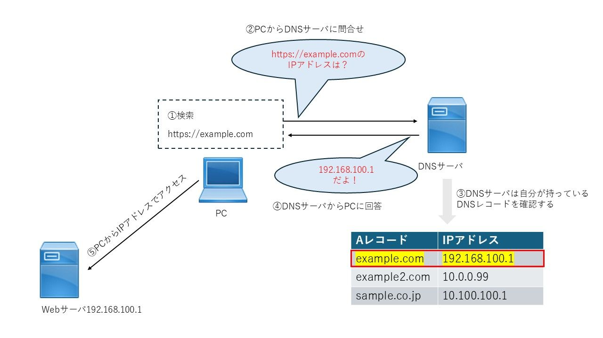

## 概要

DNSの仕組みやDNSレコードの種類と役割について、まとめております。

## DNSとは

DNS (Domain Name System)とは、　**人間が覚えやすいドメイン名をコンピュータが理解できるIPアドレスに自動的に変換**（対応付けしてくれる）する仕組みです。

DNSがあるおかげで、私たちは覚えづらいIPアドレスではなくドメイン名（URLやメールアドレス）を入力することで、WEBアクセスをしたり、メールの送信ができるようになります。

もしDNSが存在しなければ、ヤフーのサイトへアクセスするときに、「https://www.yahoo.co.jp/」と入力するのではなく、  
「https://192.168.10.1/」のようにIPアドレスを指定して検索することになってしまいます。

**DNSは現代のインターネット技術を支える重要な仕組み**なのです。

DNSでは、DNSサーバがDNSレコードを使用してIPアドレスとドメイン名の紐づけを行っています。

### DNSによるアドレス解決の仕組み（図解）



DNSによるアドレス解決は上の図のような流れで行われています。

流れとしては・・・  
①PCのWebブラウザ（chromeとかSafariなど）でドメイン名を入力し検索  
②PCからDNSサーバに対して問合せ（このドメイン名のIPアドレスを教えて！）  
③DNSサーバは自分が持っているデータ（DNSレコード）を確認  
④③で見つけたIPアドレスをPCに回答  
⑤PCはDNSサーバから教えてもらったIPアドレス宛てに通信

## DNSレコードとは

DNSレコードとは、ドメイン名に紐づけられたIPアドレスなど関連する情報を記録したデータです。  
DNSレコードには種類があり、それぞれさまざまな情報を持っています。

### DNSレコードの種類と役割

DNSレコードには様々な種類のものがあります。  
それぞれ、名称を役割をまとめていきます。

#### Aレコード

Aレコード (Address Record)は、ドメイン名をIPv4アドレスに紐づける役割を持っています。  
【ドメイン名】 IN A 【IPアドレス】　のように記載します。

例えば、上の図にあるAレコードは下記のようになっています。

```text
example.com.  IN  A  192.168.100.1
```

#### AAAAレコード

AAAAレコード (Quad A Record)は、ドメイン名をIPv6アドレスに紐づける役割を持っています。

※※補足※※  
Aレコードは、ドメイン名を 32ビットのIPv4アドレス に対応付けるためのレコードです。  
IPv6アドレスは 128ビット（＝32ビットの4倍） で構成されているため、それに対応するレコードは Aを4つ重ねた「AAAAレコード（Quad A record）」 として定義されています。

AAAAレコードは、  
【ドメイン名】 IN AAAA 【IPアドレス】　のように記載します。(以下例)

```text
example.com.   IN   AAAA   2001:db8::1234
```

#### CNAMEレコード

CNAMEレコード (Canonical Name record（カノニカルネームレコード）)はドメイン名を別のドメイン名（エイリアス）に紐づける役割を持っています。

CNAMEレコードは、「この名前はあの名前の別名だよ～」と教えてあげる仕組みです。  
そのため、最終的にはAレコードやAAAAレコードでIPアドレスに解決されます。

そんなCNAMEレコードは、  
【ドメイン名（エイリアス(別名)）】 IN CNAME 【正規のドメイン名】のように記載します（以下例）

```text
www.example.com.   IN   CNAME   example.com.
```

## おわりに

基本的なDNSの仕組みやDNSレコードの種類については以上です。  
実はDNSレコードにはもっと種類がありますので、気が向いたら追記していきます。

また、AWSのRoute53というサービスを使用してドメインを取得する方法も以下リンク先の記事にまとめております。  
よろしければぜひご覧ください。  
[AWS Route 53でドメインを簡単に取得する方法](/aws-route53-get-domain/)
