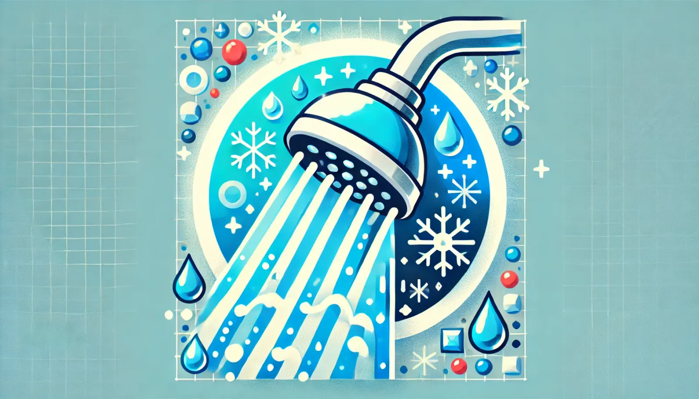

こんにちは、yuttyです。今回は**「コールドシャワーを半年続けたらどうなるのか？」**について、実体験をもとにお話しします。

最近、**コールドシャワーが健康やメンタルに良い**と話題になっていますが、「本当に効果があるのか？」「冬でも続けられるのか？」と気になる方も多いはず。

**実際に半年間、毎朝コールドシャワーを浴び続けた結果、体やメンタルにどんな変化があったのか？ メリット・デメリットを含め、正直な感想をまとめました。**

これから始めようと考えている方の参考になれば幸いです！

### コールドシャワーを始めたきっかけ

きっかけはYouTubeで見た動画でした。

**「コールドシャワーを習慣化すると、ストレス耐性が向上し、メンタルが強くなる」**  
こんな話を聞いて興味を持ち、「これは試してみる価値がありそう」と思い立ったのが始まりです。

ただ、最初の印象としては 「絶対にきついけど、効果はありそう」 という半信半疑な気持ちでした。

### コールドシャワーのメリット

実際に半年続けてみて、感じたメリットを紹介します。

####   
**1\. 朝の目覚めが圧倒的に良くなる**

冷水を浴びると、一瞬で眠気が吹き飛びます。交感神経が刺激されるので、「寝起きのぼんやり感」 がなくなり、スッキリした状態で1日をスタートできます。

#### **2\. ストレス耐性が上がり、メンタルが強くなる**

コールドシャワーは、言わば「毎朝のプチ修行」。最初は辛くても、続けることで「嫌なことにも耐えられる精神力」が鍛えられると感じました。  
  
また、**仕事でのプレッシャーやストレスに対しても、以前より冷静に対応できるように**なりました。

#### **3\. 風邪をひきにくくなる（免疫力アップ？）**

去年は1年で3回ほど高熱を出しましたが、今年はたった1回しか風邪をひいていません。寒冷刺激によって血流が良くなり、免疫力が高まったのかもしれません。

#### **4\. 疲れにくくなり、1日中エネルギッシュに動ける**

コールドシャワーを始めてから、以前より疲れを感じにくくなりました。おそらく血流が良くなった影響だと思いますが、「仕事中の集中力が続きやすくなった」のも大きな変化です。

#### **5\. 体がポカポカする（代謝アップ？）**

意外かもしれませんが、コールドシャワーを浴びた後はむしろ体がポカポカします。これは、体が体温を上げようとエネルギーを使うためと言われています。  
  
代謝が上がることで、冷え性の改善やダイエット効果も期待できるかもしれません。

### コールドシャワーの注意点（デメリット）

もちろん、良いことばかりではなく、注意点もあります。

#### **1\. 最初の1～2週間は本当に辛い**

最初の1週間は、正直 「これは続けられないかも…」 と思うレベルで辛かったです。  
  
ただ、3週間ほど経つと慣れてきて、「浴びないと逆に違和感がある」 という感覚になりました。最初のハードルさえ乗り越えられれば、継続は意外と難しくないです。

#### **2\. 冬は本当に厳しい**

12月頃から、朝シャワーを浴びるのがかなりキツくなりました。夏の時期は問題ありませんでしたが、冬は「浴びるまでの精神的なハードルが高い」のが正直な感想です。  
  
これから始めるなら、春や夏にスタートすると継続しやすいと思います。

#### **3\. 体調が悪いときは無理をしない**

寒冷刺激は体に大きな影響を与えるため、体調が悪いときや風邪気味のときは無理をしないのが大切です。  
  
私も、風邪をひきかけたときは無理せずぬるま湯シャワーに切り替えていました。

#### **4\. 心臓や血圧に不安がある人は注意**

冷水の刺激で血管が急に収縮するため、**高血圧や心臓に持病がある人には負担がかかる可能性** があります。

持病がある方は、医師に相談してから試したほうが安心です。

### 半年続けた感想と今後

半年間コールドシャワーを続けたことで、「メンタルの強化」「目覚めの改善」「疲れにくさ」 など、多くのメリットを実感できました。  
  
特に、「冬でも続けられた」という達成感があり、習慣化することで自信にもつながりました。  
  
これからも継続する予定ですが、正直、春が待ち遠しい ですね（笑）。  
  
これから始める人へのアドバイス  
  
✔ 最初の数週間は大変だが、続けると慣れる  
✔ 効果は実感できるので、ぜひ試してほしい  
✔ 冬は特に厳しいので、暖かい時期に始めるのがおすすめ  
✔ 体調が悪いときは無理をしない  
  
コールドシャワーは一見過酷な習慣ですが、続けることで確かなメリットがあります。興味のある方は、ぜひチャレンジしてみてください！
