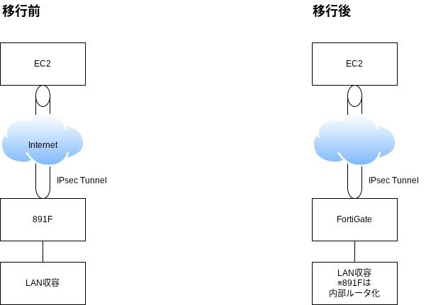

自宅からAWS上の strongSwan と張っていたIPsec VPNを、Cisco C891FJからFortiGateに移し替えました。  
設定はほぼそのまま移植したつもりだったのですが、トンネルが上がらない。

原因はサブネットマスクの 1 ビット差でした。結論だけ見れば些細なミスですが、  
そこに辿り着くまでの切り分けがIPsecの理解を深める良い教材になったので、なぜそうなるのかを含めて残しておきます。

「コマンドだけ知りたい」という方は最後の「まとめ」まで飛ばしてください。  
この記事の主眼は、IPsecがどういう仕組みで動いていて、症状からどう原因を絞り込むかの部分にあります。

なお、記事中の対向グローバル IP は 203.0.113.43（ドキュメント用アドレス）に置き換えています。  
事前共有鍵、管理者パスワード、SPI、セッション鍵の類はすべて伏せています。

# 今回の構成



移行前はCisco C891FJがIPsec VPNを終端していました。

これをFortiGateに置き換えます。対向のEC2側は変更しません。  
891F側のIPsec設定は以下のようになっていました。関係する部分だけ抜粋します。

```text
crypto ikev2 proposal IKEV2-PROP
 encryption aes-cbc-256
 integrity sha256
 group 14
!
crypto ipsec transform-set ESP-AES256-SHA esp-aes esp-sha256-hmac
 mode tunnel
!
crypto map IPSEC-MAP 10 ipsec-isakmp
 set peer 203.0.113.43
 set transform-set ESP-AES256-SHA
 set ikev2-profile IKEV2-PROFILE
 match address IPSEC-ACL
!
ip access-list extended IPSEC-ACL
 permit ip 172.16.10.0 0.0.0.31 10.0.0.0 0.0.255.255
 permit ip 172.16.10.0 0.0.0.31 172.16.255.0 0.0.0.3
 permit ip 172.16.10.0 0.0.0.31 192.168.250.0 0.0.0.255
!
interface GigabitEthernet8
 crypto map IPSEC-MAP
```

上記のアクセスリスト（IPSEC-ACL）の 0.0.0.31 が今回の記事の主役です。 頭の片隅に置いておいてください。

# 前提知識：IPsec は何をしているのか

切り分けの話に入る前に、IPsecの構造を整理します。ここが分かっていないと、後半のログが読めません。

## なぜ 2 段階に分かれているのか

IPsec のトンネル確立は 2 段階に分かれています。  
IKEv1 では Phase1 / Phase2、IKEv2 では IKE\_SA と Child SA と呼ばれますが、  
FortiGate は設定コマンドで phase1-interface / phase2-interface という名前を使い続けているので、  
実務では呼び方が混在しています。

なぜ分かれているのか。理由は 4 つあります。

### **理由 1：鍵交換そのものを暗号化したいから**

通信を暗号化するには、両者が同じ鍵を持つ必要があります。  
しかし鍵を送るには、その通信自体が保護されていないといけない。「鍵を渡すための鍵がない」という循環が発生します。

そこで第 1 段階では、鍵を送らずに鍵を作る手法（Diffie-Hellman 鍵交換）を使います。  
互いに公開値を送り合うだけで、盗聴者には計算できない共通鍵が両者の手元にできる仕組みです。  
設定にあった group 14（MODP2048）がこれにあたります。

第 1 段階が終わると暗号路ができるので、第 2 段階からは中身を暗号化して送れます。  
だから認証情報（事前共有鍵）も、「どの範囲を暗号化するか」という設定情報も、第 2 段階に置かれています。  
第 1 段階に置いたら平文で流れてしまうからです。

### **理由 2：役割が根本的に違う**

<table><tbody><tr><td></td><td>第 1 段階（IKE SA）</td><td>第 2 段階（Child SA）</td></tr><tr><td>目的</td><td>交渉するための安全な通話路を作る</td><td>実データを運ぶトンネルを作る</td></tr><tr><td>運ぶもの</td><td>制御メッセージのみ</td><td>ユーザの通信</td></tr><tr><td>寿命</td><td>長い<br>（今回 86400 秒 = 24 時間）</td><td>短い<br>（今回 3600 秒 = 1 時間）</td></tr><tr><td>本数</td><td>1 本</td><td>複数持てる</td></tr></tbody></table>

電話で例えると、第 1 段階が「電話をかけて相手を確認し、暗号で話す取り決めをする」、  
第 2 段階が「その電話で実際の用件を話す」に近いと思います。

### **理由 3：鍵を定期的に作り直すため**

暗号鍵は長く使うほど解読リスクが上がるので、定期的に作り直す必要があります。  
このとき、第 2 段階の鍵だけを更新できると効率的です。  
既にある安全な通話路を使って「新しいデータ用の鍵にしよう」と交渉すれば済み、毎回ゼロから DH 鍵交換をやり直す必要がありません。  
DH は計算コストが高いので、この差は大きいです。

### **理由 4：1 本の通話路で複数のトンネルを張れる**

今回、FortiGate 側には Phase2 が 3 本定義されていました。

```text
P2-AWS-10.0     : 172.16.10.0/24 ⇔ 10.0.0.0/16
P2-AWS-172.16.20  : 172.16.20.0/24  ⇔ 10.0.0.0/16
P2-AWS-172.16.30 : 172.16.30.0/24 ⇔ 10.0.0.0/16
```

これらは全部 set phase1name "VPN-AWS" を参照しています。  
1 つの第 1 段階の上に、3 つの第 2 段階がぶら下がる構造です。  
分離しているおかげで、認証は 1 回で済み、あとはセレクタごとに子トンネルを追加するだけで済みます。

## UDP 500 と 4500 は何をしているのか

sniffer のログを読むために必要な知識です。

### **UDP 500 は交渉用の窓口**

IKE（鍵交換や認証の会話）は UDP 500 番ポートを使うと決められています。  
IPsec を張る装置は必ずここで待ち受けています。

### **実データはポートを持たない**

ここが混乱の元です。交渉が終わった後、実際の暗号化データは ESP（プロトコル番号 50） で運ばれます。  
ESP は TCP や UDP と同じ階層のプロトコルで、ポート番号という概念がありません。

IP ヘッダには「プロトコル番号」というフィールドがあり、6 なら TCP、17 なら UDP、50 なら ESP です。  
TCP や UDP はその中にポート番号を持ちますが、ESP は持ちません。

### **NAT があると ESP が通れない**

NAT は複数の端末を 1 つのグローバル IP に集約する仕組みです。  
戻ってきたパケットをどの端末に返すか判断するために、ポート番号を使い分けます。

```text
192.168.1.10:12345  →  203.0.113.1:50001
192.168.1.11:12345  →  203.0.113.1:50002
```

ところが ESP にはポートがありません。  
NAT 装置は区別する手がかりを持てず、複数台が同時に IPsec を張ると戻り先を判断できません。結果としてパケットが落ちます。

### **そこで UDP 4500 でくるむ**

この問題を回避するのが NAT-T（NAT Traversal） です。  
ESP パケットを UDP 4500 のパケットで包んで送ります。

```text
[IP][UDP 4500][ESP][暗号化データ]
```

UDP になったのでポート番号を持ち、NAT を問題なく通過できます。  
受信側は UDP の殻を剥がして中の ESP を処理します。

<table><tbody><tr><td>ポート / プロトコル</td><td>用途</td><td>NAT 配下</td></tr><tr><td>UDP 500</td><td>IKE（交渉）</td><td>常に使う</td></tr><tr><td>ESP（プロトコル 50）</td><td>実データ</td><td>通れない</td></tr><tr><td>UDP 4500</td><td>IKE + ESP のカプセル化</td><td>これを使う</td></tr></tbody></table>

今回の FortiGate は WAN 側が 100.64.XX.XX、つまり CGNAT（キャリアグレード NAT）配下でした。当然 NAT-T が使われます。  
891F の設定に crypto isakmp nat keepalive 30 があったのも、NAT の変換テーブルが消えないよう定期的にパケットを送るためで、同じ事情によるものです。

実務上の注意として、NAT 配下から IPsec を張るときは UDP 500 と 4500 の両方を開ける必要があります。ESP を許可しても NAT 配下では使われませんし、UDP 500 だけ開けて 4500 を塞ぐと、交渉は始まるのにデータが流れないという症状になります。

### トラフィックセレクタとは何か

今回の原因そのものです。

IPsec は「トンネルを作る技術」ですが、作っただけでは何も通りません。どの通信をそのトンネルに入れるかを決める必要があります。

例えば FortiGate が 172.16.10.5 → 10.0.5.20 宛のパケットを受け取ったとき、これを暗号化してトンネルに入れるのか、そのまま普通にインターネットへ出すのか、判断が要ります。この判断基準がトラフィックセレクタ（TS）です。

設定方法（書き方）は装置によって違いますが、同じものを違う表現で書いているだけです。

<table><tbody><tr><td>装置</td><td>設定方法</td></tr><tr><td>Cisco</td><td>crypto ACL（<code>match address</code> で crypto map に紐付け）</td></tr><tr><td>FortiGate</td><td>Phase2 の <code>src-subnet</code> / <code>dst-subnet</code></td></tr><tr><td>strongSwan</td><td><code>leftsubnet</code> / <code>rightsubnet</code></td></tr></tbody></table>

そして重要なのが、**この基準は両端で一致していなければならない**という点です。

片方が「172.16.10.0/27 からの通信だけ暗号化する」と思っていて、もう片方が「172.16.10.0/24 全部」と思っていたら、範囲の外にあるパケットの扱いが食い違います。送信側は暗号化して送ったのに、受信側は「その範囲は契約外」として捨てる、という事態になります。

だから IKE\_AUTH の中で「私はこの範囲を暗号化したい」と提案し、相手が「いいよ」と答える手続きが必要です。合意できなければ TS\_UNACCEPTABLE で拒否されます。

### **では TS は必ず絞る必要があるのか。**

答えは「TS の交換は必須だが、範囲を絞る必要はない」です。0.0.0.0/0 ⇔ 0.0.0.0/0 と提案すれば「全部 OK」という合意になります。これがルートベース VPN の考え方で、暗号化範囲を広く取っておいて、実際に何を通すかはルーティングテーブルとファイアウォールポリシーで制御します。

AWS のマネージド Site-to-Site VPN（VGW / TGW）はこの方式がデフォルトです。ところが今回の対向は EC2 上の strongSwan で、leftsubnet / rightsubnet が具体的なネットワークで書かれていました。だから厳密な一致が要求されたわけです。

同じ「AWS への VPN」でも、マネージドサービスか自前の strongSwan かで挙動が変わる。ここは移行時に意識しておくべきポイントです。

# 移行手順：891F から IPsec を切り離す

FortiGate 側の設定投入が終わったら、891F 側を止めます。

ポイントは、いきなり設定を消さないことです。crypto map をインターフェイスから外すだけで IPsec は動作を停止します。設定本体（proposal、policy、keyring、profile、transform-set、ACL）はそのまま残しておけば、切り戻しが 1 コマンドで済みます。

```text
Host#conf t
Host(config)#interface GigabitEthernet8
Host(config-if)# no crypto map IPSEC-MAP
end

Host#clear crypto session
Host##clear crypto ikev2 sa
```

古い SA が残っていると対向側の Phase1 が通らないことがあるので、明示的にクリアしておきます。

確認は 3 つのコマンドで行います。

```text
Host#show crypto session
Host#show crypto ikev2 sa
Host#show crypto ipsec sa | include peer|pkts
```

3 つとも出力が空なら、891F は対向と一切ネゴシエートしない状態です。crypto map の定義自体は show crypto map に残って見えますが、末尾の Interfaces using crypto map IPSEC-MAP: の下が空欄であれば、どのインターフェイスにも適用されていません。

切り戻したい場合はこれだけです。

```text
Host#conf t
Host(config)#interface GigabitEthernet8
Host(config-if)# crypto map IPSEC-MAP
end
```

# この状態での注意点

crypto map を外すと、891F は対向宛のパケットを暗号化せずにデフォルトルートへ転送します。新しい終端装置がまだ上がっていない状態で該当セグメントの通信が発生すると、その分は平文でインターネット側に出ます。

検証中は該当セグメントの通信を止めるか、対向宛のスタティックルートを新終端に向けてから試験するのが安全です。

# トンネルが上がらない — 切り分けの流れ

FortiGate 側に切り替えたところ、トンネルが上がりませんでした。ここからが本題です。

## 段階 1：状態を確認する

```text
FortiGate # diagnose vpn ike gateway list

FortiGate # get vpn ipsec tunnel summary
'VPN-AWS' 203.0.113.43:0  selectors(total,up): 3/0  rx(pkt,err): 0/0  tx(pkt,err): 0/0
```

diagnose vpn ike gateway list が完全に空です。一方 get vpn ipsec tunnel summary には表示されている。

この 2 つのコマンドの違いを理解するのが、最初の手がかりになります。

<table><tbody><tr><td>コマンド</td><td>見えるもの</td></tr><tr><td>diagnose vpn ike gateway list</td><td>Phase1 の SA（生きている接続）</td></tr><tr><td>diagnose vpn tunnel list</td><td>Phase2 の SA、セレクタごとの状態、鍵、パケット数</td></tr><tr><td>get vpn ipsec tunnel summary</td><td>設定ベースの一覧と up 数</td></tr></tbody></table>

gateway list は「gateway」という名前が紛らわしいのですが、設定として定義したゲートウェイの一覧ではありません。実際に確立している、あるいは確立処理中のセッションを表示します。

つまりこの時点で分かるのは、「設定は存在するが、Phase1 のセッションが 1 つも生きていない」という状態です。

selectors(total,up): 3/0 は、Phase2 のセレクタが 3 本定義されていて、どれも up していないという意味です。

## 段階 2：設定の妥当性を見る

```text
FortiGate # show vpn ipsec phase1-interface
config vpn ipsec phase1-interface
    edit "VPN-AWS"
        set interface "wan1"
        set ike-version 2
        set peertype any
        set proposal aes256-sha256
        set localid-type address
        set dpd on-idle
        set npu-offload disable
        set dhgrp 14
        set remote-gw 203.0.113.43
        set psksecret ENC <REDACTED>
        set dpd-retryinterval 30
    next
end
```

interface は wan1、remote-gw も正しい、proposal（aes256-sha256）と dhgrp（14）も 891F 側と一致しています。設定不備ではなさそうです。

Phase2 も確認します。

```text
FortiGate # show vpn ipsec phase2-interface
config vpn ipsec phase2-interface
    edit "P2-AWS-10.0"
        set phase1name "VPN-AWS"
        set proposal aes256-sha256
        set pfs disable
        set auto-negotiate enable
        set keylifeseconds 3600
        set src-subnet 172.16.10.0 255.255.255.0
        set dst-subnet 10.0.0.0 255.255.0.0
    next
    ...
end
```

auto-negotiate enable が入っているので、トラフィックがなくても FortiGate 側から自動でネゴシエーションを開始するはずです。それでも gateway list が空、というのが不可解でした。

## 段階 3：土台を疑う

設定が正しいなら、その下のレイヤを確認します。

```text
FortiGate # get system interface physical | grep -A5 wan1
	==[wan1]
		mode: dhcp
		ip: 100.64.XX.XX 255.255.252.0
		status: up
		speed: 1000Mbps (Duplex: full)
```

wan1 は up で IP も取得済み。次に経路です。

```text
FortiGate # get router info routing-table all
S*      0.0.0.0/0 [5/0] via 100.64.XX.XX, wan1
C       172.16.20.0/24 is directly connected, vlan.0720
S       172.16.10.0/27 [10/0] via 172.16.99.253, vlan.100
C       172.16.10.224/27 is directly connected, vlan.100
S       172.16.30.0/24 [10/0] via 172.16.99.253, vlan.100
C       100.64.0.0/22 is directly connected, wan1
...
```

デフォルトルートも入っています。対向への経路は問題ありません。

ここで状況が整理されます。「設定も経路も正しいのに Phase1 の SA が生成されない」。ここから先は推測ではなく、パケットを直接見るしかありません。

## 段階 4：パケットレベルで確認する

```text
FortiGate # diagnose sniffer packet any 'host 203.0.113.43' 4 0 a
```

これが決定打でした。

```text
05:11:26.529161 wan1 out 100.64.XX.XX.500 -> 203.0.113.43.500: udp 432
05:11:26.535597 wan1 in  203.0.113.43.500 -> 100.64.XX.XX.500: udp 473
05:11:26.536662 wan1 out 100.64.XX.XX.4500 -> 203.0.113.43.4500: udp 244
05:11:26.543038 wan1 in  203.0.113.43.4500 -> 100.64.XX.XX.4500: udp 132
05:11:27.269514 wan1 out 100.64.XX.XX.500 -> 203.0.113.43.500: udp 432
05:11:27.276204 wan1 in  203.0.113.43.500 -> 100.64.XX.XX.500: udp 473
（以降 0.7 秒周期で繰り返し）
```

前提知識のパートを読んだ後なら、この 4 行から多くのことが読み取れます。

**UDP 500 で往復している** → 第 1 段階（IKE\_SA\_INIT）は成立しています。暗号方式や DH グループが合わないなら、ここで応答は返りません。

**UDP 4500 に切り替わっている** → NAT-T が検出され、以降の通信が 4500 番に移動しました。CGNAT 配下なので当然の動作です。

**4500 での応答が 132 バイトと短い** → 正常な IKE\_AUTH 応答なら、認証情報やトラフィックセレクタを含むのでもっと大きくなります。この短さは、エラー通知が返っていることを示しています。

**0.7 秒周期で最初から繰り返している** → SA が確立せず即座に破棄され、再試行のループに入っています。gateway list が空だった理由もこれで説明がつきます。コマンドを打った瞬間に SA が存在しない確率が高かったわけです。

ここまでで、**第 1 段階は通っていて、第 2 段階の交渉で拒否されている**ところまで絞れました。

前提知識で整理したとおり、第 2 段階でやり取りするのは「認証」と「トラフィックセレクタ」です。つまり原因はこのどちらかだと考えられます。

## 段階 5：拒否理由を特定する

あとは対向が何を理由に拒否しているかを見るだけです。

```text
diagnose debug reset
diagnose vpn ike log-filter dst-addr4 203.0.113.43
diagnose debug application ike -1
diagnose debug enable
```

デバッグを停止するときは diagnose debug disable と diagnose debug reset です。  
出力から要点を抜粋します。

```text
ike 0:VPN-AWS:45486: initiator received SA_INIT response
ike 0:VPN-AWS:45486: NAT detected: ME PEER
ike 0:VPN-AWS:45486: matched proposal id 1
ike 0:VPN-AWS:45486:         type=ENCR, val=AES_CBC (key_len = 256)
ike 0:VPN-AWS:45486:         type=INTEGR, val=AUTH_HMAC_SHA2_256_128
ike 0:VPN-AWS:45486:         type=DH_GROUP, val=MODP2048.
ike 0:VPN-AWS:45486: NAT-T float port 4500
ike 0:VPN-AWS:45486: sent IKE msg (AUTH): 100.64.XX.XX:4500->203.0.113.43:4500
ike 0:VPN-AWS:45486: initiator received AUTH msg
ike 0:VPN-AWS:45486: peer identifier IPV4_ADDR 203.0.113.43
ike 0:VPN-AWS:45486: auth verify done
ike 0:VPN-AWS:45486: authentication succeeded
ike 0:VPN-AWS:45486: received notify type TS_UNACCEPTABLE
ike 0:VPN-AWS:45486: schedule delete of IKE SA
ike 0:VPN-AWS: connection expiring due to phase1 down
ike 0:VPN-AWS: schedule auto-negotiate
```

決定的な 2 行が並んでいます。

```text
authentication succeeded
received notify type TS_UNACCEPTABLE
```

認証は成功している。 事前共有鍵もローカル ID も問題なし。落ちているのはトラフィックセレクタです。

NAT detected: ME PEER は自分も相手も NAT 配下という意味で、CGNAT 環境と整合します。schedule auto-negotiate が最後にあるので、これが 0.7 秒周期のループの正体です。

## 原因の特定：トラフィックセレクタの範囲不一致

TS が原因と分かったので、実際に何を提案していたのかを見ます。デバッグログには送信した AUTH メッセージの中身が 16 進数で出ています。

```text
...2D00001801000000070000100000FFFF0A6667000A6667FF0000001801000000070000100000FFFF0A0000000A00FFFF...
```

### TS ペイロードのデコード

16 進数なので 2 文字で 1 バイトです。IKEv2 の TS ペイロードは以下の構造をしています。

#### **ペイロードヘッダ**

<table><tbody><tr><td>値</td><td>意味</td></tr><tr><td>2D</td><td>ペイロードタイプ 45 = TSi (イニシエータ側のセレクタ)</td></tr><tr><td>00</td><td>フラグ</td></tr><tr><td>0018</td><td>ペイロード長 = 24バイト</td></tr><tr><td>01</td><td>含まれるセレクタの数 = 1</td></tr><tr><td>000000</td><td>予約領域</td></tr></tbody></table>

#### **セレクタ本体**

<table><tbody><tr><td>バイト</td><td>値</td><td>意味</td></tr><tr><td>1</td><td>07</td><td>TSタイプ = IPv4アドレス範囲</td></tr><tr><td>2</td><td>00</td><td>プロトコルID = 全プロトコル</td></tr><tr><td>3-4</td><td>0010</td><td>セレクタ長 = 16バイト</td></tr><tr><td>5-6</td><td>0000</td><td>開始ポート = 0</td></tr><tr><td>7-8</td><td>FFFF</td><td>終了ポート = 65535 (全ポート)</td></tr><tr><td>9-12</td><td>0A666700</td><td>開始アドレス</td></tr><tr><td>13-16</td><td>0A6667FF</td><td>終了アドレス</td></tr></tbody></table>

アドレス部分を 10 進数に直します。

```text
0A = 10
66 = 102
67 = 103
00 = 0     →  172.16.10.0

0A = 10
66 = 102
67 = 103
FF = 255   →  172.16.10.255
```

FortiGate は「172.16.10.0 から 172.16.10.255 まで」と提案していました。  
続く後半が宛先側（TSr）です。

```text
0A000000 → 10.0.0.0
0A00FFFF → 10.0.255.255
```

こちらは dst-subnet 10.0.0.0 255.255.0.0（/16）に対応していて、対向と一致していたので問題ありませんでした。

**なぜその値になったのか**  
ここが今回の核心です。

IKEv2 の TS は、サブネットマスクではなくアドレスの範囲（開始と終了）で表現されます。  
/24 や /27 という概念は IKEv2 のパケット上には存在せず、装置が設定を範囲に変換して送信します。

FortiGate の設定はこうでした。

```text
set src-subnet 172.16.10.0 255.255.255.0    ← /24
```

/24 は 172.16.10.0 〜 172.16.10.255 の 256 個。だから終了アドレスが 0A6667FF（172.16.10.255）になりました。

一方、対向の strongSwan は 891F 時代の設定に合わせて 172.16.10.0/27 で待っています。/27 は 172.16.10.0 〜 172.16.10.31 の 32 個なので、期待している終了アドレスは 0A66671F（172.16.10.31）です。

```text
FortiGate が提案:  172.16.10.0 - 172.16.10.255   ← /24
strongSwan の期待: 172.16.10.0 - 172.16.10.31    ← /27
```

範囲が広すぎるので、strongSwan は「その提案は受け入れられない」と TS\_UNACCEPTABLE を返していました。

### 原因は Cisco のワイルドカードマスクの読み違え

891F の ACL に戻ります。

```text
permit ip 172.16.10.0 0.0.0.31 10.0.0.0 0.0.255.255
```

0.0.0.31 は Cisco のワイルドカードマスクです。ビットを反転させると 255.255.255.224、つまり /27。

これを FortiGate に移植する際、/24 と読み違えていました。1 ビットの差でトンネルが上がらなくなる、という話です。

移行時に何度も遭遇するパターンなので、変換表を置いておきます。

<table><tbody><tr><td>ワイルドカードマスク</td><td>プレフィックス</td><td>サブネットマスク</td></tr><tr><td>0.0.0.3</td><td>/30</td><td>255.255.255.252</td></tr><tr><td>0.0.0.7</td><td>/29</td><td>255.255.255.248</td></tr><tr><td>0.0.0.15</td><td>/28</td><td>255.255.255.240</td></tr><tr><td>0.0.0.31</td><td>/27</td><td>255.255.255.224</td></tr><tr><td>0.0.0.63</td><td>/26</td><td>255.255.255.192</td></tr><tr><td>0.0.0.127</td><td>/25</td><td>255.255.255.128</td></tr><tr><td>0.0.0.255</td><td>/24</td><td>255.255.255.0</td></tr><tr><td>0.0.255.255</td><td>/16</td><td>255.255.0.0</td></tr></tbody></table>

### 修正と確認

Phase2 の src-subnet を /27 に直します。

```text
config vpn ipsec phase2-interface
 edit "P2-AWS-10.0"
  set src-subnet 172.16.10.0 255.255.255.224
 next
end
```

再ネゴシエーションを促します。

```text
diagnose vpn ike gateway flush name VPN-AWS
diagnose vpn tunnel up P2-AWS-10.0 VPN-AWS
```

```text
FortiGate # get vpn ipsec tunnel summary
'VPN-AWS' 203.0.113.43:4500  selectors(total,up): 1/1  rx(pkt,err): 0/0  tx(pkt,err): 0/0
```

selectors 1/1。上がりました。  
詳細も確認します。

```text
FortiGate # diagnose vpn ike gateway list
vd: root/0
name: VPN-AWS
version: 2
interface: wan1 5
addr: 100.64.XX.XX:4500 -> 203.0.113.43:4500
created: 71s ago
IKE SA: created 1/1  established 1/1  time 10/10/10 ms
IPsec SA: created 1/29  established 1/1  time 10/10/10 ms
  direction: initiator
  status: established 71-71s ago = 10ms
  proposal: aes256-sha256
  lifetime/rekey: 86400/86028
  DPD sent/recv: 00000002/00000002
```

established になり、lifetime/rekey で SA の有効期限と次回鍵更新までの秒数が見えます。DPD sent/recv が往復しているので死活監視も正常です。

Phase2 側も見ておきます。

```text
FortiGate # diagnose vpn tunnel list name VPN-AWS
name=VPN-AWS ver=2 serial=1 100.64.XX.XX:4500->203.0.113.43:4500
proxyid_num=1 child_num=0 refcnt=16
dpd: mode=on-idle on=1 idle=30000ms retry=3 count=0 seqno=14
natt: mode=keepalive draft=0 interval=10 remote_port=4500
proxyid=P2-AWS-10.0 proto=0 sa=1 ref=2 serial=5 auto-negotiate
  src: 0:172.16.10.0/255.255.255.224:0
  dst: 0:10.0.0.0/255.255.0.0:0
  SA: ref=3 options=802f type=00 soft=0 mtu=1422 expire=3560/0B
  life: type=01 bytes=0/0 timeout=3576/3600
```

src が 255.255.255.224 になり、891F の IPSEC-ACL と一致しました。natt: mode=keepalive interval=10 で NAT テーブル維持のための keepalive も動いています。

最後に実データの疎通を確認します。

```text
execute ping-options source 172.16.10.254
execute ping <対向のIP>
diagnose vpn tunnel list name VPN-AWS
```

dec:pkts/bytes と enc:pkts/bytes の両方が増えていれば完了です。enc だけ増えて dec が 0 の場合は、対向側のルートテーブルやセキュリティグループで戻りが落ちています。

トンネルが up でも、FortiGate のファイアウォールポリシーと、VPN インターフェイス向けのスタティックルートがなければユーザトラフィックは流れません。ここも忘れずに。

# 891F 側の設定を完全に削除する

新終端が安定稼働していることを数日確認できたら、891F の設定本体を消します。投入順序が重要です。

```text
conf t
no crypto map IPSEC-MAP 10
no crypto ipsec transform-set ESP-AES256-SHA
no crypto ikev2 profile IKEV2-PROFILE
no crypto ikev2 keyring IKEV2-KEY
no crypto ikev2 policy IKEV2-POL
no crypto ikev2 proposal IKEV2-PROP
no crypto isakmp nat keepalive 30
end
write memory
```

profile が keyring を参照しているので、profile → keyring の順です。逆にすると使用中エラーで弾かれます。

NAT 除外の設定がある場合はさらに注意が要ります。

```text
no route-map RM-NAT deny 10
no ip access-list extended NAT0-IPSEC
no ip access-list extended IPSEC-ACL
```

route-map の deny 句を先に消してから ACL を消します。逆順にすると route-map が空マッチになり、NAT の挙動が変わって通信が壊れます。

# まとめ

## 症状

FortiGate から対向へ IPsec が上がらない。diagnose vpn ike gateway list が空。

## 原因

Phase2 の src-subnet が /24。対向は /27 で待っていたため、TS の範囲が一致せず TS\_UNACCEPTABLE で拒否されていた。Cisco のワイルドカードマスク 0.0.0.31 を /24 と読み違えたことが発端。

## 切り分けの流れ

1\. diagnose vpn ike gateway list が空 → Phase1 の SA が生成されていない  
2\. show vpn ipsec phase1-interface → 設定に不備なし  
3\. get router info routing-table all → 経路も正常  
4\. diagnose sniffer packet → UDP 500 は往復、UDP 4500 で短い応答 → 第 1 段階は成功、第 2 段階で拒否  
5\. diagnose debug application ike -1 → authentication succeeded の直後に TS\_UNACCEPTABLE → 認証ではなく TS が原因と確定

## 教訓

- IPsec が 2 段階に分かれている構造を理解していると、sniffer の出力だけで原因を半分に絞り込める
- UDP 500 で往復していれば暗号方式と経路は正常、それ以降で落ちるなら認証か TS
- Cisco から他ベンダへ移行する際は、ワイルドカードマスクの変換を必ず検算する
- 対向がマネージド VPN か自前の strongSwan かで、TS の厳密さが変わる

1 ビットの差でトンネルが上がらない、という結果だけ見れば単純なミスです。ただ、そこに至る過程で IKEv2 のメッセージ構造や NAT-T の動作を実際のパケットで確認できたのは、設定を眺めているだけでは得られない理解でした。

同じ症状で詰まっている方の参考になれば幸いです。
