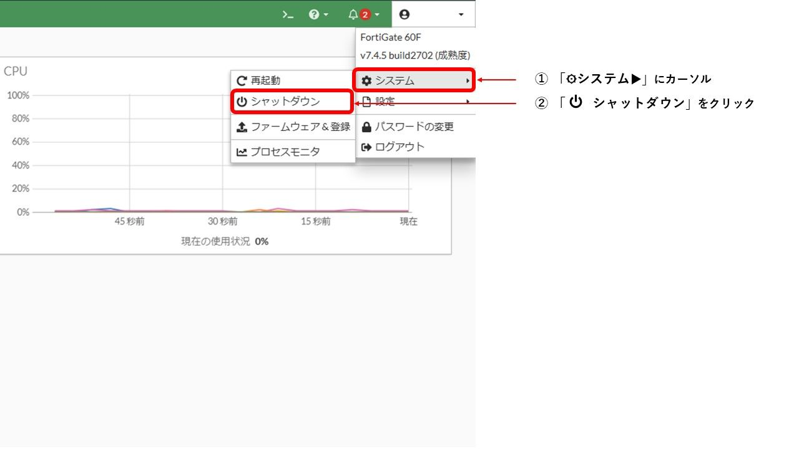
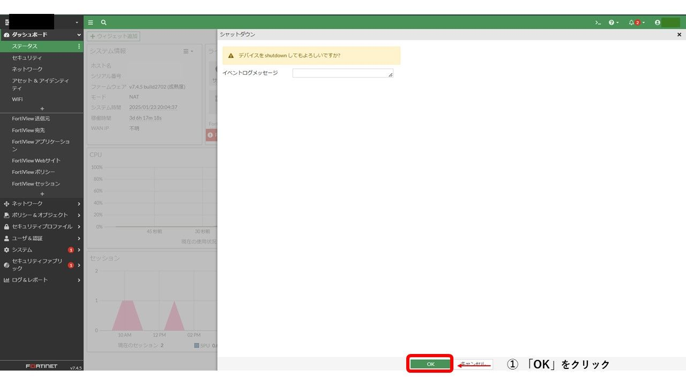
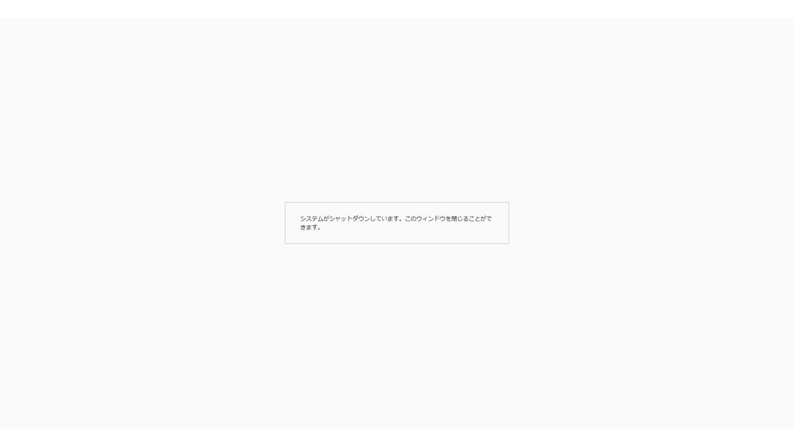

## はじめに

FortiGateの電源を切る際、  
「電源ケーブルをそのまま抜いていいの？」、「シャットダウンしないと壊れてしまう？」と不安に思ったことはありませんか。

FortiGateは、**正しい手順を踏まずに電源断すると設定破損やログ消失、OSが起動しなくなるなどのリスク**があります。

本記事では、

- CLIによるシャットダウンコマンド
- GUIでの安全な電源オフ手順
- 電源ケーブルを抜くタイミング

を解説します。

## CLI（コマンド）によるシャットダウンの方法

CLIによるコマンド操作でシャットダウンするには以下のコマンドを実行します。

```text
# execute shutdown
This operation will shutdown the system !
Do you want to continue? (y/n) y                  <-- [y]を入力
System is shutting down...
The system is going down NOW !!
#
The system is halted.
```

上記のコマンド操作によって、「The system is halted.」が表示されたら電源ケーブルを抜きます。

> [!NOTE] FortiGateの基本～応用まで詳細に説明されているおすすめ本は以下
> [FortiGateで始める 企業ネットワークセキュリティ](https://amzn.to/3LoPMtO)（単行本　**一番おすすめ**）  
> [FortiGate完全攻略](https://amzn.to/3LoQ0RG)（Kindle版 仕様に関する説明もあるので、次点でおすすめ）

## GUIによるシャットダウンの方法

GUIによる画面操作でシャットダウンする際は、以下の手順で画面操作をします。

画面右上に表示されているユーザ名にカーソルを合わせ、



画面が切り替わったら、以下の「OK」をクリックします。



以下の画面になったら、GUI上の操作は終了です。



最後に、1分程度待ち、機器の各インターフェースと「status」ランプが消灯したことを確認してから、電源ケーブルを抜きます。

[FortiGate完全攻略【電子書籍】\[ 椎屋淳伸 \]](https://item.rakuten.co.jp/rakutenkobo-ebooks/dc9211ce07ed366d8c33836dfac7babe/?rafcid=wsc_i_is_1069766294632744326)（楽天Kobo電子書籍ストア）

[FortiGateで始める 企業ネットワークセキュリティ【電子書籍】\[ 左門 至峰 \]](https://item.rakuten.co.jp/rakutenkobo-ebooks/d5d33a9968cc3f2fb654e2bba754e905/?rafcid=wsc_i_is_1069766294632744326)（楽天Kobo電子書籍ストア）
