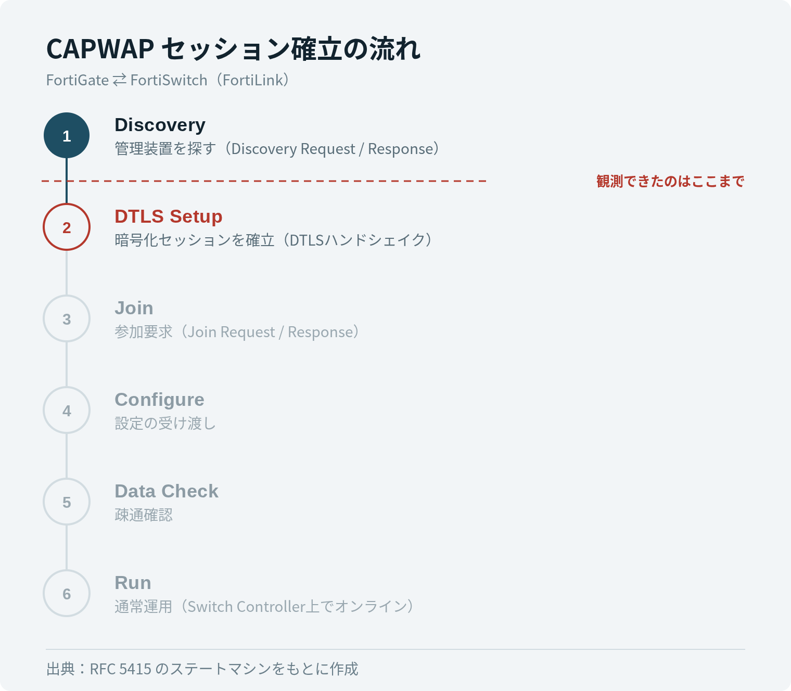

## はじめに

FortiGateでFortiSwitchを管理する構成（FortiLink）で、「FortiSwitchがDHCPでIPは取得できているのに、Switch Controller上でオンラインにならない」という事象に遭遇しました。

結果から書くと、**FortiGate側のFortiLinkインタフェースのMTUが、2500から1500に変更されていた**ことが原因でした。FortiGate側で2500に戻したところ、FortiSwitchはすぐにオンラインになっています。

一見すると「MTUを1500にしただけ」で、通常のイーサネット環境なら何も問題が起きない設定です。なぜこれが管理接続に影響するのか。この記事では、FortiLinkの管理通信がどういう仕組みで流れているかという背景から、切り分けでDTLS段階に着目した理由までを整理します。

### この記事で確認できた事実と、推定したメカニズム

技術記事として区別をつけておきたいので、最初に整理しておきます。

**確認できた事実**

- FortiSwitchはDHCPでIPアドレスを取得できていた
- パケットキャプチャ上、CAPWAP Discovery Request / Response までは観測できた
- その先のDTLSハンドシェイクに進んでいなかった
- 正常稼働している他構成とのコンフィグ差分は、FortiGate側のFortiLinkインタフェースのMTU（2500 / 1500）だった
- FortiGate側でFortilinkインターフェースのMTUを2500に戻したところ、FortiSwitchはオンラインになった

**推定したメカニズム（未検証）**

- MTU不足により、Discoveryより大きいDTLSハンドシェイクのパケットが到達できなかった

後述しますが、この推定は「あり得る説明」であって、パケットサイズやPMTU Discoveryの挙動まで確認したわけではありません。

## 前提：FortiLinkの管理通信はCAPWAPで流れている

まず押さえておきたいのは、**FortiGateとFortiSwitch間の管理通信はCAPWAPというプロトコルでカプセル化されている**という点です。

CAPWAP（Control And Provisioning of Wireless Access Points、RFC 5415）は、もともと無線APをコントローラから集中管理するために策定されたプロトコルです。FortiSwitchOSにも `mgmt-mode {capwap | https}` という設定項目があり、CAPWAPが管理方式のひとつとして用意されています。FortiLinkで管理する場合はCAPWAPが使われます。

CAPWAPそのものの仕組みについては、無線AP（LAP）とWLCの例で以前に解説しています。プロトコルの基本構造は同じなので、先に読んでおくとこの記事も理解しやすいはずです。

> 関連記事：[【図解】CAPWAPとは？無線APとWLCのセッション確立手順をわかりやすく解説](/capwap/)

FortiLinkの構成としてはこうなっています。

| 項目           | 内容                             |
| -------------- | -------------------------------- |
| 管理VLAN       | 4094（FortiLinkのデフォルト）    |
| 制御チャネル   | UDP 5246（デフォルト。変更可能） |
| データチャネル | UDP 5247（デフォルト）           |
| 暗号化         | DTLS                             |
| IPアドレス配布 | FortiGate上のDHCPサーバ          |

ポイントは、**この管理通信がトンネルである**ということです。トンネルということは、中身のパケットに外側のヘッダが追加されます。ここがMTUの話に関わってきます。

## FortiLinkのMTUが1500ではない理由（推測）

FortiGateがFortiLinkインタフェースを自動生成すると、MTUは通常のイーサネットの1500ではなく、それより大きい値が設定されます。筆者の環境では2500でした。

なぜ大きめの値なのかについては、**Fortinetの公式ドキュメントで根拠を確認できていません。** なのでここは推測として書きます。

FortiLink上を流れるフレームは、内側にペイロードがあり、その外側にCAPWAPヘッダ、UDPヘッダ、IPヘッダ、さらにDTLSを使っていればDTLSレコードのオーバーヘッドが付きます。内側が標準的な1500バイト相当だった場合、カプセル化後のフレーム長は1500を超えます。カプセル化を前提としたインタフェースに標準MTUを設定するのは余裕がなさそうだ、という程度の推測は成り立ちます。

ただし「2500という数値がオーバーヘッド分として厳密に算出された値である」とまでは言えません。正確に書くなら、

> FortiLinkではCAPWAPによる管理通信を前提として、標準の1500より大きいMTUが使われる。筆者の環境では正常系の値が2500だった。

というところまでです。

いずれにせよ実務上の結論は変わりません。**FortiLinkインタフェースのMTUはデフォルトのまま触らない。** FortiOSが自動生成する構成には理由があり、意味が分からないパラメータは意味が分かるまで触らないのが安全です。

## CAPWAPのステートマシンを知っていると切り分けが速い

今回の切り分けで一番効いたのが、CAPWAPが**段階的に状態遷移するプロトコル**だという理解でした。

RFC 5415のステートマシンをざっくり整理すると、こういう流れになります。



_図1：CAPWAPセッション確立の流れ。今回の事象では①Discoveryまでは観測できたが、②DTLS Setupに進まなかった。_

ここで重要なのが、**各フェーズで飛ぶパケットのサイズが違う**という点です。

- **Discovery Request / Response** … 数百バイト程度で小さい
- **DTLSハンドシェイク** … 証明書チェーンを交換するため、相対的にかなり大きい

MTUに起因する問題であれば、小さいDiscoveryは通過し、より大きいDTLSハンドシェイクで顕在化する、という順序になります。今回観測した「Discoveryは見える、DTLSに進まない」という症状は、これと整合します。

### ただし「1500を超えたら必ず落ちる」ではない

ここは誤解しやすいので明記しておきます。

RFC 5415には、CAPWAPメッセージがMTUを超える場合のfragmentationが規定されています。加えて、CAPWAPはPath MTU Discoveryを行い、発見したPMTUをDTLS層にも通知する設計になっています。DTLSハンドシェイクメッセージ自体もfragmentationが可能です。

つまり、**「DTLSの証明書が1500を超える → 必ず通信不能」という単純な話ではありません。** 実際に落ちるかどうかは、PMTU Discoveryが機能しているか、経路上でICMP fragmentation neededがブロックされていないか、実装がfragmentationを正しく扱っているか、といった条件に依存します。

今回のケースは「MTUを戻したら直った」ため、MTUが関与していた可能性は高いと考えていますが、**どの経路のどのメカニズムで落ちていたのかまでは特定できていません。**

## フェーズ別の確認ポイント

「オンラインにならない」という症状は候補が広すぎて手がかりになりません。どのフェーズまで進んだかで、見るべき箇所を絞れます。

なお、これは「このフェーズならこの原因」という断定ではなく、あくまで優先的に見る候補です。実際には複数要因が絡むこともあります。

| 止まった場所                    | 主な確認ポイント                                  |
| ------------------------------- | ------------------------------------------------- |
| DHCPでIPが取れない              | VLAN設定、DHCPサーバ設定、vci-match、物理結線     |
| Discoveryが届かない/返らない    | L2疎通、ポート設定、ACL、FortiLink未認可          |
| Discoveryは通るがDTLSに進まない | MTU、証明書、時刻ズレ（NTP）、cipherの不一致、ACL |
| DTLSは通るがJoinで落ちる        | ファームウェア非互換、認可状態、ライセンス        |

トラブルシュートの速度は、扱っているプロトコルへの事前理解の量にかなり比例すると考えています。

## その前に：FortiOSとFortiSwitchOSの互換性を確認する

この記事はMTUが原因だったケースですが、**FortiSwitchがオンラインにならない原因として、そもそもFortiOSとFortiSwitchOSの組み合わせが対応外というパターンもあります。** MTUを疑う前に、まずここを確認したほうが早いことも多いです。

FortiGate側とFortiSwitch側のバージョンは、以下のコマンドで確認できます。

```text
# FortiGate側
get system status

# FortiSwitch側（コンソール接続時）
get system status
```

対応するバージョンの組み合わせは、Fortinetが「FortiLink Compatibility」というPDFで公開しています。組み合わせの数が多く、改訂も入るため、この記事では表を転載せず参照先だけ示します。**必ず最新版で確認してください。**

> [FortiLink Compatibility（Fortinet公式）](https://docs.fortinet.com/document/fortiswitch/8.0.0/fortilink-compatibility)
>
> ※上記ページで確認した時点（2026年9月）では、ドキュメントの最終更新は2026年9月3日でした。

なお、対応外の組み合わせの場合はDTLSまで進んでからJoinやConfigureの段階で落ちることが多く、今回のような「Discoveryで止まる」挙動とは出方が異なる可能性があります。前掲のフェーズ別の表と合わせて切り分けると、どちらを疑うべきか判断しやすくなります。

## 実際の切り分け手順

以下、コマンドはすべて**FortiGate側のCLI**で実行しています。

### 1\. FortiSwitchがIPを取得できているか確認

まず物理・L2・DHCPが生きているかを確認します。ここが死んでいたらMTUの話にすらなりません。

```text
execute switch-controller get-conn-status
execute switch-controller diagnose-connection <FortiSwitch_SN>
```

`diagnose-connection` は、FortiLinkインタフェース、DHCPサーバ、NTPサーバといった前提条件をまとめてチェックしてくれるので、最初に叩くコマンドとして優秀です。NTPが `local` になっていると警告が出ますが、これも別の頻出パターンなので覚えておくといいです。

ここまででDHCPによるアドレス払い出しは確認できました。**つまりL2疎通は生きている。**  
※FortiGate側でFortilinkインターフェースのパケットキャプチャでも可です

### 2\. パケットキャプチャでCAPWAPの進行状況を見る

次に、CAPWAPがどこまで進んでいるかを直接見にいきます。

```text
diagnose sniffer packet any "port 5246 or port 5247" 4 0 a
```

`4` はverbose level（ヘッダ＋インタフェース名を表示）、`0` は無制限にキャプチャ、`a` は絶対時刻表示です。

観測結果は以下の通りでした。

- CAPWAP Discovery Request … 見える
- CAPWAP Discovery Response … 見える
- **DTLSハンドシェイク … 進まない**

前掲の表に照らすと、この時点で見るべき箇所がかなり絞れます。  
※FortiGate側でFortilinkインターフェースのパケットキャプチャでも可です

### 3\. 正常な構成とコンフィグをdiffする

ここで、同じくCAPWAPを使っている他の正常稼働中の構成とコンフィグを突き合わせました。

地味ですが、**「動いているものと比べる」は最も外しにくい手法**です。頭の中の理想構成と比べるのではなく、実際に動いている実物と比べる。これで差分としてMTUが浮かび上がりました。

```text
show system interface fortilink
または
show full-configuration
```

正常系は2500、問題の環境は1500。  
show full-configuration を使用したほうが、MTU以外の問題があった場合の切り分けで使えるので良いかもしれません。  
なお、SSH接続等で show full-configurationを取得するようにしてください。  
※コンソール接続だと出力完了までにかなりの時間を要するため

### 4\. デフォルト値に戻す

FortiLinkはデフォルト構成のまま使うのが基本、という前提知識がこれまでの経験則上あったため、FortiGate側で2500に戻しました。結果、FortiSwitchは正常にオンラインになりました。

必要に応じて再Joinを促す場合は、FortiGate側で以下を実行します。FortiSwitchの設定をFortiGate側から初期化して、Join処理をやり直させるコマンドです。

```text
onfig system interface
    edit "fortilink"
        set mtu-override enable
        set mtu 2500
    next
end
```

## 今後検証したいこと

今回確定できたのは、あくまで\*\*「MTUを2500に戻したら復旧した」という相関\*\*までです。因果まで詰めるなら、以下を押さえる必要があります。

1.  MTU 2500で正常動作することの再確認
2.  MTU 1500に戻して**意図的に再現するか**の確認
3.  MTU 1600 / 1800 / 2000 などで動作境界がどこにあるかの確認
4.  DTLSハンドシェイクの実パケットサイズをキャプチャ上で確認
5.  DFビットの状態と、ICMP fragmentation needed が返っているかの確認
6.  PMTU Discoveryが機能しているか（ブラックホール化していないか）の確認

特に3の境界値が取れると、「MTU不足が原因」を実証的に言い切れます。検証環境を用意できたら追記する予定です。

## まとめ

- FortiLinkの管理通信はCAPWAP（デフォルトでUDP 5246/5247）でカプセル化され、DTLSで暗号化される
- カプセル化を前提とするため、FortiGate側のFortiLinkインタフェースには標準の1500より大きいMTUが使われる（筆者環境では2500）
- 「DHCPは通る / Discoveryは見える / DTLSに進まない」という切り分け結果からMTUを疑い、デフォルト値に戻して復旧した
- ただしCAPWAP/DTLSにはfragmentationやPMTU Discoveryの仕組みがあるため、「1500だと必ず落ちる」とは言えない。厳密な因果は未検証
- MTUを疑う前に、FortiOSとFortiSwitchOSの互換性も確認しておくと切り分けが早い
- 実務上の結論はシンプルで、**FortiLinkのMTUはデフォルトのまま触らない**

同じ症状で詰まっている人の手がかりになれば幸いです。
