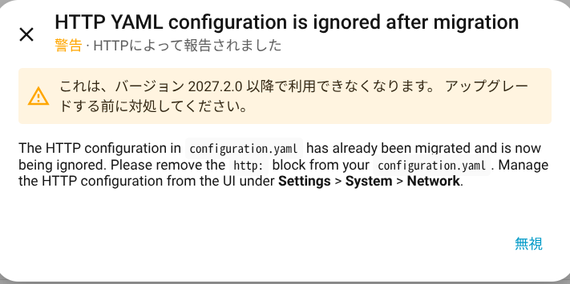
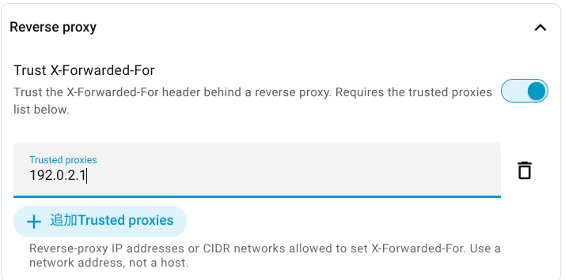

自宅のHome Assistantを、IPアドレスとポート番号ではなく `https://has.home.example.com/` のような名前で開けるようにしたくて、nginxのリバースプロキシ経由にすることにしました。

nginxの設定自体はよくある形なので、すぐ終わるだろうと思っていたのですが、実際には `400 Bad Request` が出て、昔からある対処法を試しても直らず、しばらくはまりました。原因はHome Assistantの最近の仕様変更でした。

この記事では、そのとき何が起きて、どう考えて解決したかを順番に書いていきます。「`HTTP YAML configuration is ignored after migration`」の警告が出た方や、「`trusted_proxies` をYAMLに書いたのに400が直らない」という方の参考になればうれしいです。

## 先に結論

- `400 Bad Request` は「Home Assistantまで届いたうえで、拒否されている」状態です。
- 最近のHome Assistantでは、`http:` の設定はYAMLではなく画面（設定 → システム → ネットワーク）で行います。YAMLに書いても無視されます。
- `configuration.yaml` の `http:` ブロックは削除推奨です（2027.2.0以降は使えなくなると警告が出ます）。
- 接続テストの`curl -I` で `405` が返っても失敗ではありません。`GET` で確認します。

## 環境

IPアドレスとドメイン名は、ドキュメント用の例示の値に置き換えています（`192.0.2.0/24` はRFC 5737で説明用に予約されている範囲です）。

| 項目             | 内容                                                  |
| ---------------- | ----------------------------------------------------- |
| リバースプロキシ | nginx（Debian 13のLXC）、`192.0.2.1`                  |
| Home Assistant   | Proxmox上のVM、`192.0.2.10:8123`、バージョン:2026.9.1 |
| ホスト名         | `has.home.example.com`                                |
| 証明書           | Let's Encryptのワイルドカード証明書（取得済み）       |

## nginxにHome Assistant用の設定を追加する

まずはnginx側の設定です。最終的には次の形に落ち着きました（HTTPS化まで済ませた状態です）。

```nginx
server {
    listen 80;
    server_name has.home.example.com;
    return 301 https://$host$request_uri;
}

server {
    listen 443 ssl;
    http2 on;
    server_name has.home.example.com;

    ssl_certificate     /etc/nginx/ssl/home.example.com.fullchain.pem;
    ssl_certificate_key /etc/nginx/ssl/home.example.com.key;
    ssl_protocols       TLSv1.2 TLSv1.3;

    location / {
        proxy_pass http://192.0.2.10:8123;
        proxy_http_version 1.1;
        proxy_set_header Upgrade $http_upgrade;
        proxy_set_header Connection $connection_upgrade;
        proxy_set_header Host $host;
        proxy_set_header X-Real-IP $remote_addr;
        proxy_set_header X-Forwarded-For $proxy_add_x_forwarded_for;
        proxy_set_header X-Forwarded-Proto $scheme;
    }
}
```

忘れやすいのがWebSocketの設定です。Home Assistantの画面はWebSocketでリアルタイムに更新されるので、`Upgrade` と `Connection` のヘッダーを中継する必要があります。`$connection_upgrade` は、次の共通設定で定義しています。

```nginx file="/etc/nginx/conf.d/websocket.conf"
map $http_upgrade $connection_upgrade {
    default upgrade;
    ''      close;
}
```

## 確認すると 400 Bad Request

設定を反映して、nginxのサーバーに向けて確認してみました。確認はHTTPS化する前、80番ポートでそのまま中継していた段階で行っています。

```bash
curl -sI -m 10 -H "Host: has.home.example.com" http://192.0.2.1/ | head -n 1
```

- `-s`：進捗表示を出さない
- `-I`：応答のヘッダーだけを取得する（`HEAD` という方式で問い合わせる）
- `-m 10`：10秒で打ち切る
- `-H "Host: ..."`：IPアドレス宛てでも、nginxにどのサイト宛てかを伝える
- `| head -n 1`：結果の1行目（ステータス）だけを表示する

```text file="結果"
HTTP/1.1 400 Bad Request
```

ここで大事なのは、この `400` を返しているのがnginxではなくHome Assistant自身だという点です。Home Assistantは、信頼していないリバースプロキシ経由のアクセスを `400` で拒否する仕様になっています。nginxの設定の誤りであれば、つながらずにタイムアウトしたり、`502 Bad Gateway` になったりするはずなので、通信自体はHome Assistantまで届いていると判断できます。

## いつもの方法でYAMLに書いても400のまま

原因がわかれば対処は簡単で、リバースプロキシを信頼する設定を入れればよいはずです。よく紹介されている方法どおり、`configuration.yaml` に次の設定を追加しました。

```yaml file="configuration.yaml（今は効かない）"
http:
  use_x_forwarded_for: true
  trusted_proxies:
    - 192.0.2.1
```

設定を確認して再起動しましたが、結果は `400` のままでした。書き間違いを疑って見直していたところ、Home Assistantの修復（リペア）に次の警告が出ていることに気づきました。



_修復に表示された警告_

タイトルは「`HTTP YAML configuration is ignored after migration`」です。本文には、`http:` の設定はすでに画面側へ移行済みで、YAMLの内容は無視されていると書かれていました。YAMLから `http:` ブロックを削除し、「Settings > System > Network」で管理するように、という案内です。さらに、2027.2.0以降は利用できなくなるので、アップグレード前に対処するようにとも表示されていました。

つまり、書き方が間違っていたのではなく、YAMLがそもそも読まれていなかったわけです。

## YAMLを削除して、画面で設定する

まず `configuration.yaml` から `http:` ブロックを削除しました。そのうえで、「設定」→「システム」→「ネットワーク」の「Reverse proxy」で、次のように設定しました。

- `Trust X-Forwarded-For`：有効
- `Trusted proxies`：`192.0.2.1`（「追加Trusted proxies」ボタンで項目を追加）



_Reverse proxyの設定画面_

途中、`Trusted proxies` にIPアドレスを入れないまま保存しようとしたところ、次のエラーが出ました。

```text file="エラー"
at least one trusted proxy is required to use X-Forwarded-For at 'config.trusted_proxies'. Got None
```

「X-Forwarded-Forを信頼するなら、信頼するプロキシを最低1つ指定してほしい」という意味です。プロキシの欄が項目として確定していない状態で有効にして保存すると、このエラーになりました。先にIPアドレスを入力して項目として確定させてから、有効にして保存すると通りました。

なお、`Trusted proxies` に指定したアドレスから届いた `X-Forwarded-For` は、そのまま信用されます。範囲を広く指定すると、その範囲の端末がアクセス元のIPアドレスを偽装できてしまうので、リバースプロキシが1台であれば、そのIPアドレスだけを指定するのがおすすめです。

## 今度は405。でも実は成功していた

もう一度、同じコマンドで確認しました。

```text file="結果"
HTTP/1.1 405 Method Not Allowed
```

一瞬「また別のエラーか」と思いましたが、`400` から変わったということは、Home Assistantがリバースプロキシを信頼するようになったということです。`405` になったのは、`curl -I` が `HEAD` という方式で問い合わせていて、Home Assistantのトップページがそれに対応していないためでした。

そこで、ブラウザと同じ `GET` で確認し直しました。

```bash
curl -s -o /dev/null -w "%{http_code}\n" -m 10 -H "Host: has.home.example.com" http://192.0.2.1/
```

- `-o /dev/null`：ページの本文は捨てる
- `-w "%{http_code}\n"`：ステータスコードだけを表示する

```text file="結果"
200
```

無事に `200` が返ってきました。その後HTTPS化して、`https://has.home.example.com/` を家族のiPhoneからも警告なしで開けることを確認しました。

## まとめ

今回はまったのは、「昔からの正しい方法」が仕様変更で効かなくなっていたからでした。YAMLの書き方を何度見直しても直らないはずです。振り返ると、次の3つが判断のポイントでした。

- `400` は届いたうえで拒否されている。まずは誰が返しているかを考える
- 設定が効かないときは、修復（リペア）の警告も確認する
- ステータスコードが変わったら、状況が進んだサインとして読む

自宅インフラ全体の構成は、[自宅ネットワーク基本設計書](/home-network-basicdesign/)にまとめています。  
同じ環境でのトラブル対応として、[UnboundのSERVFAILの記事](/unbound-servfail-infra-cache/)もあわせてどうぞ。
