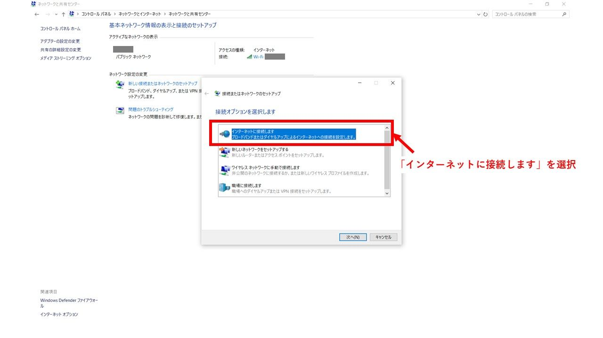
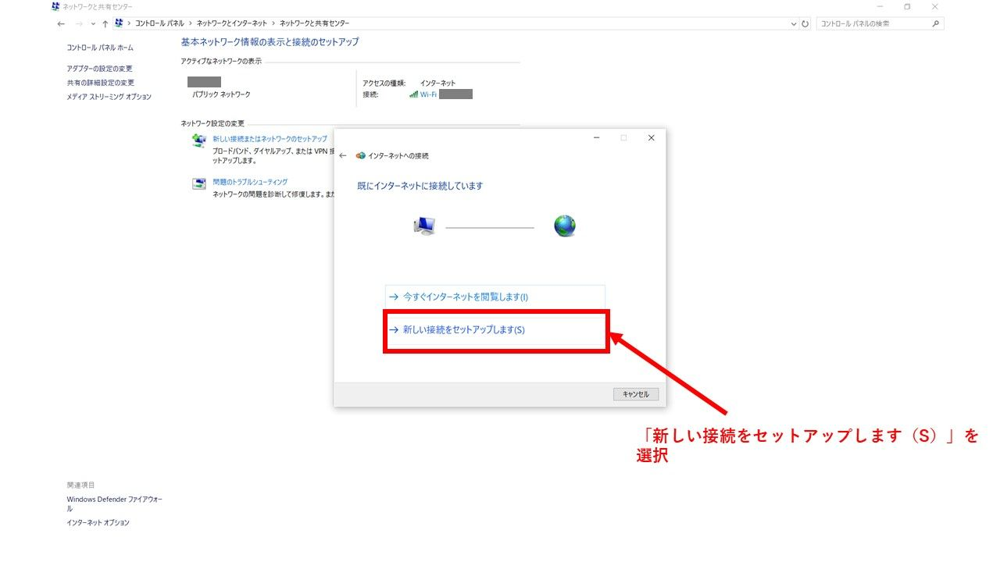
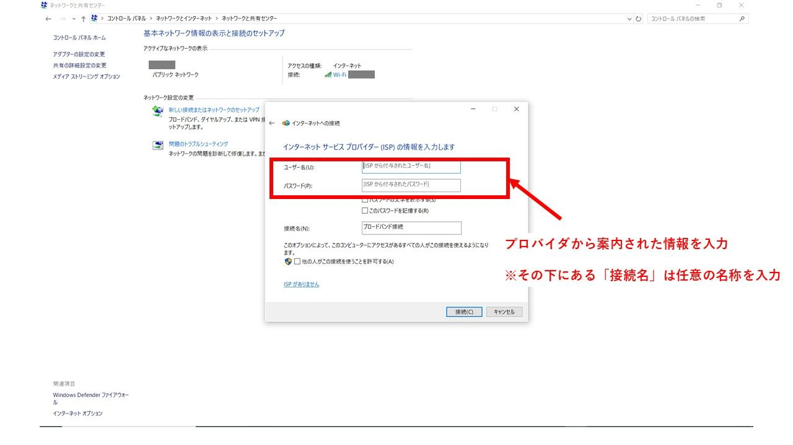

本ページでは、WindowsのPCを使用して、PPPoEに接続する方法を解説します。  
用途は、ネットワーク機器のPPPoE設定の接続前にPCで動作確認を行いたい場合（切り分けのためなど）を想定しております。

## 手順の解説

まずは、コントロールパネルを起動し、「ネットワークとインターネット」を選択します。

その後の画面で、「ネットワークと共有センター」を選択します。

画面遷移後に表示される画面で、「新しい接続またはネットワークのセットアップ」を選択します。

新しくポップアップウインドウが表示されたら、「インターネットに接続します」を選択し、

「新しい接続をセットアップします（S）」を選択します。

次に表示される画面で、「ブロードバンド(PPPoE)(R)」を選択します。

最後に下図の画面が表示されますので、  
ISP（プロバイダ）から提供された①ユーザ名と、②パスワードを入力し、  
接続名（任意）を入力した上で「接続」をクリックすると、設定が可能です。

今回の解説は以上になります。  
最後まで見ていただき、ありがとうございました。
