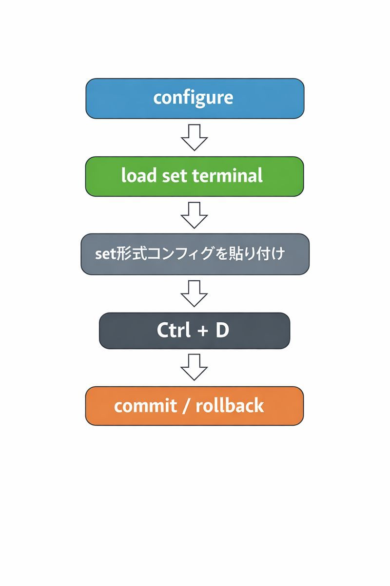

## はじめに

Juniper JUNOSでは、複数の設定投入方法がありますが、検証や構築作業を効率化したいときに、特に便利なのが  
load set terminal です。  
set 形式のコマンドをまとめて投入することができるため、手入力によるミスを減らしつつ、設定作業の効率化が可能です。  
  
この記事では、load set terminal の使い方を中心に、実際の設定例やハマりやすいポイントを整理して解説します。

### この記事で分かること

-   load set terminal の基本的な使い方
-   set 形式コンフィグを一括で投入する手順
-   実際の設定投入例とcommitまでの流れ
-   load merge や load overrideとの違い
-   ctrl + D の押し忘れなど、よくあるハマりポイントと対処方法

## load set terminal とは？

load set terminal はJUNOSの configure モードでset 形式のコンフィグをまとめて投入できるコマンドです。  
1行ずつ set コマンドを手入力する必要がなく、複数行の設定を一括で流し込めるのが大きな特徴です。  
  
主に、

-   検証環境の構築
-   既存設定への追記
-   コンフィグのコピペ投入

といった場面で、作業効率を大きく向上させることができます。

### JUNOSにおける設定投入方法の種類

JUNOSでは、設定を投入する方法がいくつか用意されています。  
代表的なものは、以下の4種類です。

#### set コマンド

-   1行ずつ設定を投入する基本的な方法
-   設定内容を理解しながら進められる反面、設定量が多いと手間がかかり、入力ミス・設定漏れが起こりやすい・・・

#### load merge terminal

-   階層構造（波括弧｛｝形式）の設定を流し込み、既存のCandidate Configurationに統合する方法
-   ファイルや入力内容を既存の設定にマージ（追記）する（新旧コンフィグの融合）
-   設定ファイルを用意して流し込むケースでよく使われる
-   set 形式ではないので、可読性低い

#### load override terminal

-   階層構造（波括弧｛｝形式）の設定を流し込み、既存のCandidate Configuration と完全に入れ替える方法
-   現在のCandidate Configuration をすべて破棄し、読み込んだ内容だけで新しく設定する操作
-   設定変更の影響範囲が広いため、本番環境では要注意
-   set形式ではないので可読性低い

#### load set terminal (今回の主役)

-   **set 形式**のコンフィグを、ターミナルから直接まとめて投入できる方法
-   ファイルを用意する必要がなく、**コピペで設定を反映**できる
-   検証や部分的な設定変更に非常に向いている
-   set 形式のため、**可読性が高い**

### load set terminal が向いているケース

load set terminalは、次のような場面に向いています。

#### 検証環境の構築

すでに作成済みのコンフィグがある場合、  
**set形式の設定をまとめて流し込むだけで、短時間で環境を構築**できます。  
ラボ環境での検証作業と相性が良い方法です。

#### 既存設定への追記（部分的な設定変更）

すでに稼働している機器設定に対して、

-   ポリシーの追加
-   インターフェース設定の追加
-   ルーティング設定の追記

といった**一部変更をまとめて反映したい場合**に便利です。

## load set terminal の基本的な使い方

### ～設定の流れ～



### 設定モードに入る

load set terminal は configure モードでのみ実行できます。  
まずは、通常通り、設定モードに移行します。（以下コマンド）

```text
configure
```

実行後、プロンプトが # に変わっていればConfigure モードに入っています。

### load set terminalの実行

Configure モード(プロンプト： # )に入ったら、以下のコマンドを実行します。

```text
load set terminal
====画面が黒くなり、貼り付けができるようになるので、投入したいコンフィグをまとめて貼り付け===
```

コマンドを実行すると、**入力待ち状態**になります。  
画面上は特にメッセージが表示されず、一見すると「何も起きていない」ように見えますが、  
この状態で **set形式のコンフィグをまとめて貼り付けることが可能**です。

> [!NOTE]
> ※このモードでは、set形式以外の設定（波括弧{}形式など）は受け付けられません。

### コンフィグの貼り付け

入力待ち状態に変わったら、投入したい**set形式のコンフィグをまとめて貼り付け**ます。

```text
(以下は例)
set system host-name JUNOS-RT01
set interfaces ge-0/0/0 unit 0 family inet address 192.168.10.1/24
set routing-options static route 0.0.0.0/0 next-hop 192.168.10.254
```

複数行をまとめてコピーして、**一度に貼り付けても問題ありません**。  
この点が、**1行ずつ入力する set コマンドとの大きな違い**です。

### 設定の終了方法（ctrl + D）

コンフィグの貼り付けが終わったら、  
ctrl + D を押して load set terminal モードを終了します。

```text
ctrl + D を実行
```

この操作を行うことで、**貼り付けた設定が Candidate Configurationに反映**されます。

### commit の実行(設定を保存)

load set terminal で投入した設定は、  
**まだActive configurationには反映されていません。**  
  
まずは、設定内容をチェックします。

```text
commit check
```

問題がなければ、設定を保存します。

```text
commit
```

基本的に、 commit check を実行してから commit するのがおすすめです。

## load set terminal を使うメリット

### 設定投入の高速化

load set terminal を使えば、  
**大量の設定を短時間で一括投入**できます。

-   インターフェース設定
-   ポリシー設定
-   ルーティング設定

などをまとめて反映できるため、構築スピードが圧倒的に向上します。

### 手入力ミスの防止

1行ずつ set コマンドを入力すると、

-   タイプミス
-   コマンド漏れ
-   入力順序のミス

が起こりがちです。  
  
事前に作成した set 形式コンフィグをそのまま貼り付けることで、  
**ヒューマンエラーを大幅に減らすことができます。**

### 検証・LAB作業との相性

load set terminal は、特に以下のような場面で真価を発揮します。

-   ラボ環境での検証
-   設定の作り直しが多い環境
-   何度も同じ構成を再現したいケース
-   ポリシーやルーティング追加作業で、設定量が非常に多いケース

検証・作業効率を上げたい場合は、必須レベルのコマンドと言えます。

### ここまでのワンポイント

本番環境で load set terminal を使う場合は  
必ず commit check と show | compare を併用し、  
意図しない設定変更が含まれていないかを確認しましょう。

## よくあるエラー・ハマりポイントと rollback を使った対処法

load set terminal は非常に便利なコマンドですが、  
使い方を誤ると**設定ミスや意図しないトラブル**につながることがあります。  
  
ここでは、**よくあるハマりポイントとその対処方法**を紹介します。

### 誤ってset形式以外のコマンドを流してしまった場合

load set terminal では、**set 形式のコンフィグのみ受け付けられます。**  
  
そのため、誤って以下のような設定を張り付けてしまうとエラーになります。

-   波括弧{}形式のコンフィグ
-   show コマンド
-   configure 以外のモード用コマンド

#### 対処法

-   **入力中（ ctrl + D を押す前）の場合**
    -   たとえ入力中にミスに気づいた場合でも、 ctrl + D を入力し、load set terminal モードから脱出します。
    -   load set terminal モードから抜けたら、 rollback 0 を入力し、設定反映前の状態に戻します。

JUNOS は commit が入力されるまで、設定の反映を行いません。  
そのため、 rollback 0 を実行することで、**最後にcommitされた状態にCandidate Configurationを戻す**ことができます。

-   入力確定後**（ ctrl + D を押した後）の場合**
    -   意図しない設定が入ってしまっていないか不安な場合は show | compare を実行

load set terminal の実際の挙動としては、1行ずつコマンドを実行する仕組みのため、set 形式ではない波括弧{} やshow コマンドなどが紛れ込むと、  
システムが**構文エラー（syntax error）としてエラーメッセージを表示**してくれます。  
  
意図しない設定が一部でも入ってしまっていないか不安な場合は、 show | compare コマンドを実行しましょう。  
これにより、**現在動いているActive Configurationと誤ってロードされたCandidate Configurationの差分を確認することが可能**です。

> [!NOTE]
> Candidate Configurationに誤った設定が混入してしまった場合は、 rollback 0 を実行し、
>
> Candidate Configurationをすべて破棄することで、最後にcommitされた設定に戻せます。

### パスワード設定をload set terminal で流し込んでしまう

ユーザーのパスワード設定は、**対話式で入力するのが基本**です。  
そのため、以下のような操作は**推奨されていません。**

```text
load set terminal

set system login user admin authentication plain-text-password

ctrl + D
commit
```

#### なぜ危険なのか

-   対話式入力を前提としている設定である
-   誤って encrypted-password を直接流し込むと、**ログインできなくなる可能性がある**

特に、誤った形式のencrypted パスワード（本来パスワードとして設定したい平文のパスワードをencrypted 指定して流し込んでしまう　など）  
を設定してしまうと、**SSH / コンソールの両方からログインできなくなる**ケースもあります。

#### 対処法

-   **パスワード設定は、load set terminal で行わない**
-   原則 load set terminal を使用していない状態で、 set system login user XXX authentication plain-text-password を実行し、**対話式で入力する**
-   もし誤って流し込んでしまった場合、commit前に気づけたときは、rollback 0 で設定を元に戻します

### ctrl + Dを押し忘れた場合

load set terminal では、 ctrl + D を実行することで初めて設定がCandidate Configurationに反映されます。  
入力待ち中に不正なコマンドが混ざったり、ctrl + D を忘れたりすると、意図しない結果になるため注意が必要です。

#### 対処法

-   ctrl + D を押したか必ず確認してから commit する
-   押し忘れなどで余計なコマンドも紛れてしまった可能性がある場合でも、まずはctrl + D を実行し、必要に応じてshow | compare で差分を確認し、 commit または rollback 0 する

## 他のloadコマンドとの違い

JUNOSには複数のload 系コマンドがありますが、  
それぞれ **用途・影響範囲・向いている場面**が明確に異なります。  
  
ここでは、load set terminal を中心に  
load merge 、load override との違いを整理します。

### load mergeとの違い

<details><summary>load merge の特徴（冒頭に記載した内容とほぼ同様です）</summary><p>load merge は、<strong>既存のCandidate Configuration に対して設定をマージ（追記）</strong>するコマンドです。</p><ul><li>階層構造（波括弧{}形式）の設定を読み込む</li><li>既存設定は基本的に保持される</li><li>同じ設定項目がある場合は、読み込んだ設定の方が優先される</li></ul></details>

主に、**設定ファイル（conf）を使った投入で利用されるケース**が多いです。

#### load merge とload set terminal の違い（表）

| 観点 | load merge | load set terminal |
| --- | --- | --- |
| 設定形式 | {}形式 | set 形式 |
| 既存設定 | マージ（追記・上書き変更） | 影響なし（set単位で追加） |
| 影響範囲 | 広い | 限定的 |
| リスク | 高い | 低い |
| 可読性 | やや低い | 高い |
| 入力方法 | ファイル / terminal | terminal（コピペ） |
| 主な用途 | 大規模設定の追記・変更 | 検証・部分変更 |

### load overrideとの違い

<details><summary>load overrideの特徴（冒頭に記載した内容とほぼ同様です）</summary><p>load overrideは、<strong>既存のCandidate Configurationを完全に破棄し、読み込んだ設定で置き換える</strong>コマンドです。</p><ul><li>階層構造（{}形式）の設定を使用</li><li>現在のCandidate Configurationはすべて破棄</li><li>commit時にシステム全体が設定を再解釈</li></ul></details>

影響範囲が非常に大きいため、**本番環境では特に注意が必要**です。

#### load overrideとload set terminalの違い（表）

| 観点 | load override | load set terminal |
| --- | --- | --- |
| 設定形式 | {}形式 | set 形式 |
| 既存設定 | 完全に破棄 | 追加 |
| 影響範囲 | 非常に広い | 限定的 |
| リスク | 非常に高い | 低い |
| 可読性 | やや低い | 高い |
| 入力方法 | ファイル / terminal | terminal（コピペ） |
| 主な用途 | 大規模な設定更改（滅多にない） | 検証・部分変更 |

load overrideは「初期化に近い操作」のため、

-   フルコンフィグ一気に入替えたい場合（検証環境の設定をそのまま本番に投入する前提の設定変更　など）
-   再構築前提の検証環境

など、**用途はかなり限定的**です。

## まとめ

load set terminal は、  
**「安全に」「素早く」「読みやすく」**設定を投入できる、  
JUNOS運用において非常にバランスの取れたコマンドです。  
  
特に、検証環境や部分的な設定変更では、  
最初に選択肢に上がるコマンドといえるでしょう。  
  
一方で、load merge やload override は  
**用途と影響範囲を正しく理解したうえで使い分ける**ことが重要といえます。

### load set terminal はこんな方におすすめ

#### 検証・LAB環境で作業することが多い方

-   構成を何度も作り直す
-   同じ設定をくりかえり投入する
-   短時間で環境を立ち上げたい

set 形式のコンフィグをまとめて流し込めるため、**検証作業のスピードを大きく向上**させることができます。

#### 既存設定に対して部分的な変更を行いたい方

-   ポリシーの追加
-   インターフェース設定の追記
-   ルーティング設定の追加

影響範囲を限定しながら設定変更できるため、**不要な設定破壊を防ぎつつ、安全に作業が可能**です。

#### 設定変更を「読みやすく・管理しやすく」したい方

-   set 形式で設定を管理したい
-   レビューしやすい形で作業したい
-   設定ミスを減らしたい

load merge や load overrideと比べて、  
**可読性が高く、差分確認もしやすいのが大きなメリット**です。

#### JUNOSの設定投入に不安がある方

-   commit の仕組みがまだ不安
-   設定ミスが怖い
-   rollbackを活用した安全な作業をしたい（特に設定変更が多い場合）

commit check や show | compare 、 rollback と組み合わせることで、  
**失敗しても戻せる前提で安心して作業**できます。

> [!NOTE]
> load set terminal で投入した設定をcommitした後に不具合が起きた場合、  
> 大体のケースでは以下を実行することで切り戻しも可能です。
>
> ```text
configure
rollback 1
commit
```
>
> これだけで、ひとつ前にcommitされた設定をCandidate configuration に復帰させて、commitさせる（復旧）ことが可能です。  
> ※no コマンドでひとつひとつ消したり、追加しなおしたりしなくて良いのがJUNOSの強みともいえます

JUNOSの commit / rollback の仕組みを正しく理解し、 load set terminal を安全に使いこなせるようになれば、  
設定作業は「怖いもの」から「コントロールできる作業」へと変わっていきます。

## 参考

### Juniper 公式ドキュメント

-   **Junos OS Configuration Files—Loading, Merging, and Replacing**
    -   [https://www.juniper.net/documentation/us/en/software/junos/cli/topics/topic-map/junos-config-files-loading.html](https://www.juniper.net/documentation/us/en/software/junos/cli/topics/topic-map/junos-config-files-loading.html)
-   **Using the Junos OS CLI**
    -   [https://www.juniper.net/documentation/us/en/software/junos/cli/](https://www.juniper.net/documentation/us/en/software/junos/cli/)
