自宅ネットワークのログ基盤を作ることにしました。最終形は rsyslog で受けたログを Alloy 経由で Loki に流し、Grafana で検索する構成です。

その第一歩として Proxmox 上に LXC を作り、rsyslog を入れたところ、**非特権コンテナでは 514/udp を待ち受けできない**という壁にぶつかりました。

原因は Linux の特権ポートと、コンテナの UID マッピングです。解決には **Ambient Capability** という仕組みを使います。

この記事では、LXC の作成から rsyslog の受信設定・ログローテーションまでを一通り扱います。ケーパビリティの話は Docker や systemd を触る場面でも応用が効くので、Proxmox を使っていない方にも読んでいただける内容だと思います。

> **記事中のIPアドレスについて** 実環境のアドレスは伏せ、`192.0.2.0/24` に置き換えています。これは RFC 5737 で**ドキュメント用に予約されたレンジ**(TEST-NET-1)です。実在のホストに割り当てられることがないため、記事やドキュメントで例示するのに適しています。逆に言うと、**このアドレスをそのまま設定しても動きません**。ご自身の環境のアドレスに読み替えてください。

---

## 目指す構成

今回作るログ基盤の全体像です。

```text
ネットワーク機器 ──syslog──> rsyslog ──┐
                                        │
サーバー ───────────────────────────────┼──> Alloy ──> Loki ──> Grafana
                                        │                 ↓
クラウドリソース ───────────────────────┘                S3
```

この記事で扱うのは、いちばん左の **rsyslog で syslog を受ける部分**です。Loki から右は別記事にします。

### なぜ rsyslog を挟むのか

「Alloy がログを集めるなら、rsyslog は要らないのでは」と思うかもしれません。サーバだけを対象にするならそのとおりです。

ただし**ネットワーク機器には Alloy を入れられません**。UTM も Cisco のルータも Aruba のスイッチも、任意のエージェントを常駐させることはできず、syslog を UDP で投げる機能しか持っていません。

そこで rsyslog を「機器側の言語」と「ログ基盤側の言語」を繋ぐ変換点として置きます。機器は昔ながらの syslog を投げるだけでよく、rsyslog がそれをファイルに落とし、Alloy がそのファイルを読む。**役割が明確に分かれるので、後から機器が増えても構成を変えずに済みます。**

### 環境

| 項目           | 内容                                                  |
| -------------- | ----------------------------------------------------- |
| ホスト         | ThinkCentre M720q (i5-8500T / メモリ16GB / SSD 512GB) |
| ハイパーバイザ | Proxmox VE 8.4.0 (Linux 6.8.12-9-pve)                 |
| コンテナ       | Debian 12 (bookworm) / **非特権LXC**                  |
| rsyslog        | 8.2302.0                                              |

---

## LXC の作成

Proxmox の Web UI から作ります。右上の **Create CT** です。

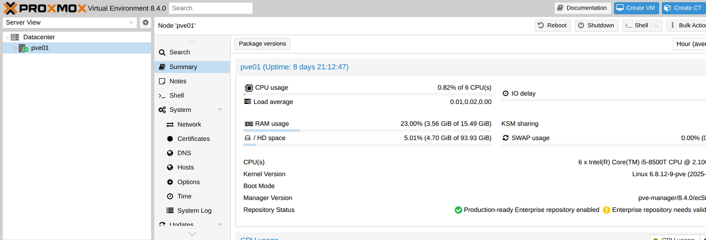

_Proxmox VE 8.4.0のノード概要画面。右上のCreate CTボタンからLXCを作成する_

`Create VM` の隣にあるボタンなので、押し間違えないよう注意してください。VM(KVM)と CT(LXC)では作成ウィザードがまったく別物です。

### General:ホスト名とコンテナ種別

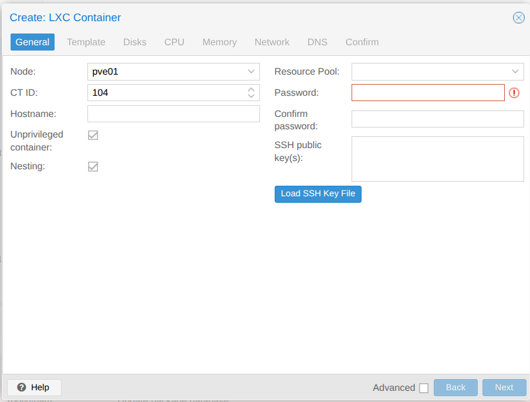

_Proxmox LXC作成ウィザードのGeneralタブ。Unprivileged containerとNestingにチェックが入った状態_

| 項目                   | 値        | 備考                                 |
| ---------------------- | --------- | ------------------------------------ |
| Node                   | pve01     |                                      |
| CT ID                  | 104       | 既存コンテナからの連番               |
| Hostname               | SV-LOG-01 | 既存の命名規則に合わせる             |
| Unprivileged container | **✓**     | デフォルトのまま                     |
| Nesting                | **✓**     | デフォルトのまま。**後述するが重要** |
| Password               | 任意      | SSH公開鍵を貼ってもよい              |

ホスト名は `SV-LOKI-01` でもよかったのですが、この LXC には rsyslog・Loki・Grafana が同居します。製品名ではなく役割で `LOG` としました。**将来 Loki を別のものに差し替えても名前を変えずに済む**からです。

`Unprivileged container` と `Nesting` はデフォルトでチェックが入っています。両方ともそのままにします。

- **Unprivileged container**:この記事の主題になる設定です。有効にすると UID マッピングが働き、セキュリティが上がる代わりに特権ポートが使えなくなります
- **Nesting**:非特権コンテナで systemd を正常に動かすために必要です。**これを外すと一部の systemd サービスが起動しなくなります**(後述のハマりどころで実例を挙げます)

### Template:Debian か Ubuntu か

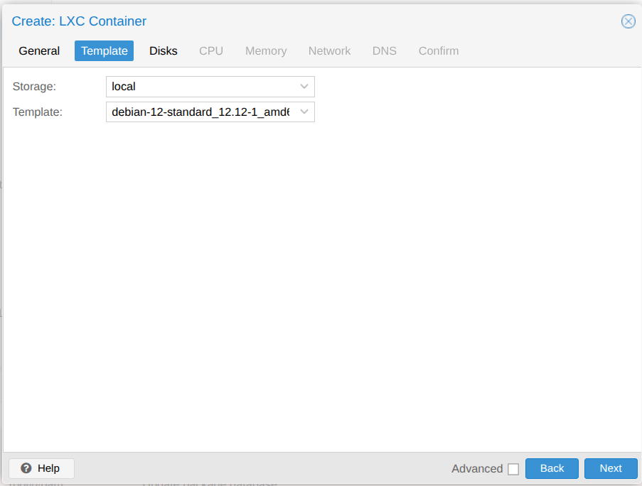

_LXC作成のTemplateタブでdebian-12-standardテンプレートを選択した画面_

`debian-12-standard_12.12-1_amd64.tar.zst` を選びました。Ubuntu ではなく Debian にした理由は3つあります。

**1\. Proxmox 自身が Debian ベース**

ホストとゲストで apt・systemd・ネットワーク設定の流儀が揃います。トラブル時に「ホストではこう見えるがコンテナでは違う」という混乱が減ります。

**2\. テンプレートが軽い**

Debian 12 standard は起動直後のメモリ実消費が 50MB 程度でした。Ubuntu のテンプレートは cloud-init や unattended-upgrades が最初から動くぶん常駐が増えます。ホストのメモリが 16GB で、すでに他のゲストが動いている環境なので、削れるところは削りたいところでした。

**3\. 今回のスタックで差がつかない**

Grafana Labs の APT リポジトリ(`apt.grafana.com`)は Debian・Ubuntu 共通です。Loki も Alloy も Grafana も同じ手順で入るため、**ディストロの選択が構築難易度に影響しません**。

なお `Storage` が `local` になっているのは、CT テンプレートが `local` の `vztmpl` ディレクトリに置かれるためです。`local-lvm` はディスクイメージ用なので、ここには表示されません。

### Disks:16GB に変更

デフォルトは 8GB です。


_LXC作成のDisksタブ。Disk sizeがデフォルトの8GiBの状態_

16GB に変更します。

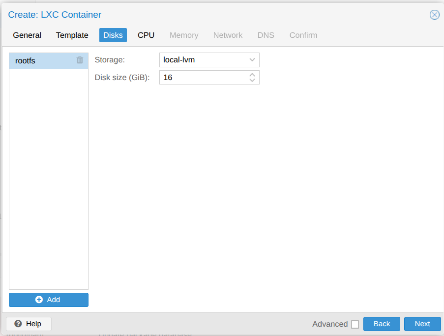

_LXC作成のDisksタブでDisk sizeを16GiBに変更した画面_

Loki のストレージバックエンドを S3 にする設計のため、**ローカルには WAL とキャッシュしか残りません**。内訳の見積もりは以下のとおりです。

| 用途               | 想定サイズ                 |
| ------------------ | -------------------------- |
| OS + パッケージ    | 2〜3GB                     |
| Loki の WAL        | 数百MB〜1GB                |
| チャンクキャッシュ | 1〜2GB(設定で上限を決める) |
| Grafana の SQLite  | 数十MB                     |
| 予備               | 残り                       |

足りなくなったら `pct resize 104 rootfs +8G` でオンライン拡張できます。**最初から大きく取る必要はありません。**

### CPU:2コアに変更

デフォルトは1コアです。


_LXC作成のCPUタブ。Coresがデフォルトの1の状態_

2に変更します。

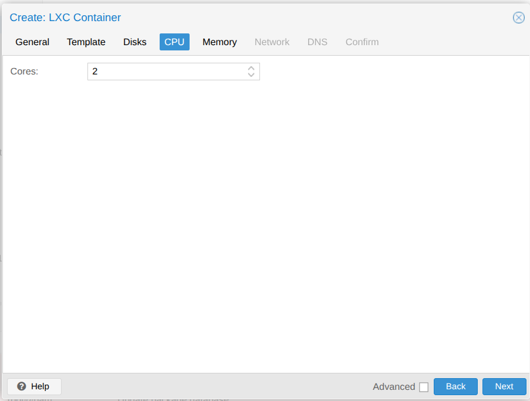

_LXC作成のCPUタブでCoresを2に変更した画面_

Loki は取り込み時にチャンクを gzip 圧縮し、クエリ時は並列でチャンクを展開します。1コアだと LogQL の全文検索が体感で重くなります。

LXC の CPU 割り当ては**上限を決めるだけで、予約ではありません**。2 にしても他のゲストが使える CPU が減るわけではないので、迷ったら多めで構いません。

### Memory:4096MB に変更

デフォルトは Memory 512 / Swap 512 です。

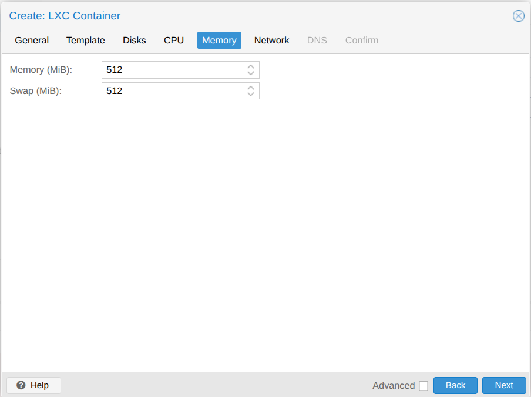

_LXC作成のMemoryタブ。Memory 512MiB、Swap 512MiBのデフォルト状態_

Memory だけ 4096 に変更します。

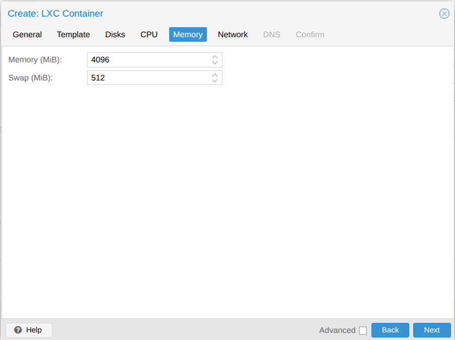

_LXC作成のMemoryタブでMemoryを4096MiBに変更した画面_

内訳の見積もりです。

| プロセス                  | 想定消費   |
| ------------------------- | ---------- |
| Loki (ingester + querier) | 500MB〜1GB |
| Grafana                   | 100〜200MB |
| rsyslog                   | 数十MB     |

実際には 1.5〜2GB あれば動きます。それでも 4GB にしたのは、長期間の LogQL 検索をかけたときに querier がメモリを持っていくためです。**稼働後に実消費を見て削る前提**の割り当てです。

Swap を 0 にしなかったのは、メモリ逼迫時に OOM Killer が即座に動くのを避けるためです。少量でも逃げ道があると、いきなりプロセスが殺される事態を減らせます。

> ただし **LXC の swap はホストの swap を消費します**。ホスト側の swap 使用率が上がってきたら、コンテナ側の割り当てを疑ってください。

### Network:ブリッジとアドレス

デフォルトは `vmbr0` で、アドレスは未設定です。

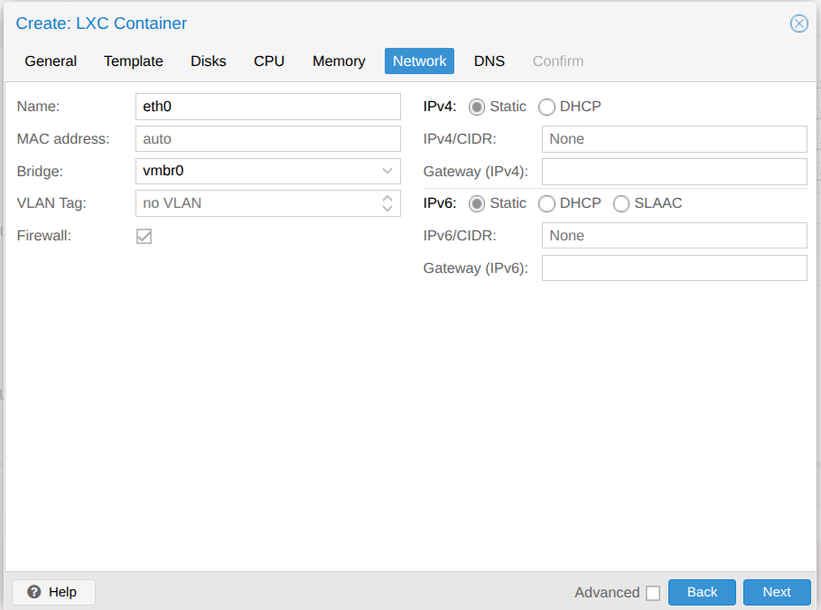

_LXC作成のNetworkタブ。Bridgeがvmbr0でIPアドレス未設定のデフォルト状態_

既存のコンテナに合わせて `vmbr1` を選び、IPv4 を Static で設定します。

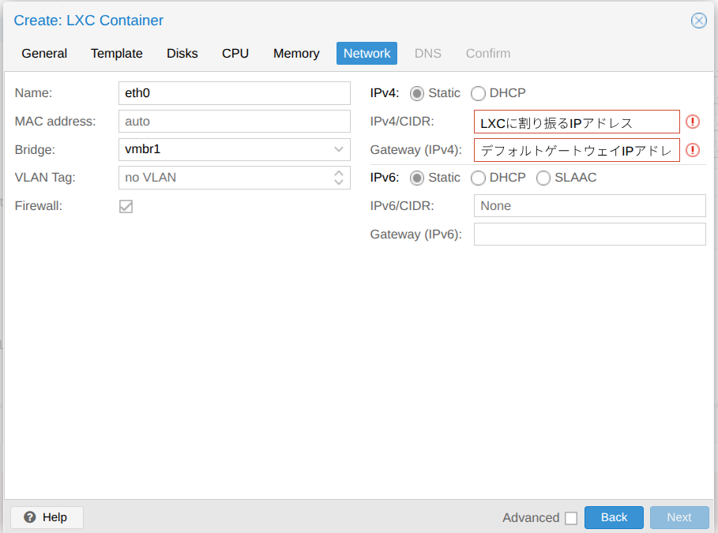

_LXC作成のNetworkタブでBridgeをvmbr1に変更し、IPv4をStaticに設定した画面_

| 項目           | 値                       |
| -------------- | ------------------------ |
| Name           | eth0                     |
| Bridge         | vmbr1                    |
| VLAN Tag       | no VLAN                  |
| Firewall       | **チェックを外す**       |
| IPv4/Cider     | Static / `192.0.2.51/24` |
| Gateway (IPv4) | `192.0.2.254`            |
| IPv6           | 未設定                   |

**VLAN Tag が `no VLAN` なのは、ブリッジ側で既に VLAN が確定しているためです。** 物理NICのサブインターフェースを切っているか、スイッチ側でアクセスポートとして VLAN を割り当てている構成では、LXC 側でタグを打つ必要がありません。ここは環境によって変わるので、既存コンテナの設定を確認してから決めてください。

**IPv4/CIDR は `/24` を忘れずに。** プレフィックス長を書かないと作成後に疎通しません。地味にハマります。

#### Firewall のチェックを外す理由

Proxmox の LXC ファイアウォールは、**Datacenter・Node・CT の3階層すべてで有効になって初めて機能します**。

多くの環境ではデータセンタレベルが無効なので、CT側にチェックが入っていても実際には何も遮断されません。「有効にしてあるつもり」で防御になっていない、という状態です。

そして厄介なのは逆方向です。**後から Datacenter 側を有効化した瞬間に、この LXC だけルールなしで全遮断されます。** syslog も Grafana も Alloy も一斉に止まり、原因を探すのに時間を取られます。

今回はセグメント間の制御を UTM とルータで実施しているため、Proxmox 側で二重に持たない方針にしました。**制御点を一箇所にまとめておくと、切り分けが楽になります。**

### DNS:ホスト設定の継承か、明示指定か

デフォルトは両方とも `use host settings`(空欄)です。

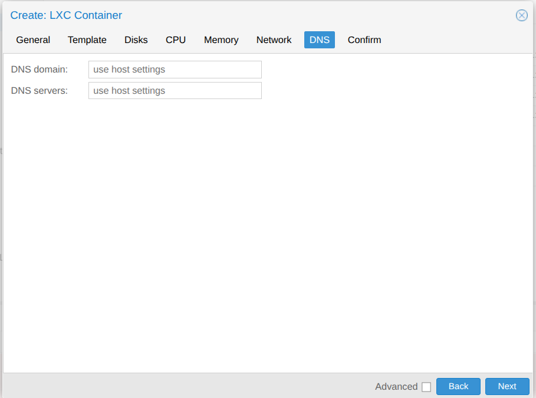

_LXC作成のDNSタブ。両項目がuse host settingsのデフォルト状態_

DNS servers を明示します。

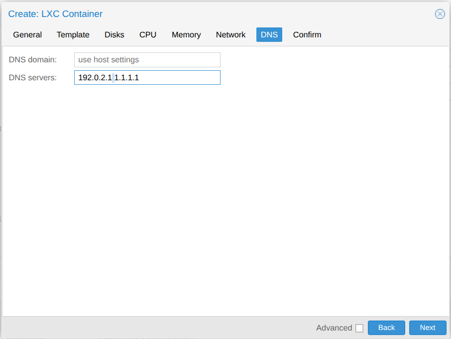

_LXC作成のDNSタブでDNSサーバを2つ、スペース区切りで指定した画面_

| 項目        | 値                  |
| ----------- | ------------------- |
| DNS domain  | 空欄                |
| DNS servers | `192.0.2.1 1.1.1.1` |

**区切りはカンマではなくスペースです。** カンマで書くと正しく解釈されません。

`DNS domain` を空欄にしたのは、このサーバが名前を引く相手が S3 のエンドポイントと apt リポジトリくらいで、どちらも FQDN だからです。ドメイン補完の恩恵がありません。

#### DNS を2つ書いても、期待するほどの保険にはならない

ここは知っておくと役に立つポイントです。glibc のリゾルバには以下の制約があります。

**1\. `MAXNS` は 3 に固定されている**

`resolv.conf` に4つ以上書いても、**先頭3つしか使われません**。4つ目以降は静かに無視されます。エラーも警告も出ないので気づきにくい仕様です。

**2\. フェイルオーバーは「無応答」のときだけ**

1つ目が応答しない場合、デフォルトで5秒待ってから2つ目に問い合わせます。逆に言うと、**毎回5秒の遅延が入ります**。

**3\. NXDOMAIN は「正常応答」**

1つ目が「そんな名前は無い」と返した場合、それは正常な応答なので2つ目には回りません。**Pi-hole のようなブロック機能を持つ DNS を1つ目に置いている場合、ブロックされたドメインが2つ目で救われることはありません。**

つまり「内部DNS + 外部DNS」の併記が効くのは、内部DNSが**完全に無応答になったとき**だけです。

それでも書いたのは、Loki が S3 に書けない状態が続くとチャンクが WAL とメモリに滞留してメモリを圧迫するためです。最低限の逃げ道として Cloudflare を併記しました。

なお、`options timeout:1 attempts:1` を `resolv.conf` に足せばタイムアウトを短縮できます。ただし Proxmox が管理する `resolv.conf` は再起動で上書きされるため、恒久化には別の工夫が必要です。

### 作成の実行

`Confirm` タブで設定値を確認し、`Start after created` にチェックを入れて Finish します。

作成ログの末尾が `TASK OK` になれば成功です。

```text
Logical volume "vm-104-disk-0" created.
Creating filesystem with 4194304 4k blocks and 1048576 inodes
extracting archive '/var/lib/vz/template/cache/debian-12-standard_12.12-1_amd64.tar.zst'
Total bytes read: 522782720 (499MiB, 334MiB/s)
Detected container architecture: amd64
Creating SSH host key 'ssh_host_ed25519_key' - this may take some time ...
(中略)
TASK OK
```

`4194304 4k blocks` は 4194304 × 4KiB = 16GiB で、指定どおりです。

---

## 初期設定と確認

### ネットワークの確認

コンソールから root でログインして確認します。

```text
# ip -4 addr show eth0
2: eth0@if19: <BROADCAST,MULTICAST,UP,LOWER_UP> mtu 1500 qdisc noqueue state UP
    inet 192.0.2.51/24 brd 192.0.2.255 scope global eth0

# ip route
default via 192.0.2.254 dev eth0 onlink
192.0.2.0/24 dev eth0 proto kernel scope link src 192.0.2.51
```

### リソースの見え方を確認

ここは確認しておく価値があります。

```text
# free -h
               total        used        free      shared  buff/cache   available
Mem:           4.0Gi        51Mi       3.5Gi        84Ki       477Mi       3.9Gi
Swap:          512Mi          0B       512Mi

# nproc
2
```

**`total` が 4.0Gi、`nproc` が 2 と、割り当てどおりに見えています。** これは `lxcfs` が効いている証拠です。

lxcfs は `/proc/meminfo` や `/proc/cpuinfo` をコンテナ視点の値に差し替えるプロセスです。これが効いていないと、コンテナ内から**ホストの物理メモリ(この環境なら16GB)が見えてしまいます**。

なぜ重要かというと、後で監視エージェントを入れたときに報告される値が変わるからです。ホストの値が見えている状態では「メモリ使用率3%」と報告されても、実際にはコンテナの割り当てを使い切っている、という食い違いが起きます。**最初に確認しておくと、後で数字を疑わずに済みます。**

ちなみに `used 51Mi` が Debian 12 standard テンプレートの素の消費量です。ここから rsyslog・Loki・Grafana を載せてどこまで伸びるかが、今後の観測ポイントになります。

### タイムゾーン

**ログ基盤において、タイムゾーンの統一は最優先事項です。**

```text
# timedatectl set-timezone Asia/Tokyo
# timedatectl status
               Local time: Sun 2026-09-06 22:38:29 JST
           Universal time: Sun 2026-09-06 13:38:29 UTC
                Time zone: Asia/Tokyo (JST, +0900)
System clock synchronized: yes
              NTP service: inactive
```

`NTP service: inactive` は異常ではありません。**非特権 LXC は自前で時刻同期せず、ホストのクロックをそのまま使います。** ホスト側で NTP が効いていれば問題ないので、`System clock synchronized: yes` になっていれば OK です。

### パッケージ更新

```text
#apt update && apt upgrade -y
#apt install -y curl gnupg2 ca-certificates vim less htop
```

`apt update` でこんな通知が出ることがあります。

```text
N: Repository 'http://deb.debian.org/debian bookworm InRelease' changed its
   'Version' value from '12.12' to '12.15'
```

これは、テンプレートが作られた後に Debian のポイントリリースが進んだという意味です。異常ではなく、`apt upgrade` で追従します。

---

## 本題:なぜ 514/udp を待ち受けできないのか

ここからが今回の主題です。

### 特権ポートという仕組み

Linux では \*\*1024未満のポート番号を「特権ポート」\*\*と呼び、root 権限がないと bind できません。

この制限は歴史的な理由で存在します。かつてのUNIXサーバは、複数のユーザーが同じマシンにログインして使うのが普通でした。もし誰でも 25番(SMTP)や 514番(syslog)を占有できたら、一般ユーザーが偽のサーバを立てて他人の通信を横取りできてしまいます。

「1024未満は管理者しか使えない」という取り決めによって、そうした成りすましを防いでいるわけです。

ネットワーク機器で言えば、VTY に access-class をかけるのと発想が近いと思います。**重要な入口は権限のある者だけに開く**、という考え方ですね。

### 非特権コンテナの UID マッピング

Proxmox の非特権 LXC では **UID マッピング**という仕組みが働きます。

コンテナ内の root(UID 0)は、ホスト側では **UID 100000 という一般ユーザー**にマッピングされます。コンテナの中で `whoami` を打てば root と返ってきますが、**ホストから見れば権限のない普通のユーザー**です。

これがコンテナ脱獄への防御になっています。仮にコンテナ内で権限昇格されても、ホスト側では一般ユーザーのままなので被害が波及しません。

その代償として、**コンテナ内の root は特権ポートに bind できません**。ホスト視点では一般ユーザーだからです。

つまり、非特権コンテナのセキュリティ上の利点と、514番を使いたいという要求が正面から衝突している、という構図です。

---

## 解決策の比較

方法は3つあります。

| 方式                   | 内容                                             | 利点                                           | 欠点                                                           |
| ---------------------- | ------------------------------------------------ | ---------------------------------------------- | -------------------------------------------------------------- |
| **Ambient Capability** | systemd の unit で `CAP_NET_BIND_SERVICE` を付与 | 機器側の設定変更が不要。設定がコンテナ内で完結 | 概念の理解が必要                                               |
| **高位ポート**         | 1514/udp で待ち受け、送信側の宛先ポートを変更    | 特権が一切不要。最もシンプル                   | 送信側**全機器**の設定変更が必要。機器によってはポート指定不可 |
| **ホスト側NAT**        | ホストの nftables で 514 → 1514 に転送           | 両側とも素直な設定のまま                       | ホストに設定が残る。**コンテナ移設時に追従を忘れる**           |

今回は **Ambient Capability** を選びました。

決め手は、送信側の機器構成です。ネットワーク機器の syslog はデフォルトが 514 で、機種によっては**送信先ポートの変更自体ができません**。Cisco なら `logging host x.x.x.x transport udp port 1514` で指定できますが、すべての機器がそうとは限りません。

**送信側に制約を課さない方式を選んでおけば、後から機器が増えても対応できます。** 設定がコンテナ内で完結するため、バックアップやリストアの対象が1箇所にまとまるのも利点です。

---

## ケーパビリティとは何か

Ambient Capability を理解するために、まずケーパビリティそのものを整理します。

### root の権限を分解する

伝統的な UNIX では、権限は「root か、そうでないか」の二択でした。root は何でもできる、それ以外は何もできない。

これは粗すぎます。「514番で待ち受けたいだけ」のプロセスに root を渡すと、ファイルの削除もカーネルモジュールのロードも可能になります。もし rsyslog に脆弱性があれば、攻撃者はシステム全体を掌握できてしまいます。

そこで Linux 2.2 以降、**root の権限が40個以上の細かい単位に分解**されました。これがケーパビリティです。

| ケーパビリティ         | できること                           | ビット位置 |
| ---------------------- | ------------------------------------ | ---------- |
| `CAP_CHOWN`            | ファイル所有者の変更                 | 0          |
| `CAP_DAC_OVERRIDE`     | パーミッションチェックの回避         | 1          |
| `CAP_KILL`             | 他ユーザーのプロセスへのシグナル送信 | 5          |
| `CAP_NET_BIND_SERVICE` | **1024未満のポートへの bind**        | **10**     |
| `CAP_NET_ADMIN`        | ネットワーク設定の変更               | 12         |
| `CAP_SYS_MODULE`       | カーネルモジュールのロード           | 16         |
| `CAP_SYS_TIME`         | システム時刻の変更                   | 25         |
| `CAP_SYSLOG`           | カーネルログへのアクセス             | 34         |

必要なものだけを渡せば、プロセスが乗っ取られても被害範囲が限定されます。**privilege level 15 をまるごと渡す代わりに、必要なコマンドだけ level を下げて許可する**運用に近いイメージです。

### file capability ではなく Ambient Capability を使う理由

ケーパビリティの付与には2つの方式があります。

**file capability** は `setcap` コマンドで実行ファイルに属性を埋め込む方式です。古くからある方法ですが、**バイナリに紐づくため `apt upgrade` で rsyslog が更新されると設定が消えます**。しかも消えたことに気づきにくく、「再起動したら急にログが来なくなった」という形で表面化します。

**Ambient Capability** は Linux 4.3 で追加された、**プロセスの起動時にケーパビリティを渡す**方式です。systemd の unit ファイルに書けるため、バイナリには一切手を加えません。パッケージ更新の影響を受けないのが最大の利点です。

自宅サーバのように長く動かし続けるものほど、**更新で壊れない書き方**を選んでおく価値があります。

---

## 設定手順

### 1\. rsyslog のインストール

Debian 12 の LXC テンプレートには rsyslog が**含まれていません**。journald だけで済ませる構成になっているためです。

```text
#apt install -y rsyslog
```

### 2\. imklog を無効化する

インストール直後、起動ログにこんなエラーが出ます。

```text
rsyslogd[9886]: imklog: cannot open kernel log (/proc/kmsg): Permission denied.
rsyslogd[9886]: activation of module imklog failed [v8.2302.0]
```

`imklog` はカーネルログ(`/proc/kmsg`)を読み込むモジュールです。非特権 LXC ではアクセスが許可されないため、必ず失敗します。

**これは異常ではありません。** そもそもコンテナは独自のカーネルを持たず、ホストの Proxmox とカーネルを共有しています。**カーネルログを収集すべきなのはホスト側**であって、コンテナ側で読む意味がありません。

とはいえ、ログ基盤自身が起動のたびに無意味なエラーを吐き続けるのは筋が悪いので、無効化します。

```text
#sed -i 's/^module(load="imklog")/#module(load="imklog")/' /etc/rsyslog.conf
```

```text
# grep -n imklog /etc/rsyslog.conf
12:#module(load="imklog")   # provides kernel logging support
```

> 「エラーが出ているが対処不要なもの」と「対処すべきもの」の区別は、コンテナ環境でつまずきやすいところです。**カーネルに関わるものはホスト側の責務**、と覚えておくと判断しやすくなります。

### 3\. ケーパビリティの付与

systemd の **drop-in** で設定を追加します。

```text
#mkdir -p /etc/systemd/system/rsyslog.service.d

#cat > /etc/systemd/system/rsyslog.service.d/override.conf <<'EOF'
[Service]
AmbientCapabilities=CAP_NET_BIND_SERVICE
CapabilityBoundingSet=CAP_NET_BIND_SERVICE CAP_SYSLOG CAP_CHOWN CAP_DAC_OVERRIDE CAP_FOWNER CAP_LEASE CAP_SETGID CAP_SETUID
EOF

#systemctl daemon-reload
```

drop-in は、**元の unit ファイルを書き換えずに設定を追加する仕組み**です。`/lib/systemd/system/rsyslog.service` を直接編集するとパッケージ更新時に上書きされますが、drop-in なら別ファイルとして残ります。file capability を避けたのと同じ考え方です。

`CapabilityBoundingSet` は**プロセスが保持できるケーパビリティの上限**を定めるものです。`AmbientCapabilities` で指定したものがこの上限に含まれていないと弾かれるため、明示しています。

### 4\. UDP 受信の有効化

`/etc/rsyslog.conf` の該当箇所はデフォルトでコメントアウトされています。

```text
16:#module(load="imudp")
17:#input(type="imudp" port="514")
```

**16行目のモジュール読み込みだけ**有効にします。

```text
#sed -i '16s/^#module(load="imudp")/module(load="imudp")/' /etc/rsyslog.conf
```

> **17行目の `input` はコメントアウトのままにしてください。** 次の手順で作る振り分け設定側で `input` を定義するため、ここを有効にすると**同じポートを2箇所で定義することになり、rsyslog が起動に失敗します**。モジュールの読み込みは1回、`input` の定義も1回だけです。

### 5\. 振り分け設定

送信元ごとにファイルを分けます。`/etc/rsyslog.d/` に置けば `/etc/rsyslog.conf` を汚さずに済みます(45行目付近の `$IncludeConfig /etc/rsyslog.d/*.conf` で読み込まれます)。

```text
#mkdir -p /var/log/network
#chown root:adm /var/log/network
#chmod 0755 /var/log/network

#cat > /etc/rsyslog.d/10-network.conf <<'EOF'
# ネットワーク機器からの syslog 振り分け
# 収集レベル: notice 以上 (severity <= 5)

template(name="RemoteHostFile" type="string"
         string="/var/log/network/%HOSTNAME%.log")

ruleset(name="remote") {
    if $syslogseverity <= 5 then {
        action(type="omfile"
               dynaFile="RemoteHostFile"
               fileOwner="root"
               fileGroup="adm"
               fileCreateMode="0640"
               dirCreateMode="0755")
    }
    stop
}

input(type="imudp" port="514" ruleset="remote")
EOF
```

この設定には4つのポイントがあります。

#### 動的ファイル名を使う

送信元IPごとに `if` を並べる方式より、`%HOSTNAME%` でファイル名を自動生成する方が保守が楽です。**機器を増やしても設定変更が不要**になります。

ただし、これは**送信側が名乗るホスト名**がそのままファイル名になるということでもあります。機器側で hostname を設定していないと、IPアドレスがファイル名になったり、FQDN で来たりします。実際にログを受けてみて意図と違えば、`%FROMHOST-IP%` に変えるか、機器側の設定を見直すことになります。

#### severity は数値で判定する

`$syslogseverity <= 5` が notice 以上です。syslog の severity は**数値が小さいほど重大**という並びになっています。

| 値  | severity   | 意味             | 今回     |
| --- | ---------- | ---------------- | -------- |
| 0   | emerg      | システム利用不可 | 収集     |
| 1   | alert      | 即座に対処が必要 | 収集     |
| 2   | crit       | 危機的           | 収集     |
| 3   | err        | エラー           | 収集     |
| 4   | warning    | 警告             | 収集     |
| 5   | **notice** | 通常だが重要     | **収集** |
| 6   | info       | 情報             | 破棄     |
| 7   | debug      | デバッグ         | 破棄     |

info と debug を落としているのは、**S3 の保管費用とクエリ速度に直結する**からです。ログ基盤は「全部集めれば安心」ではなく、**何を集めないかを決めることが設計**だと考えています。

#### ruleset の末尾に `stop` を置く

`/etc/rsyslog.conf` には以下の行があります。

```text
*.*;auth,authpriv.none               -/var/log/syslog
```

これが受信した全ログを `/var/log/syslog` にも書き込みます。`stop` がないと**二重に記録**され、ディスクを無駄に消費するうえ、**後で Alloy が同じログを2回読む**原因になります。

`stop` はこの ruleset 内でのみ効くため、コンテナ自身のログ(imuxsock 経由)は従来どおり `/var/log/syslog` に入ります。**リモートのログだけを分離できる**わけです。

#### パーミッションは action に直接書く

`/etc/rsyslog.conf` には `$FileCreateMode 0640` や `$FileGroup adm` というディレクティブがあります。しかしこれらは**記述順に依存する古い形式**で、`$IncludeConfig` で読み込まれた別ファイル内では引き継がれないことがあります。

実際、最初は指定したつもりが `0644 root:root` でファイルが作られてしまいました。

```text
-rw-r--r-- 1 root root 129 Sep  6 23:15 SV-DNS-01.log   ← 意図と違う
```

action に直接書くのが確実です。**後で Alloy を専用ユーザーで動かす場合、adm グループで読める必要がある**ので、ここは揃えておきます。

### 6\. 構文チェックと反映

投入前に必ず構文チェックをかけます。

```text
# rsyslogd -N1
rsyslogd: version 8.2302.0, config validation run (level 1), master config /etc/rsyslog.conf
rsyslogd: End of config validation run. Bye.
```

エラーがなければ再起動します。

```text
#systemctl restart rsyslog
```

---

## 動作確認

### drop-in が読まれているか

```text
# systemctl status rsyslog --no-pager
* rsyslog.service - System Logging Service
     Loaded: loaded (/lib/systemd/system/rsyslog.service; enabled; preset: enabled)
    Drop-In: /etc/systemd/system/rsyslog.service.d
             `-override.conf
     Active: active (running) since Sun 2026-09-06 23:14:16 JST
```

`Drop-In:` の行が出ていれば、systemd が設定を認識しています。imklog のエラーも消えました。

### 待ち受けの確認

```text
# ss -ulnp | grep 514
UNCONN 0      0            0.0.0.0:514       0.0.0.0:*    users:(("rsyslogd",pid=9967,fd=6))
UNCONN 0      0               [::]:514          [::]:*    users:(("rsyslogd",pid=9967,fd=7))
```

**`0.0.0.0:514` が出れば成功です。** 非特権コンテナで特権ポートを掴めました。

### ケーパビリティの確認

systemd 側の設定値を確認します。

```text
# systemctl show rsyslog -p AmbientCapabilities
AmbientCapabilities=cap_net_bind_service
```

実際のプロセスが持っている値も見てみます。ここが面白いところです。

```text
# grep Cap /proc/$(pgrep rsyslogd)/status
CapInh: 0000000000000400
CapPrm: 00000004100004cb
CapEff: 00000004100004cb
CapBnd: 00000004100004cb
CapAmb: 0000000000000400
```

5つのフィールドはそれぞれ意味が違います。

| フィールド               | 意味                                                           |
| ------------------------ | -------------------------------------------------------------- |
| **CapInh** (Inheritable) | exec 時に引き継がれる候補                                      |
| **CapPrm** (Permitted)   | プロセスが持つことを許された集合                               |
| **CapEff** (Effective)   | **現在実際に有効な集合**。カーネルが権限チェックで見るのはここ |
| **CapBnd** (Bounding)    | 上限。ここに無いものは取得できない                             |
| **CapAmb** (Ambient)     | 非特権実行ファイルを exec しても保持される集合                 |

`CapAmb` の `0000000000000400` を2進数に直すとビット10だけが立っています。表で示したとおり、**ビット10 は `CAP_NET_BIND_SERVICE` そのもの**です。狙ったとおり、必要な権限だけが渡っていることが確認できます。

`CapBnd` の `00000004100004cb` も分解してみます。

| 立っているビット | ケーパビリティ          |
| ---------------- | ----------------------- |
| 0                | CAP\_CHOWN              |
| 1                | CAP\_DAC\_OVERRIDE      |
| 3                | CAP\_FOWNER             |
| 6                | CAP\_SETGID             |
| 7                | CAP\_SETUID             |
| 10               | CAP\_NET\_BIND\_SERVICE |
| 28               | CAP\_LEASE              |
| 34               | CAP\_SYSLOG             |

**drop-in の `CapabilityBoundingSet` に書いた8つと完全に一致します。** 設定が意図どおり反映されていることが、数値レベルで裏付けられました。

なお `libcap2-bin` を入れると `capsh --decode=` で人間可読な形に変換できます。手で数える必要はありません。

```text
apt install -y libcap2-bin
capsh --decode=0000000000000400
```

### 受信テスト

別のサーバから `logger` で送ります。`-d` が UDP 指定です。

```text
logger -n 192.0.2.51 -P 514 -p user.notice -d "test notice level"
logger -n 192.0.2.51 -P 514 -p user.info   -d "test info - should be dropped"
logger -n 192.0.2.51 -P 514 -p user.err    -d "test err level"
```

受信側で確認します。

```text
# ls -l /var/log/network/
-rw-r----- 1 root adm 129 Sep  6 23:15 SV-DNS-01.log

# cat /var/log/network/SV-DNS-01.log
2026-09-06T23:14:56.492310+09:00 SV-DNS-01 root test notice level
2026-09-06T23:15:17.291444+09:00 SV-DNS-01 root test err level
```

**notice と err だけが記録され、info は落ちています。** パーミッションも `0640 root:adm` になりました。

`/var/log/syslog` の方にリモートのログが入っていないことも確認してください。入っていたら `stop` が効いていません。

---

## ログローテーション

このままではファイルが無限に伸び、いずれディスクが埋まります。

Alloy が読み取って Loki に送る前提なので、ローカルの保持は短くて構いません。ただし **Alloy が止まっている間のログを失わない**程度の余裕は必要です。

```text
# cat > /etc/logrotate.d/network <<'EOF'
/var/log/network/*.log
{
    rotate 7
    daily
    missingok
    notifempty
    compress
    delaycompress
    sharedscripts
    postrotate
        /usr/lib/rsyslog/rsyslog-rotate
    endscript
    create 0640 root adm
}
EOF
```

| 設定                   | 意味                                                                  |
| ---------------------- | --------------------------------------------------------------------- |
| `rotate 7` / `daily`   | 日次で7世代保持。Alloy が1週間止まっても取りこぼさない                |
| `compress`             | 古い世代を gzip                                                       |
| `delaycompress`        | 圧縮を1世代遅らせる。**Alloy が読んでいる最中に gzip されるのを防ぐ** |
| `notifempty`           | 中身が空ならローテートしない                                          |
| `postrotate`           | **rsyslog にファイルハンドルを再オープンさせる。最重要**              |
| `create 0640 root adm` | ローテート後の新規ファイルも同じ権限で作る                            |

### postrotate が最重要な理由

**`rsyslog-rotate` を書き忘れると、ローテート後にログが静かに消え続けます。**

logrotate はファイルを**リネーム**します。しかし rsyslog は開いたままのファイルディスクリプタを持っており、**リネーム済みの inode に書き続けます**。結果として、新しく作られたファイルは 0バイトのまま、書き込みは `.1` の方に入り続けます。

エラーは一切出ません。気づくのは「ログが全然たまっていない」と思ったときです。**必ず入れてください。**

### 動作確認

`-d` はデバッグモードで、実際にはローテートせず動作予定だけを表示します。

```text
# logrotate -d /etc/logrotate.d/network
```

問題なければ強制実行して確認します。

```text
# logrotate -f /etc/logrotate.d/network
# ls -l /var/log/network/
-rw-r----- 1 root adm  0 Sep  6 23:20 SV-DNS-01.log
-rw-r----- 1 root adm 64 Sep  6 23:18 SV-DNS-01.log.1
```

新旧に分かれ、権限も維持されています。`delaycompress` を指定しているので `.1` はまだ圧縮されていません。これも設計どおりです。

**ここで必ずローテート後の書き込みを試してください。** postrotate が効いているかの確認です。

```text
# (別サーバから logger で送信後)
# cat /var/log/network/SV-DNS-01.log
2026-09-06T23:21:26.604591+09:00 SV-DNS-01 root after rotate test
```

新しいファイルに入っていれば成功です。

Debian 12 では cron ではなく systemd timer で実行されます。

```text
# systemctl list-timers logrotate.timer --no-pager
NEXT                        LEFT       LAST PASSED UNIT            ACTIVATES
Mon 2026-09-07 00:00:00 JST 37min left -    -      logrotate.timer logrotate.service
```

---

## ハマりどころ

### タイムゾーンのずれ

**これが今回いちばん重要な発見でした。**

受信したログを見比べると、こうなっていました。

```text
2026-09-06T22:57:22.990979+09:00 SV-LOG-01 root test message from localhost
2026-09-06T13:59:14.402476+00:00 SV-DNS-01 root test from SV-DNS-01
```

**送信元のサーバだけ UTC** です。実際には 22:59 に送ったログが 13:59 と記録されています。

なぜこれが致命的かというと、**Loki はログの時刻でインデックスを作る**からです。このまま取り込むと該当ホストのログだけ9時間前に格納され、Grafana で「直近1時間」を見ても表示されません。

障害調査は複数機器のログを時系列で並べるのが基本です。**1台だけ9時間ずれていると因果関係が読めなくなります。**

重要なのは、**タイムスタンプを打つのは送信側**だという点です。受信側の rsyslog をいくら設定しても直りません。全ホストを JST に統一するのが正攻法です。

> 受信側で `$NOW` を使って上書きする方法もありますが、推奨しません。ネットワーク遅延やバッファリングで実際の発生時刻とずれますし、機器が持つ本来の情報を捨てることになります。

**ログ基盤を作る前に、全ホストのタイムゾーンを揃えておく。** これを設計の前提条件として設計書に書いておくべきだと痛感しました。

### systemd-timedated が起動しない(Nesting無効時)

そこで送信元サーバで `timedatectl` を叩いたところ、こうなりました。

```text
# timedatectl set-timezone Asia/Tokyo
Failed to set time zone: Failed to activate service 'org.freedesktop.timedate1': timed out
```

原因を追います。

```text
# journalctl -u systemd-timedated -n 20 --no-pager
systemd-timedated.service: Failed to set up mount namespacing:
  /run/systemd/unit-root/proc: Permission denied
systemd-timedated.service: Failed at step NAMESPACE spawning /lib/systemd/systemd-timedated:
  Permission denied
systemd-timedated.service: Main process exited, code=exited, status=226/NAMESPACE
```

`systemd-timedated` は起動時に **mount namespace を分離してサンドボックス化**しようとします。unit に `ProtectSystem` などの指定があると発動する、systemd のセキュリティ機能です。

この処理には mount 操作が必要ですが、**Nesting が無効なコンテナでは許可されない**ため失敗します。冒頭で Nesting のチェックを残したのはこのためでした。

**回避策**は、`timedatectl` を使わずシンボリックリンクを直接張ることです。`timedatectl` は結局のところ、この2つを操作するためのフロントエンドに過ぎません。

```text
ln -sf /usr/share/zoneinfo/Asia/Tokyo /etc/localtime
echo "Asia/Tokyo" > /etc/timezone
```

```text
# date
Sun Sep  6 23:03:53 JST 2026
```

修正後に同じテストを流すと、正しく記録されるようになりました。

```text
2026-09-06T23:04:50.886764+09:00 SV-DNS-01 root test after timezone fix
```

> **すでに起動しているプロセスは、起動時に読み込んだタイムゾーンを保持しています。** DNSサーバや DHCP サーバなどのログに反映されるのはサービス再起動後です。稼働中のサービスなら、次回のメンテナンス時でも構いません。

Nesting を後から有効にすることもできます(Options → Features → Nesting)が、**コンテナの再起動が必要**です。稼働中のサービスが載っている場合は、影響を見極めてから実施してください。

### DNS が AAAA だけ返す

`getent hosts` を叩くと IPv6 アドレスだけが返ってくることがあります。

```text
# getent hosts apt.grafana.com
2a04:4e42:8c::729 dualstack.e.sni.global.fastly.net apt.grafana.com
```

コンテナに IPv6 グローバルアドレスを振っていない場合、`apt` や `curl` が IPv6 で接続を試みて失敗し、**IPv4 にフォールバックするまで待たされる**ことがあります。

明らかに遅い場合は IPv4 を優先させます。

```text
echo 'precedence ::ffff:0:0/96  100' >> /etc/gai.conf
```

`getaddrinfo` の挙動を変えるので、`apt` も `curl` もまとめて IPv4 優先になります。

ただし今回の環境では、実測で 19秒 / 15.8MB を取得できており遅延は発生していませんでした。

```text
Fetched 15.8 MB in 19s (820 kB/s)
```

**症状が出てから対処すれば十分**です。先回りして設定を増やすと、後で「なぜこの設定があるのか」が分からなくなります。

---

## まとめ

| やりたいこと                 | 対応                                                          |
| ---------------------------- | ------------------------------------------------------------- |
| 非特権LXCで514/udpを待ち受け | systemd drop-in に `AmbientCapabilities=CAP_NET_BIND_SERVICE` |
| 付与されたか確認             | `grep Cap /proc/$(pgrep rsyslogd)/status` の **CapAmb**       |
| imklog のエラー              | 非特権LXCでは正常。コメントアウトでよい                       |
| 送信元ごとに分割             | `%HOSTNAME%` の動的ファイル名                                 |
| 二重書き込みを防ぐ           | ruleset の末尾に `stop`                                       |
| notice以上のみ収集           | `if $syslogseverity <= 5`                                     |
| パーミッションが効かない     | `$FileCreateMode` ではなく action に直接書く                  |
| ローテート後にログが消える   | `postrotate` に `rsyslog-rotate`                              |
| タイムスタンプがずれる       | **送信側**のタイムゾーンを直す                                |
| systemd サービスが起動しない | **Nesting** を確認                                            |

非特権コンテナで特権ポートを扱うのは一見面倒に見えますが、**必要な権限だけを渡すという考え方は、そもそも正しい設計**です。root をまるごと渡す代わりに `CAP_NET_BIND_SERVICE` ひとつで済むなら、その方が安全に決まっています。

今回いちばんの収穫は、実は 514番の話ではなくタイムゾーンでした。**ログ基盤の前提条件は、ログ基盤の外にある**という当たり前のことを、実際にずれたログを見て理解できたのが大きかったです。

ログ基盤としてはまだ入口ができただけです。次は Alloy と Loki を繋いで、S3 に流すところをやっていきます。
